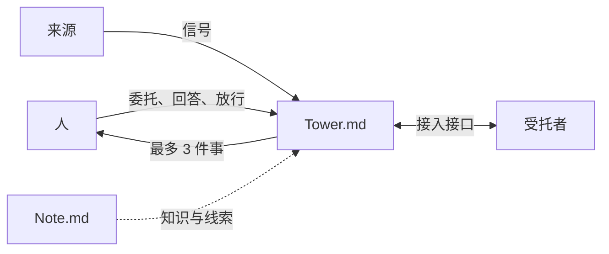

# Tower.md：让 Agent 去做，人只在关键处放行

**Delegate more. Follow up on everything.**

**多多托付，件件回响。**

只要最后由人决定，每件事的跟进就应更清楚。现在受托的是 Agent，Agent 比人更快，也更勤快。人能同时推进的事成倍增加，但人脑的容量没有变。所以，跟进工具比以前更重要。

**Agent 的动作无限，人的注意力有限**。Tower.md 替人管注意力：它决定什么时候、用什么形式让人看见什么，把人的判断留下来，让同一个问题不问第二遍。任务由 Agent 推进；人只在放行、回答和改方向时出场。

名字取自空管塔台。塔台不开飞机，只掌握全局、给出放行、在冲突前叫停。

## 为什么要做

**AI 让执行变便宜以后，瓶颈回到了人身上。**

- 一个人亲自盯住的事，通常只有 3–4 件。资源翻 100 倍，管得过来的事并不会翻 100 倍。
- Agent 产出的长文和代码，人读不过来，也不想读。人要的是"到哪了、卡在哪、要我做什么"。
- 离开一段时间再回来，人要花很多时间才能接上；到点该做的事，到点时又想不起来。

现有的看板和项目管理工具，假设"人填表、人来看"。Tower.md 反过来：Agent 写事件，人看态势。

## 产品是什么

一个本地优先的个人工具，用来长期跟进由 Agent 执行的多件事。主界面是一张无限画布；命令行是第一入口，Agent 和人用同一套命令。

下图是一件事从委托到放行的路径。

怎么读这张图：人只和 Tower.md 对话。受托者（AI Agent、人、自动化程序）经接入接口领任务、汇报、提问；来源（检查、连接器）只上报信号。Tower.md 把这些汇成每次不超过 3 件需要人做的事。

## 核心只建在人脑的共同局限上

**用户怎么用 Tower.md，我们预测不了；人脑在哪里会出错，我们预测得了。**所以核心不预设任何场景，只为人脑的 10 条共同局限做抽象，例如：工作记忆小、怕打断、到点想不起来、重返时找不到"我在哪"、看不出什么变了、对自动化要么全信要么全不信。

产品分 3 层：

| 层 | 是什么 | 例子 |
| --- | --- | --- |
| 核心 | 场景无关的名词、动作和能力 | 关注清单、跟进项、稳定的画布、完成只认证据、信任账本 |
| 扩展 | 模板、检查、连接器、技能包、实践包、套件 | 开发套件、PlantUML 模板、Note.md 连接器 |
| 用户用法 | 用户自己组合出来的工作方式 | 一个人的复盘仪式、带新人的方式 |

核心只认识 7 个名词：项目（Project）、任务（Task）、完成标准（Done When）、受托者（Delegate）、信号（Signal）、决策（Decision）、视图（View）。人只做 6 件事：看、放行、回答、委托、插话、提问。

一项功能要进核心，必须同时通过 3 条检验：能追溯到某条人脑局限；放进写软件、做研究、办婚礼这 3 种毫不相关的用途时形态不变；交给扩展各自实现会破坏人的信任或一致性。看板通不过第 2 条，所以看板是模板；"按某个字段分栏"能通过，所以它是核心的布局能力。

## 我们坚持的事

1. **默认沉默。**首屏最多 3 件事；信号分 4 级，由核心决定何时打扰，扩展只能声明级别。
2. **位置是记忆的锚。**画布上的位置只由人改变；Agent 的进展只改颜色和角标，不移动任何东西。
3. **实现可以托付，责任不能托付。**委托时写清目的和完成标准；验收时逐条看证据，分清是检查通过、Agent 自述，还是你亲自用过。
4. **完成只认证据或人的确认。**Agent 说"做完了"不算完成；标准被悄悄降低时一定标出来。
5. **人定的内容只有人能改。**结构、完成标准和决策的变更，要经人批准。人的动作只能由人发出：在 App 中点，或在命令行经本机的 Touch ID 等在场验证。
6. **你的判断属于仓库。**回答可以记为决策，同类问题不再问第二遍。状态是仓库里的纯文本，git 管文本，Arca 管大文件。
7. **能力属于厂商，信任属于你。**模型和 harness 由厂商不断刷新；你和每个受托者在每类工作上建立的信任记录，留在你的仓库里，换厂商也不丢。
8. **不锁定、不卖 token、不统计用法。**用你已有的 Agent 和订阅；卸载后仓库仍是标准 git 仓库。

## 与 Note.md 成对

Note.md 管知识，Tower.md 管行动，类比 Confluence 与 Jira。Note.md 回答"凭什么相信"，Tower.md 回答"谁在什么时间前负责什么"。两者不保存对方的状态，只互相引用；知识进入行动要经人批准，行动回写知识只写已关闭的任务和决策摘要。

## 现在到哪了

| 阶段 | 内容 | 状态 |
| --- | --- | --- |
| v0.1.1（M1） | 画布、冷启动审阅与批准、任务证据、人工放行；Claude Code 与 Codex 在 3 个工作树完成 10 项任务 | 已发布，macOS Apple Silicon 预览，未签名 |
| v0.2.0 | 核心与开发套件拆分；命令行 C0：统一输出信封、错误码与退出码、请求 ID；开发套件命令移到 `towermd dev` | 已发布，macOS Apple Silicon 预览，未签名 |
| 命令行 C1–C4 | 看、接入接口、人在场验证、计划与扩展 | 规格已写，下一步 |
| 核心第 1 阶段 | 命名第一版、接入接口、信号 4 级、完成判定、"自上次查看以来" | 规格已写 |
| 核心第 2 阶段 | 跟进项、休眠与浮现、立项与委托、逐条验收与证据 3 类、待验收积压、模板与容器、文本源容器 | 规格已写 |
| 核心第 3 阶段 | 全部项目总览、委托级别与信任账本、决策复查 | 规格已写 |
| 开发套件 M2、M3 | 一句话长出代码骨架、无头双环与合并队列 | 规格已写 |

第一个落地场景是软件开发，所以 M1 的大部分属于开发套件。开发套件很重要，但它不定义核心。

## 不做什么

- 不让用户在开始时选择项目类型或场景。第一次打开只有空画布和一句话输入框。
- 不内置任何方法论。看板、敏捷、UML 都是模板。
- 不做编排引擎，不自研模型或 Agent 循环。
- v0.1 不做多人协作，不运营云服务；多机 hub 由用户自部署。

## 文档

| 文档 | 内容 |
| --- | --- |
| [设计原则](docs/product-principles.md) | 五条核心信念与三条接口原则 |
| [核心规格](docs/specs/2026-10-21-spec-towermd-core.md) | 名词、注意力调度、画布与容器、信任底线与信任账本、接入接口、hub 与快照 |
| [开发套件规格](docs/specs/2026-10-21-spec-towermd-development-kit.md) | git、代码模块、门禁、技能包、harness 与无头双环 |
| [命令行规格](docs/specs/2026-10-21-spec-towermd-cli.md) | 命令树、输出约定、人的动作的在场验证 |
| [使用说明](docs/usage.md) | v0.2.0 的下载、构建、查看项目与 Agent 协作 |
| [变更记录](CHANGELOG.md) | 中文版见 [CHANGELOG.zh-CN.md](CHANGELOG.zh-CN.md) |
