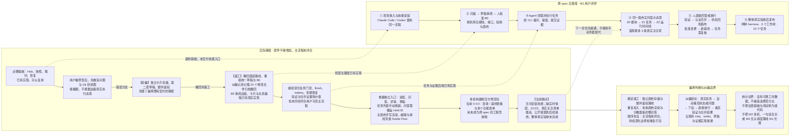

# MVP 主路径与实际开发路径偏离图

对照原始 v0.5（`906d462`）的 M1 与已交付 App（`fafc27e`）。左侧是应闭合的用户流程，右侧是实际实施顺序；连线表示流程或对应关系，不表示工时、代码量或完成比例。

依据：[M1 原定验收](specs/2026-10-16-spec-towermd-layered-agent-canvas-mvp.md#18-里程碑与验收)、[已记录的错误路线与撤回](superpowers/plans/2026-10-18-canvas-mvp-spec-alignment.md#已确认偏差及处理)、[App 主接线](../src/App.svelte)、[手动任务列表](../src/components/TaskProgressPanel.svelte)、[技能未交付提示](../crates/towermd-core/src/init.rs)、[后续基线硬阻](../crates/towermd-core/src/baseline_review.rs)。本图是偏离复核，不是产品整改完成证明。
