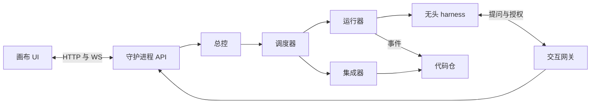
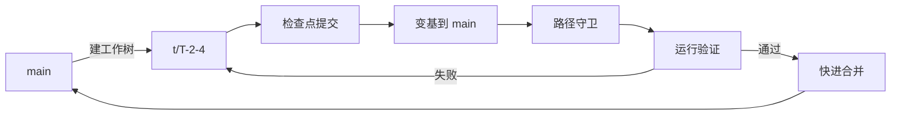
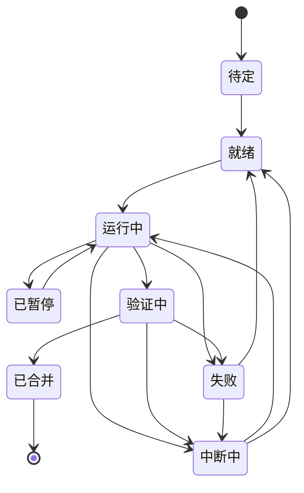
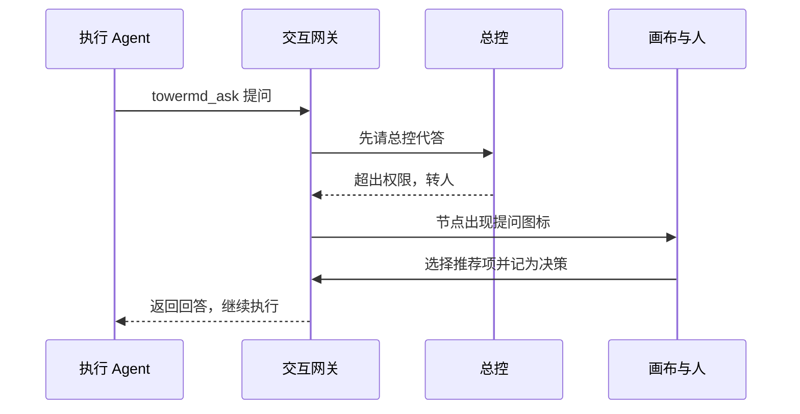

# Tower.md 最小系统以仓库内分层状态驱动画布，人批慢层、Agent 跑快层

| 项 | 内容 |
| --- | --- |
| 名称 | Tower.md（命令行 `towermd`）。与 Note.md 成对：Note.md 管 AI 知识，Tower.md 管执行 issue，类比 Confluence 与 Jira |
| 域名 | [towermd.net](https://towermd.net) |
| 版本 | v0.3 草案（v0.2 增加技能包、临时中断、质量门禁、人工干预；v0.3 定名 Tower.md，增加 Arca 大文件存储） |
| 依据 | 分层态势视图设计[^design]；红军、明豪两场交流[^hj-note][^mh-note] |
| 读者 | 产品、架构与实现负责人；实现 Agent |

## 0. 摘要

Tower.md 是一个本地优先的多 Agent 工程驾驶舱。它的最小核心只有 4 样东西：

1. **仓库内的分层状态**：架构、基线、决策、任务都以文件形式存在同一个代码仓的 `.towermd/` 目录下。
2. **一条事件流**：所有 Agent、验证器、人的动作都追加写入 `events.jsonl`。
3. **一个串行合并队列**：任务分支验证通过后，按顺序快进合并到 `main`。
4. **一张可视化画布**：慢层决定布局，快层只叠加颜色和角标；人在画布上批准慢层变更、干预执行。

大文件不进 git：harness 的完整输出、日志、截图和构建产物交给 Arca 管理，按原相对路径访问（见 6.4）。

用户有两条起步路径：

- **冷启动**：从现有项目计算出初始基线 B0，审阅后开始执行。
- **一句话生长**：从一句话需求生成最小骨架，再随信号逐步长成复杂系统。

底层执行通过无头模式调用各类 coding harness（如 Claude Code、Codex、Cursor CLI、Gemini CLI）。所有 Agent 共用一个代码仓，分支策略只有 `main`、短期任务分支和基线标签三种。

harness 运行时可能受工作流技能包约束（例如 superpowers 一类），会主动提问、等待评审或申请授权。Tower.md 把这些情况统一建模为**临时中断**，并设置**质量门禁**作为固定卡点。中断和门禁在画布上以提问、评审、授权、禁止、错误、门禁失败、预算等图标提醒人确认或修改。人也可以随时输入提示词，对总控、模块或运行中的 Agent 做临时干预。[^owner-1811]

### 0.1 与 Note.md 的定位关系

**Note.md 管 AI 知识，Tower.md 管执行 issue，两者的关系类比 Confluence 与 Jira。**[^owner-1822] 前期研究把个人内容进入组织的路径分成两条：主张的出版回答"凭什么相信"，承诺的出版回答"谁在什么时间前负责什么"。[^publish] Note.md 走第一条，Tower.md 走第二条。

| 维度 | Note.md（类比 Confluence） | Tower.md（类比 Jira） |
| --- | --- | --- |
| 管什么 | 知识：原文、研究、主张、决策背景 | 执行：任务、中断、提案、风险，以及运行和证据 |
| 核心对象 | 页面与大纲笔记 | issue。本规格中的任务、中断、提案、风险都是 issue 的类型 |
| 真值契约 | 证据、来源、有效期 | 负责人、验收标准、关闭条件、证据 |
| 主要读者 | 人与 Agent 检索和理解 | 人掌控进度，Agent 领取和执行 |
| 变化节奏 | 慢，持续沉淀 | 快，分钟到天 |
| 存放 | 个人 Vault | 项目代码仓的 `.towermd/`，大文件在 Arca |

下图是两者之间的信息流。


知识进入执行时要经过人批准的提案；执行结束后，决策和关闭的 issue 回写为经验，供下一次检索。

**边界**：

- Tower.md 不保存长篇知识。ADR 只写决策要点，背景研究链接回 Note.md。
- Note.md 不保存执行状态。它只接收已关闭的 issue 和决策摘要。
- 个人待办仍由 NEXT 管理；Tower.md 中的中断和任务不自动进入 NEXT。

### 0.2 依赖分层

Tower.md 只做结构与掌控层，不重复造存储和执行器。

| 层 | 负责者 | 放什么、做什么 |
| --- | --- | --- |
| 知识 | Note.md | 研究、主张、决策背景 |
| 结构与掌控 | Tower.md | 慢层基线、变更审批、门禁、中断、全局画布 |
| 执行 | 各类 harness（无头模式） | 在任务工作树中写代码、跑测试 |
| 文本状态与版本 | git | 代码、`.towermd/` 下的对象与事件流、基线标签 |
| 大文件 | Arca | 运行原始输出、日志、截图、构建产物，见 6.4 |

Arca 是 git 的二进制附件层："git 管可变的文本，arca 管不可变的二进制——相对路径原样工作。"[^arca]

### 0.3 命名

名字取自空管塔台（control tower）。塔台不开飞机，只掌握全局、给出放行、在冲突前叫停。这正是 Tower.md 与 Agent 的关系。

| 塔台 | Tower.md |
| --- | --- |
| 航班 | 执行 Agent 的运行 |
| 盘旋等待（holding） | 中断（hold），见第 12 节 |
| 放行许可（clearance） | 人批准提案、授权、豁免 |
| 跑道 | 串行合并队列 |
| 起飞前检查单 | 质量门禁 |
| 航路计划 | 慢层基线 |
| 雷达屏幕 | 无限画布 |

后缀 `.md` 有两层意思：与 Note.md 成对；说明执行状态是仓库里的纯文本，任何 Agent 都能读写，不锁定在某个服务里。命令行写作 `towermd`，与 `notemd` 同构。

命名取舍：Tower.md 直接对应 Jira，但容易被理解成一个文件约定；单用 Tower 会与知名的 git 客户端重名，加上 `.md` 可以区分。域名为 towermd.net；商标尚未检索。

## 1. 目标与非目标

### 1.1 目标

| ID | 目标 | 验收口径 |
| --- | --- | --- |
| G1 | 人在 1 分钟内知道"自上次查看以来，到哪了、有什么问题" | 首屏不超过 3 条关注项，均可一键下钻 |
| G2 | 慢层只能由人改变 | Agent 提交中触及慢层路径的改动，100% 被拦截并转为提案 |
| G3 | 快层由 Agent 自主推进 | 任务从派发到合并无需人操作，只在越过阈值时打扰人 |
| G4 | 从现有仓库得到可用的初始基线 | 已跟踪源码文件中至少 95% 被分配到模块 |
| G5 | 从一句话长出可运行系统 | 每一步生长结束时 `main` 都能通过验证 |
| G6 | 不绑定任何一家 harness | 新增一个 harness 只需实现一个适配器 |
| G7 | 需要人的中断及时出现，且不拖住无关工作 | 中断在 5 秒内出现在画布上；一个中断不阻塞其他模块的任务 |
| G8 | 人工输入可追溯、不绕过规则 | 每条提示词都有事件记录；提示词不能直接改慢层或跳过硬门禁 |

### 1.2 非目标（v0.1 不做）

- 多人协作与权限体系。v0.1 只服务"一个人管理多个 Agent"。
- 云端托管与远程执行。v0.1 只在一台机器上运行。
- 自研模型或 Agent 循环。执行全部委托给现有 harness。
- 甘特图编辑、工时、人员排班等传统项目管理功能。
- 替代 CI。Tower.md 调用项目已有的测试与构建命令。
- 代码评审界面。v0.1 只提供 diff 查看和跳转。

## 2. 术语

| 术语 | 定义 |
| --- | --- |
| 层（layer） | 对象的变化速度类别，共 L0–L5 六层，见第 3 节 |
| 慢层 | L0–L2。只能由人批准改变 |
| 中层 | L3–L4。由总控（controller）在授权内决定，并留下记录 |
| 快层 | L5。由执行 Agent 自主推进，只产生事件 |
| 模块（module） | 架构中的一个组件，拥有一组路径（path globs）和验证命令 |
| 基线（baseline） | 人批准过的一组慢层对象版本，用 Git 标签 `towermd/B<n>` 标记 |
| 提案（proposal） | 修改慢层的申请，附影响分析，等待人批准 |
| 任务（task） | 归属于一个模块、可独立验证的工作单元 |
| 运行（run） | 一次无头 harness 调用，执行某个任务 |
| 检查点（checkpoint） | 运行中产生的提交，打断时最多损失到上一个检查点 |
| 证据（evidence） | 验证结果，如测试、构建、评审，绑定到具体提交 |
| 总控（controller） | 外环。负责规划、派发、回答内环问题、分类错误 |
| 集成器（integrator） | 串行合并队列的执行者，负责变基、验证、合并 |
| 租约（lease） | 一个模块同一时间只允许一个写任务的锁 |
| 技能包（skill pack） | 约束 harness 工作流程的一组技能，例如 superpowers；按版本锁定在仓库中 |
| 交互点 | 技能包中会向人提问、等待评审或批准的步骤 |
| 中断（hold） | 运行因需要人或总控回应而暂停，类型见第 12 节 |
| 实时等待 | 中断期间 harness 进程保持运行，等待回答 |
| 停车续跑 | 中断期间 harness 结束回合并退出，回答后用会话 ID 续跑 |
| 门禁（gate） | 任务生命周期中的固定检查点，未通过时阻塞或告警 |
| 插话 | 人在运行中向 Agent 注入一条提示词 |
| 临时规则 | 带范围和到期时间的指令，注入相关任务卡 |

## 3. 核心概念：六层对象、三类权限

Tower.md 用一个 `layer` 字段区分对象的变化速度，再用三类权限决定谁能改。层的划分沿用前期研究中建筑六层到软件的映射。[^layered][^design]

| 层 | 名称 | 典型对象 | 权限类 | 变更等级 |
| --- | --- | --- | --- | --- |
| L0 | 目标与约束 | 意图、预算上限、合规约束 | 慢层：人批准 | 主要变更 |
| L1 | 架构基线 | 模块、接口、模块路径、验证命令 | 慢层：人批准 | 主要变更 |
| L2 | 规格与验收 | 验收标准、设计规范、对外接口契约 | 慢层：人批准 | 主要变更 |
| L3 | 流程与工具 | harness 配置、提示模板、检查规则 | 中层：总控提议，人登记 | 次要变更（需登记） |
| L4 | 模块计划 | 任务清单、依赖、优先级 | 中层：总控自批 | 次要变更（自批并记录） |
| L5 | 任务与提交 | 运行、提交、日志、证据 | 快层：执行 Agent | 不审批，只记事件 |

**FR-01** 每个对象应带 `layer` 字段。权限检查应以 `layer` 为准，而不是以文件位置为准。

**FR-02** 慢层对象只能由 `actor: human:*` 的提交修改。集成器应拒绝任何 Agent 分支中对慢层对象的修改。依据：基线只能经正式变更控制修改。[^swebok-scm]

**FR-03** 变更等级沿用 NASA 配置管理的三分法：主要变更、次要变更、豁免。豁免是带有效期的临时偏离，不改变基线。[^nasa-65]

## 4. 用户旅程

### 4.1 J1 冷启动：现有仓库 → 基线 B0 → 开跑

1. 用户执行 `towermd init`，指向一个已有 Git 仓库。
2. 系统运行冷启动管线（第 8 节），在画布上画出候选架构图：模块、接口、健康色、未分配文件。
3. 用户在画布上合并、拆分、改名、拖动模块，补充或删除接口。
4. 用户点击"批准为 B0"。系统提交 `.towermd/` 并打标签 `towermd/B0`。
5. 用户输入一个目标，或从候选任务中勾选几项。总控生成任务，执行开始。

### 4.2 J2 一句话生长

1. 用户在空画布上输入一句话，例如"做一个把会议录音转成待办的命令行工具"。
2. 系统最多问 3 个澄清问题，用户可以跳过。
3. 系统生成最小骨架：1–3 个模块、每个模块的验收标准、不超过 7 个初始任务。第一个任务是能跑通的空骨架。
4. 用户一键批准 B0，执行开始。
5. 生长信号出现时（第 9 节），系统提出新增或拆分模块的提案；用户批准后生成 B1、B2……

### 4.3 J3 日常：查看、批准、干预

1. 用户打开画布，首屏显示"自上次查看以来"的变化和不超过 3 条关注项。
2. 用户点开关注项，下钻到模块、任务、原文。
3. 用户批准或驳回提案，暂停、重派任务，或要求某个 Agent 立即汇报。
4. 用户点开节点上的中断图标（如提问、授权、禁止），在卡片中回答、批准或修改。
5. 用户在底部输入栏输入提示词，对选中的范围临时干预，例如"A-sync 先别改依赖版本"。
6. 用户关闭画布，Agent 继续执行。

### 4.4 J4 重构：保留需求，重画架构

1. 用户在画布上进入"草稿基线"模式，画出新的模块和接口。
2. 系统对比当前基线与草稿，列出受影响的需求、接口、任务和代码路径。
3. 用户批准后，新基线生效，画布平滑过渡到新布局。
4. 总控按新基线重新生成任务；旧代码标为"参考"。

这一流程对应明豪讨论中"需求不变，重新整成几个大的架构图，再让 Agent 全部重构"的设想。[^mh-note]

### 4.5 J5 处理一次临时中断

1. 执行 Agent 按技能包的流程写计划，遇到一个规格没写清的问题，调用 `towermd_ask` 提问。
2. 总控先查基线、验收标准和已有决策。能在权限内回答时直接代答，并在日报中留痕。
3. 总控答不了时，任务节点出现提问图标，模块角标加 1，关注清单出现一条。
4. 人点开图标，在卡片里选择 Agent 给出的推荐选项，并勾选"记为模块决策"。
5. Agent 若仍在实时等待，立即收到回答继续；若已停车，运行器用会话 ID 续跑。
6. 同一模块之后出现相同问题时，总控直接引用这条决策回答。

## 5. 系统架构

### 5.1 组件

下图是 Tower.md 的组件和数据流。



画布只和守护进程通信；守护进程是唯一写 `.towermd/` 和 `main` 的进程；harness 只在任务工作树里工作，需要人时经交互网关回到守护进程。

| 组件 | 职责 | 关键约束 |
| --- | --- | --- |
| 画布 UI | 渲染分层态势；接收人的批准、编辑与干预 | 只读快层；慢层编辑生成草稿提案 |
| 守护进程 API | 状态查询、命令入口、事件推送 | 本机监听，默认只绑定 127.0.0.1 |
| 总控 | 外环：规划任务、回答内环问题、分类错误、生成提案 | 只能写 L3–L4 对象和提案 |
| 调度器 | 按依赖、优先级、租约、并发上限派发任务 | 一个模块同时最多一个写任务 |
| 运行器 | 创建工作树，调用 harness，解析输出为标准事件 | 每个运行有预算和超时 |
| 集成器 | 串行合并队列：变基、门禁、快进合并 | 同一时间只合并一个任务 |
| 交互网关 | 本机 MCP 服务，提供提问、评审、授权、进度备注工具；把运行中的人工插话送达 harness | 只接受本机连接；每个工具调用都绑定运行 ID |
| 代码仓（git） | 文本事实源：代码、`.towermd/`、事件流 | 文本状态都能从 git 重建 |
| 大文件存储（Arca） | 运行原始输出、日志、截图、构建产物 | 按相对路径原样访问；只由守护进程写入主仓库目录 |

### 5.2 进程模型

- **FR-04** v0.1 应以单个本地守护进程 `towermd` 运行，画布是本地网页。
- **FR-05** 守护进程重启后，应能凭 git 仓库与 Arca 中的内容恢复全部状态。派生索引（如 SQLite）只做缓存，可以删除后重建。
- **FR-06** 运行器应把每个运行放在独立的 Git 工作树中，工作树目录不进入版本控制。

### 5.3 技术选型建议

以下是建议，不是约束：

- 守护进程：TypeScript（Node）。理由：调用多个 CLI、解析 JSON 流的生态成熟，适合 MVP。后续可迁到 Rust。
- 画布：React 加节点图库（如 React Flow）；初始布局用分层图布局算法（如 ELK）。
- 派生索引：SQLite。
- Git：直接调用 `git` 命令，不依赖托管平台。

## 6. 数据模型与仓库布局

### 6.1 目录

```text
.towermd/
  config.yaml            # harness 池、角色与模型、并发、预算、阈值、中断策略（L3）
  gates.yaml             # 质量门禁定义（L3）
  skillpacks.yaml        # 各角色启用哪些技能、交互点映射（L3）
  skillpacks/superpowers@x.y.z/  # 按版本锁定的技能包副本（L3）
  rules/tmp-0007.md      # 临时规则，带范围与到期时间（L3）
  intents/I-1.md         # 意图与约束（L0）
  arch/A-sync.md         # 模块（L1），含路径、接口、验证命令、画布坐标
  arch/interfaces.yaml   # 接口清单（L1）
  specs/A-sync.accept.md # 验收标准（L2）
  baselines/B3.yaml      # 基线清单：包含的对象与版本、批准人、时间（L1）
  decisions/D-40.md      # ADR，含层级与取代关系（L1–L4）
  proposals/P-12.md      # 慢层变更提案与影响分析
  plan/T-2-4.md          # 任务（L4）
  runs/R-0193/           # 运行目录：task.md、report.json 入 git；raw/ 交给 Arca（L5）
  holds/H-0042.md        # 中断及处理结果（L5；记为决策的回答另写入 decisions/）
  events.jsonl           # 追加写入的事件流（L5）
```

**FR-07** `.towermd/` 下的对象文件应使用 Markdown 加 YAML frontmatter，便于人和 Agent 都能读写。

**FR-08** 运行的原始输出、日志和截图不进 git，交给 Arca 管理（见 6.4）；git 只保存 `task.md`、`report.json` 和事件。

### 6.2 对象字段

所有对象共有字段：`id`、`layer`、`status`、`owner`、`created`、`updated`、`source`（指向原文或提交）。

| 对象 | 关键字段 |
| --- | --- |
| 意图 I | `text`、`constraints`、`priority`、`allocated_to`（模块 ID 列表） |
| 模块 A | `name`、`paths`、`interfaces`、`verify`（命令列表）、`baseline`、`map`（坐标与地标） |
| 接口 | `from`、`to`、`contract`（文件或说明）、`baseline` |
| 基线 B | `objects`（ID 与内容哈希）、`approved_by`、`approved_at`、`git_tag` |
| 决策 D | `context`、`options`、`decision`、`rationale`、`affects`、`supersedes`、`class` |
| 提案 P | `kind`（新增模块、拆分、合并、接口变更、验收变更等）、`draft_baseline`、`impact`、`requested_by` |
| 任务 T | `module`、`allowed_paths`、`depends_on`、`acceptance`、`priority`、`harness_role`、`state` |
| 运行 R | `task`、`harness`、`model`、`session_id`、`branch`、`checkpoints`、`cost_usd`、`exit` |
| 证据 E | `kind`（test、build、review、lint、gate）、`commit`、`result`、`log`（Arca 管理的相对路径） |
| 中断 H | `type`、`run`、`task`、`mode`（live 或 parked）、`question`、`options`、`recommended`、`context`、`opened_at`、`deadline`、`resolved_by`、`resolution`、`remember_as` |
| 门禁 G | `id`、`stage`、`applies_to`（层、模块、风险等级）、`check`（命令、Agent、人）、`hard`、`auto_fix_max`、`on_fail` |
| 技能包 S | `name`、`version`、`source`、`hash`、`enabled_for`（角色到技能列表）、`disabled`、`interaction_points` |
| 临时规则 | `text`、`scope`（全局、模块、任务）、`until`、`created_by` |

模块对象示例：

```yaml
---
id: A-sync
layer: L1
status: active
owner: human:bruce
name: 同步
paths: ["src/sync/**", "tests/sync/**"]
interfaces: [IF-sync-store]
verify: ["pnpm test --filter sync"]
baseline: B3
map: { x: 2, y: 1, landmark: 中转站 }
---
负责把本地变更同步到存储层。
```

### 6.3 事件

**FR-09** 每个事件应是一行 JSON，字段如下：

| 字段 | 说明 |
| --- | --- |
| `id` | 单调递增的事件 ID |
| `t` | ISO 8601 时间，带时区 |
| `actor` | `human:<id>`、`controller`、`agent:<run>`、`integrator`、`verifier` |
| `type` | 事件类型，见下表 |
| `layer` | 事件所属层 |
| `obj` | 关联对象 ID |
| `data` | 类型相关的负载 |
| `cost_usd` | 可选，本事件产生的费用估算 |

| 类型 | 层 | 含义 |
| --- | --- | --- |
| `run.started` / `run.finished` | L5 | 运行开始与结束，结束时附退出码和报告摘要 |
| `run.checkpoint` | L5 | 产生检查点提交 |
| `run.question` | L5 | 内环向外环提问 |
| `run.retry` | L5 | harness 报告的 API 重试 |
| `evidence.recorded` | L5 | 验证结果写入 |
| `task.state` | L4 | 任务状态变化 |
| `plan.changed` | L4 | 总控调整任务、依赖或优先级 |
| `decision.recorded` | L1–L4 | 新决策或取代 |
| `proposal.created` / `proposal.resolved` | L1–L2 | 提案生成与人工处理结果 |
| `baseline.created` | L1 | 新基线生效 |
| `merge.done` / `merge.rejected` | L5 | 集成器合并或拒绝 |
| `human.action` | 各层 | 人的干预，如暂停、重派、批准 |
| `alert.raised` / `alert.cleared` | 各层 | 告警升起与清除 |
| `hold.opened` / `hold.resolved` / `hold.escalated` | L5 | 中断打开、处理、超时升级 |
| `gate.passed` / `gate.failed` | L5 | 门禁结果 |
| `human.prompt` / `prompt.delivered` | 各层 | 人工提示词与送达确认 |
| `rule.temp.added` / `rule.temp.expired` | L3 | 临时规则生效与到期 |
| `skill.loaded` | L5 | 运行加载的技能包与版本 |

### 6.4 大文件与 Arca

文本状态进 git，大文件进 Arca。两者都按仓库内的相对路径访问，画布和 Agent 不需要区分。[^arca]

| 内容 | 存放 | 理由 |
| --- | --- | --- |
| 对象文件、`task.md`、`report.json`、`events.jsonl` | git | 可变文本，需要 diff 和合并 |
| harness 原始输出流、完整日志 | Arca | 体积大，写入后不再改 |
| 测试报告、截图、录屏、构建产物 | Arca | 二进制或大文件，作为证据不可变 |
| 冷启动扫描的中间结果 | Arca | 体积大，只供回溯 |

**FR-75** Arca 管理的文件应由守护进程写入主仓库目录下的 `.towermd/runs/<run>/raw/`，不得放在任务工作树中。理由：Arca 文档说明 `git clean -xdf` 会永久删除尚未同步到 hub 的托管文件，而 Tower.md 会在合并后删除任务工作树。[^arca]

**FR-76** 证据对象应记录 Arca 文件的相对路径，以及 Arca 给出的内容哈希（若可取得）。证据写入后不得修改；更正时写新证据。

**FR-77** 本机未安装 Arca 时，运行器应退回普通本地目录，该目录同样被 git 忽略；画布在相关证据旁标注"仅本机"。

**FR-78** 守护进程启动时宜运行 `arca doctor`，把"本地有、hub 无副本"的文件数显示在画布状态栏。

## 7. 分支与提交策略（极简）

### 7.1 规则

只有三种 Git 引用：

| 引用 | 命名 | 生命周期 | 谁写 |
| --- | --- | --- | --- |
| 主干 | `main` | 长期 | 只有集成器和人 |
| 任务分支 | `t/<task-id>` | 一个任务，合并后删除 | 执行 Agent，在独立工作树中 |
| 基线标签 | `towermd/B<n>` | 永久 | 守护进程，在人批准后 |

下图是一个任务从开始到合并的路径。



任务分支只活一个任务；合并前必须变基到最新 `main` 并通过验证；`main` 始终可运行。

**FR-10** 合并方式应为"变基后快进合并"。一个任务的多个检查点可在合并时压缩为一个提交，默认保留。

**FR-11** 集成器应串行处理合并队列。v0.1 不做并行合并。理由：并发 Agent 数量在 10 个以内时，串行队列足够，且冲突处理最简单。

**FR-12** 每个合并提交应带以下 trailer，用于溯源：

```text
Towermd-Task: T-2-4
Towermd-Run: R-0193
Towermd-Module: A-sync
Towermd-Evidence: E-0877
```

**FR-13** 回滚只用 `git revert` 撤销某个合并提交，不改写 `main` 历史。

### 7.2 冲突预防：模块租约与路径守卫

- **FR-14** 调度器派发任务前，应取得该任务所属模块的写租约。同一模块同一时间只有一个写任务。
- **FR-15** 任务需要修改其他模块路径时，应在任务中声明 `touches`，并同时取得这些模块的租约。
- **FR-16** 集成器应检查 diff：改动路径必须属于 `allowed_paths` 与所属模块 `paths` 的并集，否则拒绝合并。
- **FR-17** diff 中出现慢层对象（`.towermd/intents`、`.towermd/arch`、`.towermd/specs`、`.towermd/baselines`）时，集成器应拒绝合并，并把改动内容转成一个提案。

跨模块任务的比例同时是一个生长信号（第 9 节）。比例持续偏高，说明模块边界划分有问题。依据：Simon 指出，近可分解系统的子系统内部联系强于子系统之间的联系。[^simon-nd]

## 8. 冷启动：从现有项目计算基线

### 8.1 管线

下图是冷启动管线。前 5 步是确定性计算，第 6 步调用模型，最后由人审阅批准。


| 步骤 | 做法 | 输出 |
| --- | --- | --- |
| S1 文件盘点 | `git ls-files`；识别语言、清单文件（如 package.json、Cargo.toml、go.mod、pyproject.toml）、构建与测试命令（脚本、Makefile、CI 配置） | 文件清单、候选验证命令 |
| S2 依赖图 | 按语言解析 import；解析不了时退回目录结构 | 文件级依赖图 |
| S3 聚类 | 以目录边界为初值，用社区发现算法在依赖图上聚类；每层模块数宜在 3–9 个之间 | 候选模块与路径 |
| S4 历史耦合 | 统计 `git log` 中经常一起修改的文件和改动热点，用于修正聚类 | 耦合矩阵、热点列表 |
| S5 跑现有测试 | 在只读工作树中运行候选验证命令，设置超时 | 每个模块的初始证据：通过、失败或无测试 |
| S6 模型综合 | 用最强模型、只读权限运行一次 harness，输入 S1–S5 的结果，输出结构化 JSON | 模块名称与职责、接口、风险、待确认问题、从 README 与文档还原的意图草稿 |
| S7 画布审阅 | 人合并、拆分、改名、拖动，补充接口，确认验证命令 | 草稿基线 |
| S8 批准 B0 | 提交 `.towermd/` 并打标签 `towermd/B0` | 初始基线 |

**FR-18** S6 应要求 harness 按 JSON Schema 输出。Claude Code 可用 `--output-format json` 加 `--json-schema`；Codex 可用 `--output-schema`。[^cc-headless][^codex-exec]

**FR-19** 冷启动期间 harness 应只读运行。Claude Code 宜用 `--permission-mode dontAsk` 并只放行读工具；Codex 用默认的 `read-only` 沙箱。[^cc-headless][^codex-exec]

**FR-20** 每个候选模块应附置信度和理由。置信度低的模块在画布上以虚线边框显示，提醒人重点审阅。

**FR-21** 未分配到任何模块的文件应集中列出，并在画布上显示为"未划分区"。

### 8.2 验收

- 已跟踪源码文件中至少 95% 被分配到模块，其余列入未划分区。
- 每个模块至少有一条验证命令，或明确标记为"无测试"并生成一条补测试的候选任务。
- 对 20 万行以内的仓库，S1–S6 在 15 分钟内完成（不含测试本身超过超时的部分）。

## 9. 一句话生长

### 9.1 流程

1. **种子**：一句话写入意图 I-1（L0）。
2. **澄清**：最强模型最多提 3 个问题，以卡片形式显示在画布上。
3. **骨架**：生成 1–3 个模块、验收标准、不超过 7 个任务。第一个任务是"空骨架能构建并通过一条冒烟测试"。
4. **批准**：人一键批准 B0。仓库未初始化时，系统先执行 `git init`。
5. **生长**：执行中积累生长信号；信号越过阈值时，总控生成提案。
6. **定型**：模块数达到阈值，或人手动切换后，项目从"生长期"进入"定型期"。

### 9.2 生长期与定型期

| 项 | 生长期 | 定型期 |
| --- | --- | --- |
| 未划分区 | 允许 Agent 在未划分区新建文件 | 不允许；所有文件必须属于某个模块 |
| 新增模块 | 提案可一键批准，影响分析从简 | 提案必须附完整影响分析 |
| 接口契约 | 可以只写一句说明 | 必须有契约文件或测试 |
| 默认验证 | 冒烟测试 | 模块全部验证命令 |

这对应 Brand 所说的"已精装区域"与"可用但未精装区域"共存，也对应前期研究的结论：MVP 前让结构自然生长，产品化后先立慢层。[^layered]

**FR-22** 每一步生长结束时，`main` 应能通过当前基线定义的验证。依据：Simon 的钟表匠寓言说明，稳定的中间形态让复杂系统更快形成，被打断时损失也更小。[^simon-watch]

### 9.3 生长信号与默认阈值

| 信号 | 计算方式 | 默认阈值 | 生成的提案 |
| --- | --- | --- | --- |
| 模块过大 | 模块内源码行数或文件数 | 超过 3000 行或 40 个文件 | 拆分模块 |
| 跨模块改动 | 最近 10 个任务中声明了 `touches` 的比例 | 超过 30% | 调整边界或新增接口 |
| 未划分区膨胀 | 未划分区文件数 | 超过 10 个 | 新增模块 |
| 需求未分配 | 意图的 `allocated_to` 为空 | 存在即触发 | 新增模块或扩展职责 |
| 同类错误反复 | 同一错误类别在 24 小时内出现次数 | 3 次及以上 | 修改 L3 流程或检查规则 |

阈值写在 `config.yaml`，人可以修改。这些数字是起点，需要在使用中校准。

## 10. 执行：双环与无头 harness

### 10.1 双环

- **外环（总控）**：读取当前基线和任务状态，生成或调整任务，派发给调度器，回答内环问题，分类错误，生成提案。总控本身也通过无头 harness 调用模型。
- **内环（执行 Agent）**：在任务工作树中完成一个任务，产生检查点提交和报告。

这一结构来自红军的双环实践：外环负责总控和审核，内环负责执行；人只和外环对接。[^hj-note]

**FR-23** 总控只能写 L3–L4 对象、决策（次要）和提案，不能直接修改慢层对象。

**FR-24** 总控回答内环问题时，只能在当前基线和验收标准范围内作答。超出范围的问题应转为 `needs_human`。

### 10.2 任务状态机



| 转换 | 触发条件 |
| --- | --- |
| 待定 → 就绪 | 依赖已合并，且取得模块租约 |
| 就绪 → 运行中 | 调度器派发，运行器启动 harness |
| 运行中 → 已暂停 | 人暂停，运行器发送中断并等待到检查点 |
| 运行中 → 验证中 | 运行正常结束，报告状态为 `done` |
| 运行中 → 中断中 | Agent 提问或申请授权；报告状态为 `needs_input` 或 `needs_decision`；路径或策略被拦截；预算用完 |
| 中断中 → 运行中 | 中断被回答或批准，实时等待的进程继续，或停车的运行续跑 |
| 中断中 → 就绪 | 人选择"改写任务"或"重派"，原运行结束 |
| 验证中 → 中断中 | 门禁要求人评审，或硬门禁自动修复次数用完 |
| 验证中 → 已合并 | 全部硬门禁通过 |
| 失败 → 就绪 | 总控判为执行类错误，重试次数未超上限 |
| 失败 → 中断中 | 同一任务失败 3 次，或判为设计类错误，生成错误中断 |

### 10.3 harness 适配器

**FR-25** 每个 harness 通过一个适配器接入。适配器接口如下：

```ts
interface HarnessAdapter {
  id: string;                       // "claude-code" | "codex" | "cursor" | "gemini" | ...
  probe(): Promise<{ version: string; capabilities: string[] }>;
  start(run: RunSpec): ChildHandle; // 在工作树中启动无头进程
  parse(line: string): TowerEvent[]; // 把一行原始输出转成标准事件
  interrupt(h: ChildHandle): Promise<void>; // 优雅中断
  resume?(run: RunSpec, sessionId: string, message: string): ChildHandle; // 停车续跑
  send?(h: ChildHandle, message: string): Promise<"delivered" | "queued">; // 运行中插话
  channels: {
    mcp: boolean;             // 能否连接交互网关（实时提问、评审）
    permissionRoute: boolean; // 能否把授权请求转给交互网关
    liveInput: boolean;       // 能否在运行中注入消息
    skills: "plugin-dir" | "skills-dir" | "none"; // 技能包注入方式
  };
}

interface RunSpec {
  runId: string; taskId: string; worktree: string;
  prompt: string;            // 固定模板，指向 task.md
  model?: string;
  permission: "read-only" | "workspace-write";
  budgetUsd?: number; timeoutSec: number;
  outputSchema?: object;     // 最终报告的 JSON Schema
  mcpConfig?: string;        // 交互网关的 MCP 配置
  skillDirs?: string[];      // 本次运行组装好的技能目录
}
```

v0.1 宜先实现 Claude Code 和 Codex 两个适配器。下表列出各 harness 文档中可用的无头调用方式。CLI 变化快，实现时应以 `probe()` 读到的版本和官方文档为准。

| harness | 无头调用与输出 | 提问通道 | 授权路由 | 运行中插话 | 技能注入 | 结构化报告 | 续跑与预算 |
| --- | --- | --- | --- | --- | --- | --- | --- |
| Claude Code | `claude --bare -p`；`--output-format stream-json --verbose`，最后一行 `result` 含费用 | MCP 工具（`--mcp-config`，宜加 `--strict-mcp-config`）；停车续跑 | `--permission-prompt-tool` 指向交互网关；完全无人值守时 `--permission-prompts none` | `--input-format stream-json`；`--replay-user-messages` 回显作送达确认 | `--plugin-dir` 或 `--add-dir`（bare 模式不自动发现） | `--json-schema` | `--resume <session_id>`；`--max-budget-usd`；`--max-turns` |
| Codex | `codex exec --json`（JSON Lines，含 `turn.completed`、`item.*`） | 停车续跑；MCP 未核对 | `--sandbox workspace-write`；`--approve-for-me` 走自动评审；被拒记为禁止 | 未核对，排队到续跑 | 未核对 | `--output-schema <file>`；`-o` 写出最后消息 | `codex exec resume <SESSION_ID>` |
| Cursor CLI | `agent -p --output-format stream-json`；`--force` 允许改文件 | 停车续跑 | 未核对 | 未核对 | 未核对 | `--output-format json` | 未核对 |
| Gemini CLI | `gemini -p --output-format stream-json` | 停车续跑 | 未核对 | 未核对 | 未核对 | `--output-format json`（含 `stats`） | 未核对 |

来源：[^cc-headless][^cc-cli][^codex-exec][^cursor-headless][^gemini-headless]

**FR-26** 运行器调用 Claude Code 时宜使用 `--bare`。理由：文档说明 `-p` 默认会加载工作目录中的 hooks 和 MCP 配置且不显示信任提示，`--bare` 跳过这些发现，使每台机器上的结果一致。[^cc-headless] bare 模式不会自动加载技能、插件和 MCP，所以技能包和交互网关都应由运行器显式传入（见 10.6 与第 12 节）。[^cc-cli]

**FR-27** 运行器中断运行时，应先发送 SIGINT，等待最多 60 秒；超时再发送 SIGTERM。理由：Claude Code 文档说明 SIGTERM 会让当前回合不完整，SIGINT 才会结束回合。[^cc-headless]

### 10.4 运行契约

每个运行开始前，运行器在工作树中写入 `.towermd/runs/<run>/task.md`。各 harness 使用同一个提示模板，只要求它读取这个文件。

`task.md` 包含：

- 任务 ID、所属模块、`allowed_paths`。
- 验收标准与验证命令。
- 相关接口契约（只读）与相关决策摘要。
- 禁止事项：不得修改慢层对象；不得修改 `allowed_paths` 以外的文件；不得自行创建分支、工作树、合并或拉取请求，这些由 Tower.md 管理。
- 本运行启用的技能和交互点约定：需要人时调用交互网关的工具；工具返回 `deferred` 时，结束回合并写出 `needs_input` 报告。
- 当前生效的临时规则和人工插话摘要。
- 检查点要求：每完成一个可验证的小步就提交一次。
- 报告要求：结束前写出 `report.json`。

**FR-28** `report.json` 应符合以下结构。harness 支持 JSON Schema 时，应同时用 schema 约束最终输出。

```json
{
  "status": "done | blocked | needs_input | needs_decision | failed",
  "summary": "不超过 300 字",
  "checkpoints": ["<commit sha>"],
  "changed_paths": ["src/sync/queue.ts"],
  "questions": ["需要外环回答的问题"],
  "suspected_class": "external | execution | design",
  "proposal": { "kind": "interface_change", "reason": "..." }
}
```

**FR-29** 运行没有写出 `report.json` 时，运行器应把 `run.finished` 的状态记为 `failed`，并把 harness 最后一条消息存为摘要。

### 10.5 角色与模型分层

| 角色 | 默认模型档位 | 理由 |
| --- | --- | --- |
| 冷启动综合、慢层提案起草 | 最强档 | 慢层后果大，明豪讨论中建议慢层用人或最贵的模型[^mh-note] |
| 总控 | 中档或最强档 | 需要判断优先级和错误类别 |
| 执行 Agent | 便宜档 | 边界清楚的小模块，便宜模型已能胜任[^mh-note] |
| 进度摘要、事件归纳 | 便宜档或纯规则 | 红军用便宜模型持续维护进度图[^hj-note] |
| 交叉评审（可选） | 与执行 Agent 不同的厂商 | 同一模型自评容易有共同盲点[^hj-note] |

**FR-30** 角色到 harness 与模型的映射应写在 `config.yaml`，可按模块覆盖。

**FR-31** 并发上限默认 4，可配置。超过上限的就绪任务排队。

### 10.6 工作流技能包

工作流技能包规定 harness 按什么步骤干活，例如先头脑风暴、再写计划、测试先行、完成前自检、请求代码评审。superpowers 是这类技能包的一个例子。[^superpowers] 这类技能包有两个特点：一是部分步骤会停下来问人或等人评审；二是部分步骤会自己管理分支和工作树，与 Tower.md 的职责重叠。

**FR-51** 技能包应按版本复制到 `.towermd/skillpacks/<name>@<version>/`，并记录内容哈希。升级或更换技能包属于 L3 变更，需要登记。

**FR-52** `skillpacks.yaml` 应按角色（总控、执行 Agent、评审 Agent）声明启用哪些技能。运行器为每个运行组装一个只含启用技能的目录，再按适配器的方式注入。Claude Code 用 `--plugin-dir` 或 `--add-dir`。[^cc-cli]

**FR-53** 每个技能包应声明它的交互点，并映射到 Tower.md 的中断类型或门禁：

```yaml
# skillpacks.yaml 片段
packs:
  - name: superpowers
    version: x.y.z
    enabled_for:
      controller: [brainstorming, writing-plans]
      executor: [writing-plans, executing-plans, test-driven-development,
                 systematic-debugging, verification-before-completion,
                 requesting-code-review, receiving-code-review]
    disabled: [using-git-worktrees, finishing-a-development-branch]
    interaction_points:
      brainstorming: { maps_to: hold.question, scope: slow_layer }
      requesting-code-review: { maps_to: gate.G4 }
```

**FR-54** 技能中与 Tower.md 职责冲突的步骤（建分支、建工作树、合并、开拉取请求）应被禁用，或由 `task.md` 明确覆盖。Tower.md 的分支策略优先。

下表以 superpowers 为例说明映射方式。技能说明来自第三方介绍，锁定版本时应按该版本的原文复核。[^superpowers]

| 技能 | 技能中的交互点 | Tower.md 中的处理 |
| --- | --- | --- |
| brainstorming | 逐个提问，等用户批准规格 | 只给总控在一句话生长和慢层提案中使用；问题转为提问中断；执行 Agent 不启用，因为规格已写在 `task.md` |
| writing-plans | 生成分任务计划 | 执行 Agent 可用；高风险模块的计划进入计划门禁 G1 |
| executing-plans、dispatching-parallel-agents | 无人工点 | 可用；子 Agent 的费用计入本运行预算 |
| test-driven-development、systematic-debugging | 无人工点 | 可用；与验证门禁 G3 一致 |
| verification-before-completion | 结果供人查看 | 可用；自检结果附在报告中，但不能替代 G3 |
| requesting-code-review、receiving-code-review | 人决定是否修复严重问题 | 映射到评审门禁 G4，按严重程度分流 |
| using-git-worktrees、finishing-a-development-branch | 建工作树、开拉取请求 | 禁用；由 Tower.md 的运行器和集成器负责 |

## 11. 质量门禁与证据

- **FR-32** 集成器在每次合并前，应在变基后的任务分支上运行所属模块的全部验证命令，结果写为证据并绑定提交。
- **FR-33** 任务进度只按"已验证"计算。执行 Agent 报告 `done` 但证据未通过时，任务状态为"失败"，画布显示为"已声称、未验证"。依据：Simon 指出，可识别的阶段性进展在问题求解中起到稳定组件的作用。[^simon-cue]
- **FR-34** 慢层提案可配置一次异构模型交叉评审，评审意见附在提案上，只供人参考，不自动决定。

### 11.1 门禁清单

门禁是任务生命周期中的固定卡点。硬门禁不通过就不能进入下一步；软门禁不通过只标黄并附说明。

| 门禁 | 阶段 | 检查方式 | 默认 | 未通过时 | 画布图标 |
| --- | --- | --- | --- | --- | --- |
| G0 就绪 | 派发前 | 规则：有验收标准、允许路径、模块租约、相关决策 | 硬 | 任务不派发，生成提问中断"缺信息" | 提问 |
| G1 计划 | 运行中，写完计划后 | 总控对照规格评审；高风险模块由人评审 | 软；高风险模块为硬 | 退回 Agent 改计划，或生成评审中断 | 评审 |
| G2 路径与策略 | 运行中与合并前 | 规则：路径守卫、慢层保护、敏感文件、危险命令 | 硬 | 拦截，生成禁止中断 | 禁止 |
| G3 验证 | 合并前 | 运行模块验证命令；可选检查行为改动是否带测试 | 硬 | 自动修复，次数用完生成门禁失败中断 | 门禁失败 |
| G4 评审 | 合并前 | 评审 Agent（宜与执行 Agent 不同厂商）给出分级意见 | 严重问题为硬，其余为软 | 严重：自动修复或评审中断；重要：总控决定；次要：记录 | 评审 |
| G5 合并 | 合并时 | 变基到最新 `main` 后再跑一次 G3 | 硬 | 退回任务分支重做 | 门禁失败 |
| G6 基线 | 慢层变更 | 提案有影响分析且人已批准 | 硬 | 提案不生效 | 评审 |

**FR-55** 门禁定义写在 `.towermd/gates.yaml`，可以按层、模块或风险等级覆盖。修改门禁属于 L3 变更，需要登记。

**FR-56** 每个门禁结果都写成证据（`kind: gate`），绑定提交。

**FR-57** 硬门禁的自动修复次数默认 2 次。次数用完后生成门禁失败中断，由人决定重试、改验收标准或授予豁免。

**FR-58** 模块可标记 `risk: high`。高风险模块的 G1 和 G4 必须有人评审。

```yaml
# gates.yaml 片段
gates:
  G3: { stage: pre_merge, check: module.verify, hard: true, auto_fix_max: 2 }
  G4: { stage: pre_merge, check: agent.review, reviewer_vendor: different,
        hard_on: [critical], on_important: controller, on_minor: log }
overrides:
  - match: { risk: high }
    G1: { hard: true, check: human.review }
    G4: { check: human.review }
```

## 12. 临时中断与人工干预

### 12.1 中断类型

harness 运行时需要回应的情况分为 7 类。每类都有固定的图标、默认处理者和超时策略。

| 类型 | 图标 | 触发 | 默认处理者 | 人的选项 | 超时策略（默认） |
| --- | --- | --- | --- | --- | --- |
| 提问 | ❓ | Agent 调用 `towermd_ask`；报告为 `needs_input`；G0 缺信息 | 总控先代答，超出权限转人 | 选推荐项、自由回答、让总控代答、"按你的假设继续" | 30 分钟未答，升级到关注清单；不自动猜测 |
| 评审 | 👁 | G1、G4、G6 要求评审；技能包的评审交互点 | 按门禁配置：总控或人 | 通过、要求修改（附意见）、驳回 | 不会超时自动通过 |
| 授权 | 🔑 | harness 请求执行未放行的工具或命令 | 人 | 本次允许、写入允许规则（L3 登记）、拒绝 | 10 分钟未答则拒绝，Agent 改用其他方法 |
| 禁止 | ⛔ | G2 拦截：碰慢层、越界、敏感文件、危险命令 | 人 | 撤销改动、转为提案、授予豁免（带到期时间） | 保持拦截 |
| 门禁失败 | 🚧 | 硬门禁自动修复次数用完 | 人 | 查看日志、让 Agent 再修、改验收标准、豁免 | 保持阻塞 |
| 错误 | ❗ | 设计类错误；同一任务失败 3 次；harness 崩溃 | 人 | 重试、改写任务、换 harness 或模型、放弃 | 保持 |
| 预算 | 💰 | 运行或模块达到预算上限 | 人 | 追加预算、换便宜模型、停止 | 停止运行，保留检查点 |

图标只是示意。画布实现时，每个图标都要同时有形状、颜色和文字标签，不只靠颜色或表情符号区分（见 15.7）。

### 12.2 两种等待方式

下图是一次提问从发出到回答的路径。



实时等待时，Agent 进程一直在等这次工具调用返回；超过等待上限时转为停车续跑。

| 方式 | 做法 | 适用 | 代价 |
| --- | --- | --- | --- |
| 实时等待 | 交互网关的工具调用阻塞，直到有回答 | 预计几分钟内有人回答 | 进程常驻，但等待期间不耗 token |
| 停车续跑 | Agent 结束回合并写 `needs_input` 报告，进程退出；回答后运行器用会话 ID 续跑，把回答作为新提示 | 回答要等较久；harness 不支持 MCP | 续跑时需要重新加载上下文 |

**FR-59** 实时等待超过 `live_wait_max`（默认 10 分钟）时，交互网关应返回 `deferred`。`task.md` 规定 Agent 收到 `deferred` 后结束回合，并写出 `needs_input` 报告。

**FR-60** harness 不支持 MCP 时，只用停车续跑。

**FR-61** 中断期间，该任务的模块租约保留；调度器继续派发其他模块的任务。一个中断不得阻塞无关的 Agent。依据：近可分解系统中各子系统短期内近似独立。[^simon-nd]

**FR-62** 交互网关应对问题做去重：以"模块加归一化问题文本"作指纹。已有决策覆盖同一问题时，总控直接引用该决策回答。

**FR-63** Claude Code 运行宜用 `--permission-prompt-tool` 把授权请求转给交互网关，生成授权中断。完全无人值守的运行才用 `--permission-prompts none`，此时被拒的请求记为禁止事件。[^cc-headless][^cc-cli]

### 12.3 回答记到哪里

中断卡片上的回答有 4 个去向，由人勾选：

| 去向 | 写入 | 效果 |
| --- | --- | --- |
| 只用于本次 | 中断记录 `holds/H-*.md` | 只影响当前运行 |
| 记为模块决策 | L4 次要决策 | 同模块之后的任务卡自动带上；同类问题由总控引用作答 |
| 记为流程规则 | L3 规则，需登记 | 所有相关任务卡带上 |
| 涉及慢层 | 生成草稿提案 | 走第 13 节变更控制，不直接生效 |

**FR-64** 回答一旦涉及 L0–L2 对象，系统应自动转为草稿提案，不得直接写入慢层。

### 12.4 总控代答策略

**FR-65** 每类中断的处理策略写在 `config.yaml`，取值为 `auto`（总控直接处理）、`auto_notify`（总控处理并在日报中通知人）、`human`（必须人处理）。默认值如下：

| 类型 | 默认策略 | 说明 |
| --- | --- | --- |
| 提问（L4 范围内） | `auto_notify` | 总控只能依据基线、验收标准和已有决策作答，并注明依据 |
| 提问（涉及慢层） | `human` | 例如技能包的头脑风暴在种子流程中提出的问题 |
| 评审 | 按门禁配置 | 高风险模块为 `human` |
| 授权、禁止、错误、门禁失败、预算 | `human` | 可以对授权配置允许规则，减少重复请求 |

**FR-66** 人可以推翻总控的代答。推翻后，系统标记受影响的检查点，并建议重跑相关任务。

### 12.5 人工输入：提示词与临时干预

画布底部有一个常驻输入栏。输入的范围取决于当前选中的对象。

| 选中对象 | 输入发给 | 效果 |
| --- | --- | --- |
| 无（全局） | 总控 | 总控把指令转成动作计划，例如新增任务、调整优先级、暂停一组任务 |
| 模块 | 总控（带模块上下文） | 只影响该模块的计划和任务 |
| 运行中的任务 | 该任务的执行 Agent | 插话：支持运行中注入的 harness 立即送达，否则排队到下一次续跑 |
| 中断卡片 | 该中断 | 作为自由回答 |

**FR-67** 总控生成的动作计划影响 2 个及以上任务，或涉及任何慢层对象时，应先在画布上预览，人确认后才执行。涉及慢层的部分只生成草稿提案。

**FR-68** 插话应显示送达状态：已送达、排队中、已处理。Claude Code 可用 `--input-format stream-json` 注入，用 `--replay-user-messages` 的回显确认送达。[^cc-cli]

**FR-69** 人可以创建临时规则，例如"今晚所有 Agent 不要改依赖版本"。临时规则带范围和到期时间，写入 `.towermd/rules/`，注入范围内所有任务卡；到期后自动失效并记事件。

**FR-70** 输入栏支持少量快捷命令：

| 命令 | 作用 |
| --- | --- |
| `/pause`、`/resume` | 暂停或恢复选中范围 |
| `/report` | 要求选中的 Agent 在下一个回合结束后汇报 |
| `/retry` | 重跑选中的任务 |
| `/assume <假设>` | 回答提问时声明假设，假设记入风险登记 |
| `/rule <内容> --until <时间>` | 创建临时规则 |

**FR-71** 每条人工输入都应记录 `human.prompt` 事件，包含范围、原文和产生的动作，并显示在时间轴和 Z2 运行时间线中。

**FR-72** 人工输入不能绕过 FR-02（慢层只能经批准修改）和硬门禁。要跳过硬门禁，只能授予带到期时间的豁免。

## 13. 变更控制

### 13.1 等级与审批

| 等级 | 适用对象 | 审批 | 记录 |
| --- | --- | --- | --- |
| 主要变更 | L0–L2 | 人在画布上批准 | 提案、决策（ADR）、新基线标签 |
| 次要变更（需登记） | L3 | 总控提议，人一键确认 | 决策，状态"已登记" |
| 次要变更（自批） | L4 | 总控自批 | 决策（简版）与 `plan.changed` 事件 |
| 无需审批 | L5 | 无 | 事件 |
| 豁免 | 任何验收项 | 人批准，带到期时间 | 决策，到期后自动告警 |

### 13.2 提案

**FR-35** 提案应包含：变更内容（草稿基线与当前基线的差异）、理由、受影响的意图、模块、接口、任务和路径清单、备选方案、建议。依据：NASA 决策分析要求记录准则、备选方案和最终理由，深度与后果相称。[^design]

**FR-36** 涉及接口的提案，应列出该接口两端的模块，并在画布上同时高亮。依据：NASA 要求影响外部接口的变更须所有受影响方批准。[^nasa-65]

**FR-37** 人批准提案后，系统应在一个提交中完成：更新慢层对象、写入决策、生成基线清单，然后打标签 `towermd/B<n+1>`。

**FR-38** 新基线生效后，与旧基线冲突的就绪任务和运行中任务应被标记为"需复核"，由总控重新规划。

## 14. 事件聚合与告警

### 14.1 向上聚合

**FR-39** 画布上层只显示聚合值。模块级聚合字段为：已合并任务数、运行中任务数、阻塞任务数、各类未处理中断数、24 小时费用、最近一次验证结果。依据：近可分解系统中，长期内各子系统只以聚合方式相互影响。[^simon-nd]

### 14.2 健康色规则

| 颜色 | 模块级条件（满足任一） |
| --- | --- |
| 红 | 存在未处理的禁止、错误或门禁失败中断；`main` 上该模块验证失败；存在阻塞该模块的待批提案 |
| 黄 | 存在未处理的提问、评审、授权或预算中断；存在阻塞任务；24 小时内执行类失败 2 次及以上；费用超过预算的 80%；有运行中任务但 4 小时内没有已验证进展 |
| 绿 | 以上都不满足 |
| 灰 | 无任务、无验证命令 |

阈值写在 `config.yaml`。

### 14.3 错误分类

| 类别 | 判定来源 | 默认处理 |
| --- | --- | --- |
| 外部 | harness 的重试事件、网络或鉴权类退出码 | 运行器自动重试，不着色 |
| 执行 | 验证失败；报告 `suspected_class: execution` | 总控重试或改写任务，最多 3 次 |
| 设计 | 报告 `suspected_class: design`；执行类失败 3 次；验收标准互相冲突 | 生成错误中断，进入关注清单 |

这套分类来自红军的做法：外部错误是外部性，执行错误和设计错误分别指向内环和设计阶段，所有错误都是对流程的测试反馈。[^hj-note]

### 14.4 关注清单

**FR-40** 首屏关注清单最多 3 条，按以下顺序取：

1. 需要人处理的中断，按 15.7 的图标优先级排序，同级按等待时长降序；其次是待批提案和即将到期的豁免。
2. 红色模块。
3. 趋势恶化：费用逼近预算、关键依赖链延后、黄色持续超过 24 小时。

同一类中按影响的任务数降序排列。其余条目放入"更多"。

**FR-41** 每条关注项应写清 4 件事：发生了什么、影响多大、建议怎么做、需要人做什么。

**FR-42** 首屏默认时间窗是"自上次查看以来"，以人上次关闭画布的时间为起点。

依据：红军要求"18 件事里告诉我最该关注的 3 件"，李峻指出人"记得住才会问"，所以默认推送，按需下钻。[^hj-note][^mh-note]

## 15. 画布交互规格

### 15.1 布局与编码

- **FR-43** 模块的画布坐标存于模块对象的 `map` 字段，属于慢层。只有基线变化或人拖动（生成草稿）时坐标才改变。
- **FR-44** 快层状态只通过以下方式表达：模块填充色（健康色）、角标（中断图标与数量、运行中 Agent 数、费用）、细微动画（有运行进行时）。快层变化不得移动任何节点。
- **FR-45** 拟议变更以虚线叠加在当前基线上；批准后变实线。
- **FR-46** 新基线生效时，布局变化应用 300–800 毫秒的过渡动画，并可切换显示旧基线的幽灵层。

依据：红军指出位置是记忆的锚，"一眼就知道是啥"才重要。[^hj-note]

### 15.2 四级缩放

| 级别 | 显示 | 进入方式 |
| --- | --- | --- |
| Z0 全局 | 模块地图、接口连线、健康色、角标、关注清单 | 默认首屏 |
| Z1 模块 | 模块内任务依赖图（已合并、运行中、就绪、阻塞）、关键路径、在跑的 Agent、费用、相关决策 | 双击模块 |
| Z2 任务 | 运行时间线：事件、检查点、证据、问题与回答、报告 | 点击任务 |
| Z3 原文 | 决策原文、提交 diff、测试日志、harness 原始输出 | 点击任何事件或证据 |

### 15.3 面板与轨道

- **关注清单**：顶部，最多 3 条。
- **决策轨**：右侧，按时间列出决策，显示取代关系。点击决策时，在地图上高亮受影响对象。
- **基线轨**：右侧，B0→B1→…的版本链；草稿基线显示在末端。
- **时间轴**：底部，可拖动回放"上次查看到现在"的事件。v0.1 可只做事件列表回放，地图回放留到 M3。

### 15.4 编辑规则

**FR-47** 快层元素在画布上只读。人不能直接修改任务状态、进度或健康色。

**FR-48** 人在画布上对慢层的任何编辑（新建、删除、拆分、合并模块，画接口，改验收标准，拖动位置）都写入草稿基线。草稿只有在人点击"批准"后才生效。拖动位置这类纯布局修改可以直接批准，不要求影响分析。

这一规则化解了两条需求之间的张力：李峻认为 AI 生成的图不应被人手改，用户批注要求慢层由人来画。[^design]

### 15.5 人的操作

| 对象 | 操作 | 系统动作 |
| --- | --- | --- |
| 任务 | 暂停 | 运行器发送中断，等待到检查点，状态变"已暂停" |
| 任务 | 继续 | 支持续跑的 harness 用会话 ID 续跑；否则新开运行，附上次报告 |
| 任务 | 重派 | 换 harness 或模型，新开运行，保留分支 |
| 任务 | 要求汇报 | 运行器在下一个回合结束后，让 Agent 写一份中间报告 |
| 模块 | 新增任务 | 写入 L4 任务，状态"待定" |
| 模块 | 固定关注 | 加入个人 pin 列表，最多 5 个 |
| 提案 | 批准、驳回、要求补充 | 见第 13 节 |
| 基线 | 进入草稿模式 | 见 J4 |
| 全局 | 暂停全部 | 所有运行到检查点后停止，调度器停止派发 |
| 中断 | 回答、批准、授权、拒绝、豁免 | 见第 12 节；回答可选择记为决策或规则 |
| 任意 | 输入提示词 | 见 12.5；按选中范围发给总控或 Agent |

### 15.6 实时更新

**FR-49** 守护进程应通过 WebSocket 推送事件。画布按对象 ID 增量更新，不整页重绘。

**FR-50** 同一模块 1 秒内的多个快层事件应合并为一次视觉更新，避免闪烁。

### 15.7 中断图标与提醒

**FR-73** 中断在画布上的显示规则：

- 任务节点（Z1、Z2）显示该任务的中断图标。
- 模块节点（Z0）显示优先级最高的那个图标，并附各类中断的总数。
- 点击图标，在右侧抽屉打开中断卡片。
- 等待超过超时阈值的图标做缓慢脉动。
- 禁止和授权两类会拖住正在运行的进程，可选发系统通知。

图标优先级从高到低：

| 优先级 | 类型 | 图标 | 颜色 | 形状 | 理由 |
| --- | --- | --- | --- | --- | --- |
| 1 | 禁止 | ⛔ | 红 | 八边形 | 安全与慢层保护 |
| 2 | 授权 | 🔑 | 橙 | 菱形 | 实时进程在等，时间敏感 |
| 3 | 错误 | ❗ | 红 | 三角形 | 任务已无法自行推进 |
| 4 | 门禁失败 | 🚧 | 红 | 方形 | 阻塞合并 |
| 5 | 评审 | 👁 | 蓝 | 圆形 | 需要判断，通常不紧急 |
| 6 | 提问 | ❓ | 黄 | 圆形 | 需要信息 |
| 7 | 预算 | 💰 | 黄 | 圆形 | 运行已停，可稍后处理 |
| 8 | 已暂停 | ⏸ | 灰 | 圆形 | 人主动暂停，只作提示 |

中断卡片布局示意：

```text
┌─ ❓ 提问 · A-sync / T-2-4 · 已等 12 分钟 ───────────────┐
│ 问题：队列满时，新变更应丢弃还是阻塞写入？               │
│ 来源：技能包 writing-plans；Agent 报告第 3 步            │
│ 上下文：spec A-sync.accept.md 第 2 条；diff 摘要（展开）  │
│ 选项：○ 阻塞写入（推荐：符合"不丢数据"约束）            │
│       ○ 丢弃并记日志                                    │
│ 自由回答：[                                    ]        │
│ 记为：○ 只用于本次  ● 模块决策  ○ 流程规则              │
│ [让总控代答]                         [提交回答]         │
└────────────────────────────────────────────────────────┘
```

### 15.8 提示词输入栏

输入栏位于画布底部，左侧显示当前范围，右侧显示送达状态。

```text
┌─ 范围：T-2-4（运行中，Claude Code）─────────────────── 已送达 ✓ ┐
│ > 先别改公共接口，只在 A-sync 内部加缓冲队列                     │
└───────────────────────────────────────────────────────────────┘
```

**FR-74** 输入栏发出的内容应立即出现在对应对象的时间线中，并在送达状态变化时更新。

## 16. 接口

### 16.1 命令行

| 命令 | 作用 |
| --- | --- |
| `towermd init [path]` | 在仓库中创建 `.towermd/` 和默认配置 |
| `towermd baseline --from-repo` | 运行冷启动管线，生成草稿基线 |
| `towermd seed "<一句话>"` | 运行一句话生长的种子流程 |
| `towermd up` | 启动守护进程和画布 |
| `towermd pause --all` / `towermd resume --all` | 暂停或恢复全部执行 |
| `towermd rebuild-index` | 从仓库重建派生索引 |

### 16.2 守护进程 API（本机）

| 方法与路径 | 作用 |
| --- | --- |
| `GET /state?since=<event-id>` | 全局状态快照与增量 |
| `GET /modules/:id`、`GET /tasks/:id`、`GET /runs/:id/events` | 下钻查询 |
| `POST /baseline/coldstart`、`POST /seed` | 启动两条起步路径 |
| `POST /drafts`、`POST /proposals/:id/approve`、`POST /proposals/:id/reject` | 草稿与提案 |
| `POST /tasks`、`POST /tasks/:id/{pause,resume,reassign,report}` | 任务操作 |
| `GET /holds`、`POST /holds/:id/resolve` | 查询与处理中断 |
| `POST /prompts` | 提交人工提示词，参数为范围与文本 |
| `POST /rules/temp` | 创建临时规则 |
| `WS /events` | 事件推送 |

### 16.3 交互网关的 MCP 工具

| 工具 | 输入 | 返回 | 阻塞 |
| --- | --- | --- | --- |
| `towermd_ask` | 问题、选项、推荐项、上下文路径 | 回答，或 `deferred` | 是，最长 `live_wait_max` |
| `towermd_request_review` | 评审类型（计划、代码、设计）、产物路径、摘要 | 结论与意见，或 `deferred` | 是 |
| `towermd_permission` | harness 转来的授权请求 | 允许或拒绝 | 是，最长 10 分钟 |
| `towermd_note` | 进度备注 | 确认 | 否 |

`towermd_permission` 的输入输出格式应遵循各 harness 的授权工具协议，例如 Claude Code 的 `--permission-prompt-tool`。[^cc-cli]

## 17. 非功能需求

| ID | 要求 |
| --- | --- |
| NFR-01 本地优先 | 所有状态在本地仓库；不依赖托管平台即可运行 |
| NFR-02 可恢复 | 删除派生索引和工作树后，`towermd up` 能凭 git 与 Arca 恢复到一致状态 |
| NFR-03 响应 | 事件写入到画布显示的延迟不超过 2 秒；Z0 在 50 个模块、500 个任务时首屏渲染不超过 1 秒 |
| NFR-04 安全 | 守护进程只绑定 127.0.0.1；harness 只在工作树中写入；密钥只从环境变量读取，不写入 `.towermd/` |
| NFR-05 成本可见 | 每个运行的费用估算写入事件；harness 不报告费用时标为"未知"，不填 0 |
| NFR-06 可观测 | 守护进程自身日志与事件流分开，事件流只记录业务事件 |
| NFR-07 可替换 | 新增 harness 只需新增适配器，不修改调度、集成和画布代码 |
| NFR-08 中断时延 | 中断从发生到出现在画布不超过 5 秒；回答到达 Agent 不超过 5 秒（实时等待时） |
| NFR-09 技能可复现 | 同一运行在任何机器上加载相同版本、相同哈希的技能包 |

## 18. 里程碑与验收

| 里程碑 | 范围 | 验收标准 |
| --- | --- | --- |
| M0 骨架 | 数据模型；`.towermd/` 读写；冷启动 S1–S5（无模型）；Z0 只读画布；事件流 | 对一个真实仓库生成候选模块图，覆盖率至少 95% |
| M1 执行 | Claude Code 与 Codex 适配器；任务状态机（含中断中）；工作树；集成器；门禁 G0、G2、G3、G5；停车续跑式提问；提问、禁止、错误、门禁失败图标与卡片；Z1、Z2；关注清单；任务级提示词（排队送达）与总控指令预览 | 4 个 Agent 并发跑 20 个任务，`main` 始终可通过验证；越界改动 100% 被拦截；一个中断不阻塞其他模块 |
| M2 变更与生长 | 冷启动 S6–S8；提案与基线标签；草稿模式；一句话生长；生长信号；布局过渡动画；交互网关（实时等待、评审、授权路由）；Claude Code 运行中插话；技能包锁定与组装；门禁 G1、G4、G6；临时规则；回答记为决策 | 从一句话长到 5 个模块，每次生长后 `main` 可通过验证；每次慢层变更都有决策和标签；重复问题由总控引用决策作答 |
| M3 打磨 | 时间轴地图回放；透镜（进度、决策、需求、风险、成本、证据）；pin；Cursor 与 Gemini 适配器 | 用户在一周试用中，每天早上 1 分钟内说出"到哪了、有什么问题" |

## 19. 度量

| 指标 | 定义 | 用途 |
| --- | --- | --- |
| 态势获得时间 | 打开画布到能说出现状的时间 | 检验 G1 |
| 意外次数 | 事后才发现、画布未提前标出的问题数 | 检验告警覆盖 |
| 决策等待时间 | 提案从生成到处理的时间 | 发现人是否成为瓶颈 |
| 关注项采纳率 | 关注清单中人实际处理的比例 | 采纳率低说明告警噪声大 |
| 一次合并成功率 | 首次进入合并队列即通过验证的任务比例 | 检验任务切分和执行质量 |
| 返工率 | 已合并后又被撤销或重做的任务比例 | 检验方向是否正确 |
| 每个已验证任务的费用 | 总费用除以已合并任务数 | 检验模型分层是否合理 |
| 中断等待时间 | 中断打开到处理的时间，按类型统计 | 发现人工瓶颈 |
| 每任务人工中断数 | 需要人处理的中断数除以任务数 | 过高说明规格或技能交互点配置不合理 |
| 代答推翻率 | 总控代答被人推翻的比例 | 过高说明代答权限过宽 |

## 20. 风险与待定问题

| 风险或问题 | 影响 | 当前处理 |
| --- | --- | --- |
| harness CLI 参数变化快 | 适配器失效 | `probe()` 检查版本与能力；适配器单独发版 |
| 冷启动聚类不准 | 模块边界错误，跨模块任务多 | 置信度可视化；人审阅；跨模块比例作为生长信号 |
| Agent 报告不真实 | 画布给出错误的安心感 | 进度只按证据计算；报告缺失记为失败 |
| 串行合并成为瓶颈 | 并发高时排队变长 | v0.1 限制并发；M3 后评估合并批处理 |
| 模块租约降低并发 | 同一模块的任务只能排队 | 这是有意的取舍；排队长度作为拆分模块的信号 |
| 生长阈值是猜测 | 提案过多或过少 | 阈值可配置；在 M2 用真实项目校准 |
| 订阅制与 API 计费混用 | 费用统计口径不一 | 费用字段注明来源（harness 报告或估算） |
| 多人协作 | 超出 v0.1 范围 | 未来引入 CCB 式审批规则 |
| 技能包与 Tower.md 职责冲突 | 技能自行建分支、开拉取请求，破坏分支策略 | 禁用冲突技能；`task.md` 明确覆盖；G2 拦截 |
| 提问风暴 | 多个 Agent 同时提问，人被淹没 | 总控先代答；问题去重；关注清单最多 3 条；同模块问题合并成一张卡 |
| 实时等待占用资源 | 大量进程常驻 | `live_wait_max` 后转停车续跑 |
| 技能包版本漂移 | 同一任务在不同机器上行为不同 | 锁定版本与哈希（NFR-09） |
| Arca 多机同步尚未完成 | 大文件只在一台机器上，换机后证据不可见 | v0.x 按单机设计；`arca doctor` 提示未同步文件；Arca 的 hub 同步完成后再开放多机 |
| 授权协议变化 | 授权路由失效 | 适配器 `probe()` 检测能力；失效时退回 `--permission-prompts none` 并记禁止事件 |

待定问题：

1. 总控本身用哪种 harness、哪个模型档位，是否允许按项目切换？
2. 运行原始输出在 Arca 中保留多久，何时执行 `arca gc`？（是否进 git 已定：不进，见 6.4）
3. 豁免的默认有效期是多少？
4. 定型期的模块数阈值是多少？
5. 画布地标样式（如把 Agent 模块画成机器人）是否进入 v0.1？
6. 提问中断超时后，是否允许总控"带假设继续"（假设记入风险登记），还是一律等人？
7. 首批锁定哪些技能包，执行 Agent 的默认启用清单是什么？

## 21. 需求追溯

| 需求 | 来源 |
| --- | --- |
| G1、FR-40–42 关注清单与"自上次查看" | 红军"18 件里关注 3 件""早上第一句问到哪了"；李峻"记得住才会问"[^hj-note][^mh-note] |
| FR-43–46 慢层定布局、快层叠加 | 分层态势视图设计；Simon 频率分离；红军"位置是记忆的锚"[^design][^simon-nd] |
| FR-02、FR-17、第 13 节 变更控制 | NASA 配置管理；SWEBOK 基线；用户批注"慢层由人架构绘制变更"[^nasa-65][^swebok-scm][^design] |
| 第 10 节 双环与错误分类 | 红军双环实践与错误分类[^hj-note] |
| FR-32–33 进度只认证据 | Simon 进展线索[^simon-cue] |
| FR-14–16、第 9.3 节 租约与生长信号 | Simon 近可分解[^simon-nd] |
| 第 9 节 生长期与定型期 | 前期研究"MVP 前自然生长，产品化后先立慢层"；Brand 未精装区[^layered] |
| FR-22 每步可运行 | Simon 钟表匠寓言[^simon-watch] |
| 第 10.5 节 模型分层 | 明豪讨论；红军便宜模型维护进度图[^mh-note][^hj-note] |
| FR-47–48 快层只读、慢层草稿 | 李峻"图不允许用户修改"与用户批注的折中[^design] |
| 第 10.3 节 适配器 | 各 harness 官方文档[^cc-headless][^cc-cli][^codex-exec][^cursor-headless][^gemini-headless] |
| 0.2、6.4、FR-75–78 Arca 存储层 | 用户 2026-10-16 说明大文件由其项目 Arca 管理[^owner-1822][^arca] |
| G7–G8、10.6、第 11–12 节、15.7–15.8 技能包、门禁、中断、图标与提示词 | 用户 2026-10-16 补充需求[^owner-1811]；明豪讨论"随时打断、及时干预"[^mh-note]；superpowers 交互点[^superpowers] |

[^design]: [分层态势视图设计](../../../sotvault/research/2026-10-16-hemory-layered-situation-view-fast-slow-layers.md)，第 3–4 节与第 8 节。
[^hj-note]: [红军实践经验整理](../../../sotvault/hemory/2026-10-15-meeting-hongjun-practices-and-reasons.md)，第 2–3 节；原话见 [逐字稿](../../../sotvault/ssot/meetings/20261015_124348/transcript.md) 13:04–13:12、18:07–18:24。
[^mh-note]: [明豪讨论整理](../../../sotvault/hemory/2026-10-16-meeting-agent-engineering-dashboard.md)；原话见 [逐字稿](../../../sotvault/ssot/meetings/20261016_151704/transcript.md) 第 2–73 行。
[^layered]: [分层架构研究](../../../sotvault/research/2026-09-23-claude-mvp-growth-then-layered-architecture.md)，第 2 节与第 4 节。
[^simon-nd]: [Simon 1962](../../../sotvault/ssot/books/2026-10/The Architecture of Complexity/book.typeset.md) 第 835–875 行与第 1210–1250 行附近，近可分解与频率分离。
[^simon-watch]: [Simon 1962](../../../sotvault/ssot/books/2026-10/The Architecture of Complexity/book.typeset.md) 第 500–540 行与第 790–800 行附近，钟表匠寓言与稳定中间形态。
[^simon-cue]: [Simon 1962](../../../sotvault/ssot/books/2026-10/The Architecture of Complexity/book.typeset.md) 第 625–700 行附近，进展线索。
[^swebok-scm]: [SWEBOK v4](../../../sotvault/ssot/books/2026-10/swebok v4/book.typeset.md) 第 8 章 2.3 Baseline Identification，第 15173–15205 行附近。
[^nasa-65]: [NASA SEH 6.5 Configuration Management](https://www.nasa.gov/reference/6-5-configuration-management/)，2026-10-16 读取。
[^cc-headless]: [Claude Code：Run Claude Code programmatically](https://code.claude.com/docs/en/headless)，2026-10-16 读取。
[^codex-exec]: [Codex：Non-interactive mode](https://learn.chatgpt.com/docs/non-interactive-mode.md)，2026-10-16 读取。
[^cursor-headless]: [Cursor CLI：Headless mode](https://cursor.com/docs/cli/headless)，2026-10-16 读取。
[^gemini-headless]: [Gemini CLI：Headless mode reference](https://www.geminicli.com/docs/cli/headless)，2026-10-16 读取。
[^cc-cli]: [Claude Code：CLI reference](https://code.claude.com/docs/en/cli-reference)，2026-10-16 读取；涉及 `--bare`、`--plugin-dir`、`--add-dir`、`--permission-prompt-tool`、`--permission-prompts`、`--input-format`、`--replay-user-messages`、`--max-turns`。
[^superpowers]: [Claude Superpowers Skill Guide](https://mcp.directory/blog/claude-superpowers-skill-guide)，2026-10-16 读取；第三方介绍，技能清单与交互点以锁定版本的原文为准。
[^owner-1811]: 2026-10-16 18:11 与 18:14 用户在对话中的补充需求。
[^owner-1822]: 2026-10-16 18:22–18:46 用户在对话中的改名要求、定位说明与定名 towermd，以及大文件由 Arca 管理的说明。
[^arca]: [wizlijun/arca](https://github.com/wizlijun/arca) README，2026-10-16 读取。
[^publish]: [行动与经验的工具期待分析](../../../sotvault/research/2026-10-16-hemory-tool-relationship-action-vs-experience-hongjun-yingqi.md)，4.5 节"主张的出版"与"承诺的出版"。
