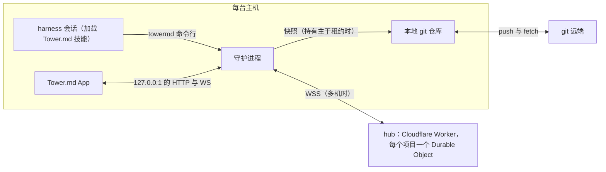
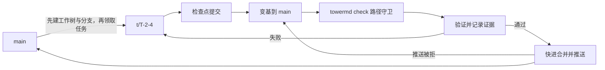
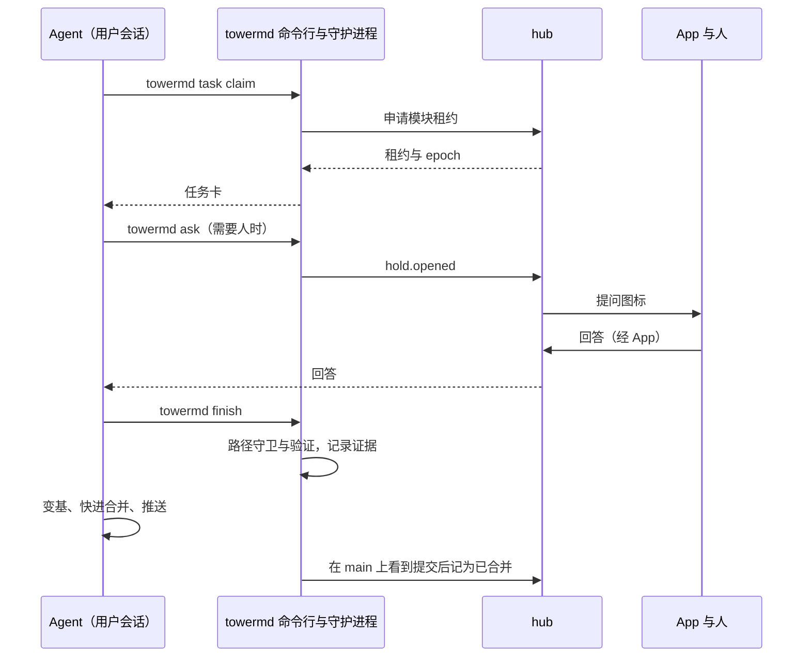
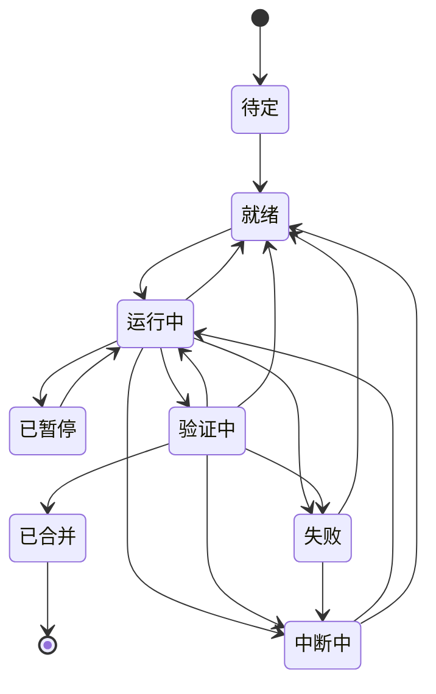
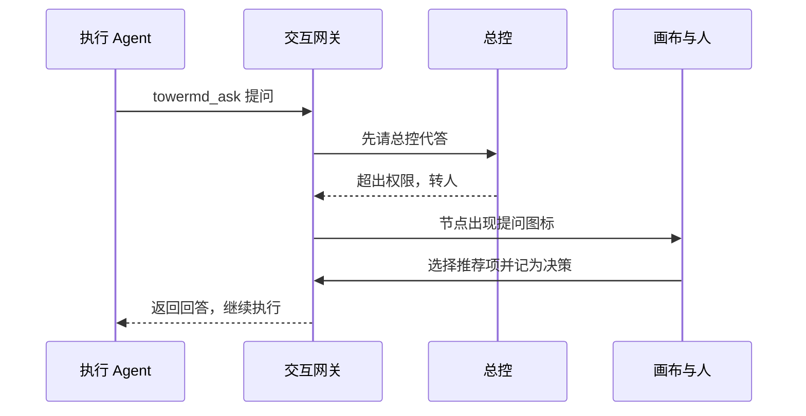

# Tower.md 最小系统以仓库内分层状态驱动画布，人批慢层、Agent 跑快层

| 项 | 内容 |
| --- | --- |
| 名称 | Tower.md（命令行 `towermd`）。与 Note.md 成对：Note.md 管 AI 知识，Tower.md 管执行 issue，类比 Confluence 与 Jira |
| 域名 | [towermd.net](https://towermd.net) |
| 版本 | v0.5 草案（v0.2 增加技能包、临时中断、质量门禁、人工干预；v0.3 定名 Tower.md，增加 Arca 大文件存储；v0.4 按设计原则对齐 OKF 字段与 actor、仓库内 Agent 规则、Note.md 回写形式、token 政策与可移除性，技术选型改为 Rust + Tauri[^principles]；v0.5 改为技能包加 App 的产品形态，md 文档放用户文档目录，布局存 `tower.canvas`，活跃状态由唯一 hub 协调多工作树与多机、快照存回仓库，v0.1 技能优先、无头调度放到 M3[^owner-1016pm]） |
| 依据 | 分层态势视图设计[^design]；红军、明豪两场交流[^hj-note][^mh-note] |
| 读者 | 产品、架构与实现负责人；实现 Agent |

## 修订记录

| 日期 | 修订 |
| --- | --- |
| 2026-10-17 | 按 M0 整改 D0–D6 的推荐方案同步 FR-91、恢复与有界快照元数据、App 确认端点、共用分离工作树验证器、冷启动扫描与 M0 验收；追认 FR-16、FR-106 与 G0 的授权边界。R6/R7 明确协议抽象与连续前缀验收，不新增依赖。[^owner-1017-remediation] |

## 0. 摘要

Tower.md 是一个本地优先的多 Agent 工程驾驶舱。产品由三样东西组成：[^owner-1016pm]

1. **Tower.md 技能包**：一套类似 superpowers 的技能。用户在自己的 Claude Code、Codex 等会话里加载它，Agent 按技能流程领取任务、提问、提交证据（见 10.0）。
2. **`towermd` 命令行与守护进程**：每台主机上运行。技能只通过命令行读写 Tower.md 的状态，不直接改文件。
3. **Tower.md App**：独立的桌面应用，渲染画布、实时显示进度，人在这里放行。

用户把 Tower.md 初始化到自己的 git 项目里。数据按变化速度分成三个面，各有唯一的权威来源（见 5.2）：

| 面 | 内容 | 权威来源 |
| --- | --- | --- |
| 知识面（慢层） | 意图、架构、规格、决策、基线、画布布局 `tower.canvas` | `main` 上的用户文档目录（初始化时指定，默认 `docs/tower/`） |
| 状态面（快层） | 任务、领取与租约、中断与回答、证据、提案、事件 | 唯一的 hub 服务：单机时是本机守护进程，多机时是用户自部署的 Cloudflare Worker |
| 代码面 | 代码 | 任务分支与工作树 |

hub 定期把状态快照提交回用户文档目录，所以项目状态仍跟随仓库做版本管理，hub 丢失后能从快照重建。`.towermd/` 只放隐藏的系统配置。

大文件不进 git：harness 的完整输出、日志、截图和构建产物交给 Arca 管理，按原相对路径访问（见 6.4）。

用户有两条起步路径：

- **冷启动**：从现有项目计算出初始基线 B0，审阅后开始执行。
- **一句话生长**：从一句话需求生成最小骨架，再随信号逐步长成复杂系统。

v0.1 技能优先：Agent 跑在用户自己开的 harness 会话里，可以是一台机器上的多个工作树，也可以是多台机器。由 Tower.md 无头调度 harness、串行合并队列放到 M3，届时复用同一套技能和 hub。分支策略只有 `main`、短期任务分支和基线标签三种。

harness 运行时可能受工作流技能包约束（例如 superpowers 一类），会主动提问、等待评审或申请授权。Tower.md 把这些情况统一建模为**临时中断**，并设置**质量门禁**作为固定卡点。中断和门禁在画布上以提问、评审、授权、禁止、错误、门禁失败、预算等图标提醒人确认或修改。人也可以随时输入提示词，对总控、模块或运行中的 Agent 做临时干预。[^owner-1811]

### 0.1 与 Note.md 的定位关系

**Note.md 管 AI 知识，Tower.md 管执行 issue，两者的关系类比 Confluence 与 Jira。**[^owner-1822] 前期研究把个人内容进入组织的路径分成两条：主张的出版回答"凭什么相信"，承诺的出版回答"谁在什么时间前负责什么"。[^publish] Note.md 走第一条，Tower.md 走第二条。

| 维度 | Note.md（类比 Confluence） | Tower.md（类比 Jira） |
| --- | --- | --- |
| 管什么 | 知识：原文、研究、主张、决策背景 | 执行：任务、中断、提案、风险，以及运行和证据 |
| 核心对象 | 页面与大纲笔记 | issue。本规格中的任务、中断、提案、风险都是 issue 的类型 |
| 真值契约 | 证据、来源、有效期 | 负责人、验收标准、关闭条件、证据 |
| 主要读者 | 人与 Agent 检索和理解 | 人掌控进度，Agent 领取和执行 |
| 变化节奏 | 慢，持续沉淀 | 快，分钟到天 |
| 存放 | 个人 Vault | 项目代码仓的用户文档目录与快照；活跃状态在 hub；大文件在 Arca |

下图是两者之间的信息流。


知识进入执行时要经过人批准的提案；执行结束后，决策和关闭的 issue 回写为经验，供下一次检索。

**边界**：

- Tower.md 不保存长篇知识。ADR 只写决策要点，背景研究链接回 Note.md。
- Note.md 不保存执行状态。它只接收已关闭的 issue 和决策摘要。
- 个人待办仍由 NEXT 管理；Tower.md 中的中断和任务不自动进入 NEXT。

**FR-79** ADR 和提案引用 Note.md 知识时，应在 `sources` 中记录来源文档的 OKF `id` 与块引用；文件路径只作定位提示，路径失效不影响引用成立。[^principles]

**FR-80** 回写 Note.md 的已关闭 issue 和决策摘要应是 OKF 文档：纯 `.md`，写入 vault 约定的捕获目录；`generated.by` 为 `process:towermd`；`sources` 指回提交 SHA 与 issue ID。回写不创建 `.note.md`，不自动建立链接；进入 Note.md 知识网仍由人确认。[^principles]

### 0.2 依赖分层

Tower.md 只做结构与掌控层，不重复造存储和执行器。

| 层 | 负责者 | 放什么、做什么 |
| --- | --- | --- |
| 知识 | Note.md | 研究、主张、决策背景 |
| 结构与掌控 | Tower.md | 慢层基线、变更审批、门禁、中断、全局画布 |
| 实时协调 | Tower.md hub | 活跃状态的唯一来源：事件定序、租约、实时推送；单机为本机守护进程，多机为用户自部署的 Cloudflare Worker |
| 执行 | 各类 harness | v0.1 在用户自己的会话中加载 Tower.md 技能；M3 起也可由 Tower.md 无头调用 |
| 文本状态与版本 | git | 代码、用户文档目录中的慢层对象与 `tower.canvas`、状态快照、基线标签 |
| 大文件 | Arca | 运行原始输出、日志、截图、构建产物，见 6.4 |

Arca 是 git 的二进制附件层："git 管可变的文本，arca 管不可变的二进制——相对路径原样工作。"[^arca]

### 0.3 命名

名字取自空管塔台（control tower）。塔台不开飞机，只掌握全局、给出放行、在冲突前叫停。这正是 Tower.md 与 Agent 的关系。

| 塔台 | Tower.md |
| --- | --- |
| 航班 | 执行 Agent 的运行 |
| 盘旋等待（holding） | 中断（hold），见第 12 节 |
| 放行许可（clearance） | 人批准提案、授权、豁免 |
| 跑道 | 串行合并队列 |
| 起飞前检查单 | 质量门禁 |
| 航路计划 | 慢层基线 |
| 雷达屏幕 | 无限画布 |

后缀 `.md` 有两层意思：与 Note.md 成对；说明慢层和状态快照是仓库里的纯文本，任何 Agent 都能读，不锁定在某个服务里。命令行写作 `towermd`，与 `notemd` 同构。

命名取舍：Tower.md 直接对应 Jira，但容易被理解成一个文件约定；单用 Tower 会与知名的 git 客户端重名，加上 `.md` 可以区分。域名为 towermd.net；商标尚未检索。

## 1. 目标与非目标

### 1.1 目标

| ID | 目标 | 验收口径 |
| --- | --- | --- |
| G1 | 人在 1 分钟内知道"自上次查看以来，到哪了、有什么问题" | 首屏不超过 3 条关注项，均可一键下钻 |
| G2 | 慢层只能由人改变 | v0.1：Agent 触及慢层路径的改动，100% 在 `towermd finish` 时被拦下，或在下一次 fetch 后被检出（FR-103）；M3：合并前 100% 被拦截并转为提案 |
| G3 | 快层由 Agent 自主推进 | 任务从派发到合并无需人操作，只在越过阈值时打扰人 |
| G4 | 从现有仓库得到可用的初始基线 | 已跟踪源码文件中至少 95% 被分配到模块 |
| G5 | 从一句话长出可运行系统 | 每一步生长结束时 `main` 都能通过验证 |
| G6 | 不绑定任何一家 harness | 新增一个 harness 只需实现一个适配器 |
| G7 | 需要人的中断及时出现，且不拖住无关工作 | 中断在 5 秒内出现在画布上；一个中断不阻塞其他模块的任务 |
| G8 | 人工输入可追溯、不绕过规则 | 每条提示词都有事件记录；提示词不能直接改慢层或跳过硬门禁 |

### 1.2 非目标（v0.1 不做）

- 多人协作与权限体系。v0.1 只服务"一个人管理多个 Agent"，Agent 可以分布在多台主机上。
- Tower.md 运营的云服务。多机协调用的 hub 由用户部署在自己的 Cloudflare 账号下；单机使用不需要任何云服务或账号。
- 由 Tower.md 无头调度 harness、总控双环、串行合并队列。放到 M3（见第 10 节）。
- 自研模型或 Agent 循环。执行全部委托给现有 harness。
- 甘特图编辑、工时、人员排班等传统项目管理功能。
- 替代 CI。Tower.md 调用项目已有的测试与构建命令。
- 代码评审界面。v0.1 只提供 diff 查看和跳转。

## 2. 术语

| 术语 | 定义 |
| --- | --- |
| 层（layer） | 对象的变化速度类别，共 L0–L5 六层，见第 3 节 |
| 慢层 | L0–L2。只能由人批准改变 |
| 中层 | L3–L4。由总控（controller）在授权内决定，并留下记录 |
| 快层 | L5。由执行 Agent 自主推进，只产生事件 |
| 模块（module） | 架构中的一个组件，拥有一组路径（path globs）和验证命令 |
| 基线（baseline） | 人批准过的一组慢层对象版本，用 Git 标签 `towermd/B<n>` 标记 |
| 提案（proposal） | 修改慢层的申请，附影响分析，等待人批准 |
| 任务（task） | 归属于一个模块、可独立验证的工作单元 |
| 运行（run） | 执行某个任务的一次尝试。v0.1 中一次领取就是一次运行，运行 ID 由 `towermd task claim` 生成；M3 中是一次无头 harness 调用 |
| 检查点（checkpoint） | 运行中产生的提交，打断时最多损失到上一个检查点 |
| 证据（evidence） | 验证结果，如测试、构建、评审，绑定到具体提交 |
| 总控（controller） | 外环。负责规划、派发、回答内环问题、分类错误；M3 引入 |
| 集成器（integrator） | 串行合并队列的执行者，负责变基、验证、合并；M3 引入 |
| 租约（lease） | 由 hub 发放、带有效期的独占权，如"一个模块同一时间只有一个写任务"。每次发放带递增的 `epoch`，旧 `epoch` 下的写入标为过期、不计入进度 |
| hub | 活跃状态的唯一服务：给事件定序、发放租约、向各端实时推送。单机时由本机守护进程担任，多机时由用户自部署的 Cloudflare Worker 担任 |
| 快照（snapshot） | 主干租约持有者把 hub 当前状态和新归档事件提交到 `main` 或 FR-91 的私有引用中对应用户文档目录的一次写入，用于版本管理与重建 |
| 用户文档目录（docs_dir） | 存放慢层 md 文档、`tower.canvas` 与快照的目录，`towermd init` 时由人或 Agent 指定，默认 `docs/tower/` |
| 主干租约 | 全局唯一的写 `main` 权：持有者负责提交慢层变更、基线和快照；M3 起也负责合并队列 |
| 技能包（skill pack） | 约束 harness 工作流程的一组技能，例如 superpowers；按版本锁定在仓库中 |
| 交互点 | 技能包中会向人提问、等待评审或批准的步骤 |
| 中断（hold） | 运行因需要人或总控回应而暂停，类型见第 12 节 |
| 实时等待 | 中断期间 harness 进程保持运行，等待回答 |
| 停车续跑 | 中断期间 harness 结束回合并退出，回答后用会话 ID 续跑 |
| 门禁（gate） | 任务生命周期中的固定检查点，未通过时阻塞或告警 |
| 插话 | 人在运行中向 Agent 注入一条提示词 |
| 临时规则 | 带范围和到期时间的指令，注入相关任务卡 |

## 3. 核心概念：六层对象、三类权限

Tower.md 用一个 `layer` 字段区分对象的变化速度，再用三类权限决定谁能改。层的划分沿用前期研究中建筑六层到软件的映射。[^layered][^design]

| 层 | 名称 | 典型对象 | 权限类 | 变更等级 |
| --- | --- | --- | --- | --- |
| L0 | 目标与约束 | 意图、预算上限、合规约束 | 慢层：人批准 | 主要变更 |
| L1 | 架构基线 | 模块、接口、模块路径、验证命令 | 慢层：人批准 | 主要变更 |
| L2 | 规格与验收 | 验收标准、设计规范、对外接口契约 | 慢层：人批准 | 主要变更 |
| L3 | 流程与工具 | harness 配置、提示模板、检查规则 | 中层：总控提议，人登记 | 次要变更（需登记） |
| L4 | 模块计划 | 任务清单、依赖、优先级 | 中层：总控自批 | 次要变更（自批并记录） |
| L5 | 任务与提交 | 运行、提交、日志、证据 | 快层：执行 Agent | 不审批，只记事件 |

**FR-01** 每个对象应带 `layer` 字段。权限检查应以 `layer` 为准，而不是以文件位置为准。

**FR-02** 慢层对象只能经人在 App 中的批准修改，由持有主干租约的守护进程提交（FR-95）。任何 Agent 分支中对慢层对象的修改都应在合并前被拒绝，或在合并后被检出（FR-17、FR-103）。依据：基线只能经正式变更控制修改。[^swebok-scm]

**FR-03** 变更等级沿用 NASA 配置管理的三分法：主要变更、次要变更、豁免。豁免是带有效期的临时偏离，不改变基线。[^nasa-65]

## 4. 用户旅程

### 4.1 J1 冷启动：现有仓库 → 基线 B0 → 开跑

1. 用户在已有 Git 仓库中执行 `towermd init`，或让 Agent 用 Tower.md 技能初始化。系统询问用户文档目录（默认 `docs/tower/`），创建 `.towermd/` 配置。
2. 系统运行冷启动管线（第 8 节），在 App 的画布上画出候选架构图：模块、接口、健康色、未分配文件。
3. 用户在画布上合并、拆分、改名、拖动模块，补充或删除接口。
4. 用户点击"批准为 B0"。系统把慢层对象和 `tower.canvas` 提交到用户文档目录，并打标签 `towermd/B0`。
5. 用户输入一个目标，或从候选任务中勾选几项，生成任务。用户在一个或多个工作树、一台或多台机器上开 harness 会话，Agent 用技能领取任务，执行开始。

### 4.2 J2 一句话生长

1. 用户在空画布上输入一句话，例如"做一个把会议录音转成待办的命令行工具"。
2. 系统最多问 3 个澄清问题，用户可以跳过。
3. 系统生成最小骨架：1–3 个模块、每个模块的验收标准、不超过 7 个初始任务。第一个任务是能跑通的空骨架。
4. 用户一键批准 B0，执行开始。
5. 生长信号出现时（第 9 节），系统提出新增或拆分模块的提案；用户批准后生成 B1、B2……

### 4.3 J3 日常：查看、批准、干预

1. 用户打开画布，首屏显示"自上次查看以来"的变化和不超过 3 条关注项。
2. 用户点开关注项，下钻到模块、任务、原文。
3. 用户批准或驳回提案，暂停、重派任务，或要求某个 Agent 立即汇报。
4. 用户点开节点上的中断图标（如提问、授权、禁止），在卡片中回答、批准或修改。
5. 用户在底部输入栏输入提示词，对选中的范围临时干预，例如"A-sync 先别改依赖版本"。
6. 用户关闭画布，Agent 继续执行。

### 4.4 J4 重构：保留需求，重画架构

1. 用户在画布上进入"草稿基线"模式，画出新的模块和接口。
2. 系统对比当前基线与草稿，列出受影响的需求、接口、任务和代码路径。
3. 用户批准后，新基线生效，画布平滑过渡到新布局。
4. 总控按新基线重新生成任务；旧代码标为"参考"。

这一流程对应明豪讨论中"需求不变，重新整成几个大的架构图，再让 Agent 全部重构"的设想。[^mh-note]

### 4.5 J5 处理一次临时中断

1. 执行 Agent 按技能包的流程写计划，遇到一个规格没写清的问题，执行 `towermd ask` 提问（M3 的无头运行用交互网关的 `towermd_ask`）。
2. 系统先查已有决策：同一问题已有决策覆盖时直接引用作答（FR-62）。M3 起，总控还能在权限内代答，并在日报中留痕。
3. 没有可引用的决策时，任务节点出现提问图标，模块角标加 1，关注清单出现一条。
4. 人点开图标，在卡片里选择 Agent 给出的推荐选项，并勾选"记为模块决策"。
5. Agent 若仍在实时等待，立即收到回答继续；若已收到 `deferred` 并结束回合，人回到该会话，或 Agent 下一次调用 `towermd` 时取到回答。
6. 同一模块之后出现相同问题时，系统直接引用这条决策回答。

## 5. 系统架构

### 5.1 组件

下图是 v0.1 的组件和数据流。单机时不需要 Cloudflare：本机守护进程自己担任 hub。



技能只调用命令行；命令行只和本机守护进程通信；守护进程是本机唯一连接 hub、唯一写快照和慢层提交的进程；App 只连本机守护进程。

| 组件 | 职责 | 关键约束 |
| --- | --- | --- |
| Tower.md 技能包 | 引导 Agent 按流程领取任务、提问、提交证据、提提案、收尾（10.0） | 只调用 `towermd` 命令行；不直接写用户文档目录、快照或 `.towermd/` |
| `towermd` 命令行 | 技能与人的命令入口 | 经本机守护进程读写；不提供任何批准类命令（FR-95） |
| 守护进程 | hub 客户端（或本地 hub）；本机投影索引；验证器；持有主干租约时写快照与慢层提交；向 App 推送 | 只绑定 127.0.0.1；对外只有到 hub 的出站连接；首次调用命令行时自动启动 |
| 本地 hub | 单机时给事件定序、发放租约 | 数据放在 git 公共目录下，同一 clone 的所有工作树共享（FR-85） |
| Cloudflare hub | 多机时给事件定序、发放租约、广播 | 用户自部署；按项目 ID 区分项目（FR-97） |
| Tower.md App | 渲染画布、实时显示状态、接收人的批准与干预 | Tauri 桌面应用；批准只能从 App 发出（FR-95）；关闭 App 不影响 Agent |
| 代码仓（git） | 代码、慢层对象、`tower.canvas`、状态快照、基线标签 | 慢层以 `main` 为准（FR-83） |
| 大文件存储（Arca） | 运行原始输出、日志、截图、构建产物 | 按相对路径原样访问；只由守护进程写入主仓库目录 |
| 总控、调度器、运行器、集成器、交互网关 | 无头执行的双环、合并队列与 MCP 通道（第 10 节） | M3 引入，作为守护进程的组件，复用同一 hub 与技能 |

### 5.2 三个面与唯一来源

多个 harness 会在不同分支、不同工作树里工作，也可能在不同主机上。如果状态以文件形式存在工作树里，每个分支、每台机器都会有一份 canvas 和 md，只能事后合并。Tower.md 的做法是按变化速度把数据分成三个面，每个面只有一个权威来源，快速变化的状态不进入任何工作树。[^owner-1016pm]

- **FR-83** 慢层对象、`tower.canvas` 与 `.towermd/` 配置的权威版本是 `main` 上的那一份。有远端时，App 和命令行按最近一次 fetch 后的 `origin/main` 读取；没有远端时按本地 `main` 读取。不读工作树中的副本，工作树中的副本只供 Agent 阅读。快照按 FR-91 在 `main` 与私有引用 `refs/towermd/snapshot` 中取 `(epoch, seq)` 最大的一份；私有引用不改变慢层的权威来源。[^owner-1017-remediation]
- **FR-84** 快层状态（任务、领取、租约、中断、回答、证据、提案、临时规则、事件）不写入任何工作树文件，只经命令行追加到 hub。每个项目同一时间只有一个 hub，在 `.towermd/config.yaml` 中配置：`hub: local`，或 `hub: { url: wss://<用户的 Worker 域名> }`。
- **FR-85** 本地 hub 的数据放在 `$(git rev-parse --git-common-dir)/towermd/` 下。同一个 clone 的所有工作树共享这个目录，因此一台机器上多个 harness 开多个工作树时，天然只有一份状态。该目录不进入版本控制。同一台主机上同一项目若有两个 clone 都配置 `hub: local`，就会出现两个 hub；本地 hub 启动时按 `.towermd/config.yaml` 中的项目 ID 在用户运行时目录加锁，发现另一个 clone 已持有时拒绝启动，并提示改用工作树或 Cloudflare hub。
- **FR-86** Cloudflare hub 由一个 Worker 和每个项目一个 SQLite Durable Object 组成。它的全部职责是：按项目 ID 路由到该项目的 Durable Object、给事件分配全局序号、按 `eid` 去重、发放和回收租约（含主干租约）、执行暂停全部（拒绝领取）、向已连接的守护进程广播、保存上次快照之后的事件。它只读事件信封（`seq`、`eid`、`epoch`、`actor`、`type`、`task`），不解析 `data`；状态投影在各主机的 `towermd-core` 中计算。v0.1 不做认证与加密，见 5.4 的"安全加固"。实现沿用 Note.md 的 mdrelay：wrangler、vitest-in-workerd。理由：需要可靠并发检查的权威状态应放 Durable Object，最终一致的 KV 不适合。[^mdrelay][^share-design]
- **FR-87** 客户端 `eid` 幂等适用于 `append`；`lease.*` 由 hub 自产，续租请求不携 `eid`、不进入发件箱，已省略续租不承诺恢复其历史 `eid`／`seq`。每个追加事件由客户端生成 `eid`（UUIDv7，按时间有序；沿用 Note.md 已有的 uuid 库），hub 分配连续、无空洞的 `seq`；被拒收的追加不占用 `seq`。同一 `eid` 重复提交时，hub 返回原 `seq`，不重复记录。hub 截断已快照的事件时只删内容，在 hub 检查点保留非心跳事件的 `eid → seq` 索引，以便发件箱在截断之后补发时仍能去重；续租心跳不进发件箱，恢复时丢弃发件箱中的续租事件。快照 `state.json` 不保存该索引，恢复时非心跳事件的 `eid → seq` 从归档 `events/*.jsonl` 推导。从 git 观察推导出的事件（如 FR-103 的检测结果、FR-107 的合并），`eid` 取“提交 SHA + 事件类型”的确定性哈希，由调用方计算；hub 只按 `eid` 去重，不解析 `data`。[^owner-1017-remediation]
- **FR-88** 守护进程与 hub 断开时，普通事件进入本机发件箱，恢复后按原 `eid` 补发。领取任务、续租、取得主干租约必须在线。租约续不上时，命令行告诉 Agent 停止领取新任务。在已失效 `epoch` 下产生的事件，hub 照常定序记录，但标 `stale: true`，不参与状态投影，因此不计入进度；审计信息不丢。

**与设计原则的关系。** 设计原则信念二原来写的是"不建云端中枢""不把关键状态只放在内存或私有数据库里"。v0.5 按用户决定改为：活跃状态以唯一的 hub 为准，沉淀状态以仓库为准，二者用快照衔接；hub 可以是本机守护进程，云端 hub 由用户自部署、可从快照重建。设计原则与 `AGENTS.md` 已按此修订（Q10）。[^principles][^owner-1016pm]

### 5.3 快照

hub 是活跃状态的唯一来源；快照让状态仍跟随仓库做版本管理，并在 hub 丢失时可以重建。

- **FR-110** 主干租约默认由 App 所在主机的守护进程申请；App 没有运行时，由第一个需要写快照或慢层提交的守护进程申请。TTL 默认 2 分钟，持有者每 30 秒续一次。新持有者上任时，先在 `main` 与私有引用 `refs/towermd/snapshot` 中读取 `(epoch, seq)` 最大的快照 trailer，对其中的 `seq` 补发 `snapshot.ack`，再开始写入。[^owner-1017-remediation]
- **FR-89** 快照只由持有主干租约的守护进程写入，全局同一时间只有一个写入者。一次快照是按 FR-91 持久化到 `main` 或私有引用的一个提交，只改两个位置：`<docs_dir>/state/state.json`（当前状态投影：任务、中断、提案、租约摘要、证据索引、临时规则，覆盖写）与 `<docs_dir>/state/events/<YYYY-MM>.jsonl`（自上次快照以来的事件，追加写；续租这类心跳事件不归档）。`state.json` 不保存 receipts 或逐条心跳，只保存省略心跳的 `seq` 区间与恢复跳号等最小恢复元数据。提交带 trailer `Towermd-Snapshot: <seq>` 与 `Towermd-Epoch: <epoch>`。快照只覆盖 hub 已确认的连续前缀：写入者以 `HubProtocol::contiguous_seq()` 返回的“已连续定序到的最大 `seq`”为快照点，而不是以自己收到的最后一个事件为准。[^owner-1017-remediation]
- **FR-90** 写快照的时机：基线批准、任务关闭、人处理了中断或提案、执行 `towermd snapshot`；此外，有变化时按 `snapshot_interval` 定期写，默认 30 分钟。
- **FR-91** 写快照（以及 FR-37 的慢层提交）不得触碰任何用户工作树或 index；除本条明确允许的无远端且 `main` 未检出时更新本地 `main` 外，不得移动任何本地分支。有远端时，在 fetch 下来的 `origin/main` 上用 git 底层命令（`read-tree`、`write-tree`、`commit-tree`，使用临时 index）生成提交，再 `push <sha>:refs/heads/main`；非快进被拒时重新 fetch、检查 fencing、在新的基底上重建提交并推送，最多尝试 3 次，仍失败则报错。生成新快照前在 `main` 与私有引用中检查已有快照，若有 `(epoch, seq)` 不小于自己的快照，则放弃写入并记录原因；旧持有者的推送要么非快进被拒，要么在重做前因发现更新快照而放弃。提交作者经命令行参数传入 `process:towermd-snapshot` 身份，不使用用户的 git 身份，不运行仓库的 hooks。没有远端时，`main` 未检出则用带旧值校验的 `update-ref`（比较并交换，CAS）更新本地 `main`；`main` 在任一工作树已检出时，快照用同样的 CAS 写入私有引用 `refs/towermd/snapshot`，它不是分支，不移动分支、工作树或 index。待 `main` 不再检出，或配置了远端后，将最新私有快照按常规路径写回 `main`；搬送同一私有快照不因它与自身边界相等而拒绝，仍须核对当前主干租约及目标 `main` 的 fencing 边界。私有引用仅保存快照，不授权未经批准的慢层变更。`towermd init` 对远端直推 `main` 只作尽力检查：先尝试 fetch，再以 `origin/main` 的 SHA 作 dry-run 协商；只有明确的策略拒绝（如受保护分支、明确权限不足）才报错，网络失败、认证失败、没有本地 `main` 只警告“快照写入时会再次检查”。dry-run 不作为实际推送权限的保证。[^owner-1017-remediation]
- **FR-92** hub 在收到 `snapshot.ack` 之后，才可以将 `seq` 不大于该快照的事件折叠为检查点并丢弃事件内容；检查点保留业务投影与非心跳事件的 `eid → seq` 索引（FR-87）；业务投影由守护进程中的 `towermd-core` 计算，调用方将其作为不透明检查点提供，hub 只持久化该数据及定序元数据，不解释业务 `data`。ack 必须对应 FR-91 已持久化到 `main` 或 `refs/towermd/snapshot` 的快照提交。客户端以小于截断点的 `seq` 订阅时，hub 返回“请从快照加载”，客户端按 FR-83 读取最大 `(epoch, seq)` 的快照，再从快照点之后订阅。[^owner-1017-remediation]
- **FR-93** hub 数据丢失时，`towermd hub rebuild` 只发起重建请求；App 经 16.2 节确认端点批准后，守护进程从 `main` 与 `refs/towermd/snapshot` 中 `(epoch, seq)` 最大的快照加各主机发件箱恢复，并扫描快照之后 `main` 上带 Towermd trailer 的提交，按“提交 SHA + 事件类型”补回 `merge.done`、`baseline.created`、`snapshot.written` 等事件。未知的 `Towermd-*` trailer 记为附原文的 `alert.raised`，不阻止恢复。发件箱按从归档推导的非心跳 `eid` 索引去重，丢弃续租事件，旧 `epoch` 的写入标为过期。重建后的 `seq` 与 `epoch` 都跳过一个大间隔（2^32）继续发放，原有租约全部作废，Agent 须重新领取。新的边界必须按 FR-91 先持久化到 `main` 或私有快照引用，成功后才开放写服务；即使本地安装失败，下一次恢复也从已持久化的新边界继续，不能再次发放同一区间。恢复证明只接受统一reader核过的原归档或confirmed完整原Event；pending正文、孤立passed文件、raw投影或bare基线标签都不能认证完成/批准。正常producer先pending耐久→hub接受→核原完整回执→confirmed耐久才返回本次成功，Hub已接受事实仍正常同步。恢复重放不产生第二confirmed，不把新stale外层回执替换原非stale证明；canonical证明随归档持久，使二次无旧outbox仍可核。数据/证明格式与唯一consumer见[共享恢复证明契约](../superpowers/plans/2026-10-17-shared-recovery-proof-contract.md)。只存在于丢失的 hub 中、既未进入快照也不在任何发件箱里的事件会丢失，丢失范围以一个快照间隔为上限。Cloudflare 的 Durable Object 存储本身是持久的，这条只用于灾难恢复。`state.json` 是快照点上的检查点，权威语义是“在快照点加载 `state.json`，再应用 `seq` 更大的事件”；实现须有测试保证“重放全部归档事件”与 `state.json` 的业务投影一致，心跳省略与恢复跳号由元数据解释。本机投影索引（SQLite）是派生的，删除后从 hub 重建。hub 为空时 `status` 仍可只读报告“需恢复”，其他写命令拒绝执行。[^owner-1017-remediation]
- **FR-94** 除快照写入者外，任何提交都不得修改 `<docs_dir>/state/`。检查方式同 FR-17。

2026-10-17 整改澄清：`state.json` 不保存 receipts、逐条心跳或 `eid → seq` 索引；非心跳索引从归档 jsonl 推导，心跳省略以 `seq` 区间保存，恢复跳号另记边界。租约摘要只用于追溯，灾难恢复时全部失效。恢复边界持久化可按 FR-91 写到私有快照引用。App 人工确认闸门不可绕过：CLI 只能请求恢复；M0 以 App 客户端身份调用 `POST /hub/rebuild/:request_id/confirm` 完成端到端验收，真人点击留到 M1。该端点仅接受 App 客户端，v0.1 按客户端类型区分，不增加加密认证。[^owner-1017-remediation]

### 5.4 人机署名与批准

Agent 和人可能坐在同一个终端、用同一个命令行。如果命令行能批准，Agent 就能自己放行。

**威胁模型。** v0.1 防的是 Agent 粗心、跳过流程，不防 Agent 恶意，也不防网络上的第三方：Agent 与守护进程以同一个系统用户运行，有意为之的 Agent 可以直接改写本地 hub 文件、调用守护进程 API 或伪造事件。v0.1 的保障是结构性的：命令行和技能里根本没有批准类命令，人的动作只有 App 一个入口；守护进程在记录"已合并"时复核证据（FR-107），伪造证据的提交至少会在事后被标出。按用户决定，安全将来再考虑。[^owner-1016pm]

**安全加固（未排期）。** 以下内容不进入 v0.1 的 M0–M3，留到安全加固时再设计：人类密钥签名（密钥存系统钥匙串、每次签名需用户在场确认、签名覆盖对象 ID 与内容哈希、公钥不从仓库读取）；设备配对、设备令牌（从环境变量读取）与吊销；hub 认证；事件 `data` 的端到端加密；无头运行放进不持有凭据的沙箱。

- **FR-95** 命令行不提供批准类命令：批准提案与基线、授予豁免、通过评审、确认慢层草稿。这些动作只能从 App 发出。批准事件记录"对象 ID + 内容哈希 + 目标基线号"；慢层草稿以 git 引用 `refs/towermd/drafts/<id>` 推送，主干租约持有者提交前核对内容哈希与批准事件一致，保证提交的正是人批准的那一份。
- **FR-111** 凡是署名 `human:<id>` 的事件都必须从 App 发出，包括回答提问、人工提示词、临时规则、暂停与恢复。命令行发出的事件一律署名 `process:towermd-cli`，不能产生 `human:` 事件。会扩大影响面的命令行操作（`towermd hub rebuild`、`towermd resume --all`）只发起请求，须在 App 中确认后才执行。
- **FR-96** 人在 harness 会话里直接回答 Agent 的提问时，Agent 可以经命令行代为记录，署名为 Agent 本身，并带 `data.relayed_from: human`。这类转述的回答可以解开当前提问，但不能记为决策或规则，也不能触及慢层；要记为决策，须在 App 中确认。
- **FR-97** 多机协作以项目 ID 为准。`towermd init` 生成的项目 ID（FR-98）与 hub 地址都写在 `.towermd/config.yaml` 中、随仓库分发；任何主机 clone 仓库后，命令行读 `main` 上的配置，用同一个项目 ID 连接同一个 hub，不需要额外的配对步骤。[^owner-1016pm] 任何密钥都不写入仓库。

### 5.5 进程模型

- **FR-04** 每台主机、每个系统用户运行一个 `towermd` 守护进程，服务这台主机上的所有项目（按项目 ID 区分）、所有终端和所有 Agent。命令行在首次调用时自动启动它；多个终端同时调用、同时尝试启动时，用用户运行时目录中的锁文件保证只启动一个，其余调用等待它就绪后再连接。守护进程须能同时处理多个命令行请求。App 是 Tauri 桌面应用，作为本机守护进程的客户端；关闭 App 不影响 Agent。
- **FR-113** 一台主机上可能有多个终端，每个终端里又可能有多个 Agent，各自在不同分支、不同工作树上干活。命令行按调用时的当前目录确定调用者：取 `git rev-parse --show-toplevel` 得到工作树，取当前分支，在 hub 中查找绑定到"本机 + 该工作树 + 该分支"的运行（FR-112）。找到就作用于该运行；找不到时，需要运行的命令（`ask`、`propose`、`check`、`finish`、`trailers`）报错并列出本机的活动运行。任何命令都可用 `--run <id>` 显式指定运行，覆盖自动判定。一个工作树同一时间最多绑定一个活动运行；不依赖终端级的环境变量，因为同一终端里的多个 Agent 共用环境。
- **FR-05** 守护进程重启后，应能凭 hub、git 仓库与 Arca 恢复全部状态。派生索引（如 SQLite）只做缓存，可以删除后重建。
- **FR-06** v0.1 的工作树由用户或 harness 自己创建，Tower.md 不要求特定布局。M3 的运行器把每个无头运行放在独立的 Git 工作树中，工作树目录不进入版本控制。

### 5.6 技术选型

技术选型与 Note.md 同构，完整清单与新增依赖规则见仓库根目录的 `AGENTS.md`。要点：

- 核心：Rust。一个与平台无关的核心 crate，守护进程与命令行、Tauri App、M3 的 MCP 交互网关是它的适配层。
- 守护进程：Rust（tokio 管理子进程与网络；clap 做命令行；axum 提供本机 HTTP 与 WebSocket）。理由：单二进制常驻、占用低，与 `notemd` 的 CLI 和 MCP 实现同构。
- App：Tauri 2 + Svelte 5，节点图用 `@xyflow/svelte`（Note.md 已在使用），初始布局用 elkjs。
- Cloudflare hub：TypeScript Worker 加 SQLite Durable Object，wrangler ^3、`@cloudflare/workers-types` ^4、vitest-in-workerd，与 Note.md 的 mdrelay 相同。
- 派生索引：SQLite（rusqlite）。
- Git：直接调用 `git` 命令，不依赖托管平台。

新依赖：axum 已确认；hub 客户端的 WebSocket 库类别已确认，具体库在 M2 计划中写明理由。人类签名与系统钥匙串访问的库随安全加固再定。

10.3 中的适配器接口用 TypeScript 写成，只为示意字段；实现为 Rust trait。

## 6. 数据模型与仓库布局

### 6.1 目录

`.towermd/` 只放隐藏的系统配置；md 文档、画布与快照放在用户文档目录。[^owner-1016pm]

```text
.towermd/                    # 系统配置（L3），提交进 git
  config.yaml                # docs_dir、项目 ID、hub 地址（不含密钥）、角色与模型、并发、预算、阈值、中断策略
  gates.yaml                 # 质量门禁定义
  skillpacks.yaml            # 各角色启用哪些技能、交互点映射
  skillpacks/<name>@x.y.z/   # 按版本锁定的技能包副本
  rules/R-3.md               # 登记过的流程规则
  AGENTS.md                  # 给任何 Agent 的仓库规矩（由 towermd 生成）

<docs_dir>/                  # 默认 docs/tower/，init 时由人或 Agent 指定
  tower.canvas               # 画布布局（L1，JSON Canvas 1.0，见 6.5）
  intents/I-1.md             # 意图与约束（L0）
  arch/A-sync.md             # 模块（L1）：路径、接口、验证命令
  arch/interfaces.yaml       # 接口清单（L1）
  specs/A-sync.accept.md     # 验收标准（L2）
  baselines/B3.yaml          # 基线清单：包含的对象与版本、批准人、时间（L1）
  decisions/D-40.md          # ADR，含层级与取代关系（L1–L4）
  state/state.json           # 快照：当前状态投影（只由快照写入者写，FR-89）
  state/events/2026-10.jsonl # 快照：归档的事件
  artifacts/<run>/           # Arca 管理的大文件，见 6.4

$(git rev-parse --git-common-dir)/towermd/   # 本地 hub 与本机缓存，不进版本控制（FR-85）
```

任务、中断、提案、证据、临时规则在活跃期只存在于 hub（FR-84），快照把它们写进 `state/`。提案被批准后，结论写成 `decisions/` 下的 ADR，变更写进对应的慢层对象。

**FR-07** 用户文档目录下的对象文件应使用 Markdown 加 YAML frontmatter，按 OKF v0.2 书写，便于人和 Agent 都能读。[^okf] `tower.canvas` 与 `state/` 下的文件是 JSON，不是 OKF 文档，对象加载器跳过它们。

**FR-08** 运行的原始输出、日志和截图不进 git，交给 Arca 管理（见 6.4）。运行报告与证据作为事件进入 hub，随快照归档。

**FR-98** `towermd init` 应生成项目 ID（UUIDv7）并询问用户文档目录，写入 `.towermd/config.yaml` 的 `project_id` 与 `docs_dir`。项目 ID 一经生成就不再改变：再次执行 `init` 时保留原值，它是本地 hub 加锁（FR-85）、Cloudflare hub 路由（FR-86）与多机协作（FR-97）的依据。Agent 用技能初始化时，可以按项目已有的文档约定提出建议，由人确认。做法同 superpowers 把规格和计划放在项目文档目录中。目录中已有的 md 文件保持原样，可在 `tower.canvas` 中作为引用节点出现（6.5）。所选目录下已有与 `intents/`、`arch/`、`specs/`、`baselines/`、`state/` 同名的子目录时，`init` 应警告：这些子目录会整体成为受保护路径（FR-17），建议另选一个专用目录。`init` 在 hub 与守护进程存在之前运行，是唯一不经守护进程的写入：它只在当前工作树中生成文件，不提交，由人检查后自己提交。

**FR-81** `towermd init` 应生成 `.towermd/AGENTS.md`，写明哪些路径属于慢层、越界改动如何转为提案、哪些状态必须经 `towermd` 命令行写入。若仓库根目录已有 `AGENTS.md`，只提示用户自行加一行引用，不修改该文件。`.towermd/AGENTS.md` 是给 Agent 读的说明，不是对象文件，对象加载器跳过它。理由：用户在仓库里直接打开一个 harness 时，也应在动手前看到慢层规则，而不是等合并时才被拦下。[^principles]

### 6.2 对象字段

对象文件是 OKF v0.2 概念文档。[^okf] 所有对象共有字段：

| 字段 | 说明 |
| --- | --- |
| `type` | 必填。对象类型，取值见下表第一列 |
| `id` | 对象 ID，如 `A-sync`、`T-2-4` |
| `layer` | `L0`–`L5`，权限检查以此为准（FR-01） |
| `title` | 可选，人类可读名称 |
| `status` | OKF 生命周期：`draft`、`stable`、`deprecated`；缺省为 `stable`。业务状态另用 `state` 等字段，不复用 `status` |
| `owner` | 负责的 actor，格式同 6.3 |
| `generated` | `{ by: <actor>, at: <ISO 8601> }`，内容最后一次实质变更 |
| `verified` | 可选，`{ by, at }` 或其列表。慢层对象被纳入基线时，由批准人以 `human:<id>` 写入 |
| `sources` | 可选，OKF 来源列表，指向原文、提交或 Note.md 文档（FR-79） |

**FR-82** 对象的 `type` 取值应只在 `towermd-core` 中登记一处，所有写入路径都经过这份登记。读取时宽容：缺可选字段、未知 `type`、未知附加键都不得使对象被拒绝；读不懂的键在往返后原样保留。[^okf]

| 对象（`type`） | 关键字段 |
| --- | --- |
| 意图 `Intent` | `text`、`constraints`、`priority`、`allocated_to`（模块 ID 列表） |
| 模块 `Module` | `name`、`paths`、`interfaces`、`verify`（命令列表）、`baseline`、`landmark`（地标文字，可选）。坐标不在模块对象里，在 `tower.canvas` 中（FR-43） |
| 接口 `Interface` | `from`、`to`、`contract`（文件或说明）、`baseline` |
| 验收标准 `Acceptance` | `module`、`criteria`（条目列表）、`verify`（对应的验证命令）、`baseline` |
| 基线 `Baseline` | `objects`（ID 与内容哈希）、`approved_by`、`approved_at`、`git_tag` |
| 决策 `Decision` | `context`、`options`、`decision`、`rationale`、`affects`、`supersedes`、`class` |
| 提案 `Proposal` | `kind`（新增模块、拆分、合并、接口变更、验收变更等）、`draft_baseline`、`impact`、`requested_by` |
| 任务 `Task` | `module`、`allowed_paths`、`depends_on`、`acceptance`、`priority`、`harness_role`、`state` |
| 运行 `Run` | `task`、`harness`、`model`、`session_id`、`branch`、`checkpoints`、`cost_usd`（未知时为 `null`）、`exit` |
| 证据 `Evidence` | `kind`（test、build、review、lint、gate）、`commit`、`tree`（证据绑定的 tree，FR-107）、`result`、`log`（Arca 管理的相对路径） |
| 中断 `Hold` | `hold_type`、`run`、`task`、`mode`（live 或 parked）、`question`、`options`、`recommended`、`context`、`opened_at`、`deadline`、`resolved_by`、`resolution`、`remember_as` |
| 门禁 `Gate` | `stage`、`applies_to`（层、模块、风险等级）、`check`（命令、Agent、人）、`hard`、`auto_fix_max`、`on_fail` |
| 技能包 `SkillPack` | `name`、`version`、`origin`（上游地址）、`hash`、`enabled_for`（角色到技能列表）、`disabled`、`interaction_points` |
| 临时规则 `Rule` | `text`、`scope`（全局、模块、任务）、`until`、`created_by` |

中断的类别字段名为 `hold_type`，避免与 OKF 的 `type` 冲突。`interfaces.yaml`、`gates.yaml`、`skillpacks.yaml` 中的每个条目同样带 `type`。任务、运行、证据、中断、提案、临时规则在 hub 中以同样的字段表示，快照 `state.json` 按 `type` 分组存放。

模块对象示例：

```yaml
---
type: Module
id: A-sync
layer: L1
title: 同步
status: stable
owner: human:bruce
generated: { by: claude-code/opus-5.5, at: 2026-10-16T10:00:00Z }
verified: { by: human:bruce, at: 2026-10-16T10:30:00Z }
name: 同步
paths: ["src/sync/**", "tests/sync/**"]
interfaces: [IF-sync-store]
verify: ["pnpm test --filter sync"]
baseline: B3
landmark: 中转站
---
负责把本地变更同步到存储层。
```

### 6.3 事件

**FR-09** 每个事件是一个 JSON 对象，在 hub 中按 `seq` 排序，归档时一行一个。字段如下：

| 字段 | 说明 |
| --- | --- |
| `seq` | hub 分配的全局单调递增序号（FR-87） |
| `eid` | 客户端生成的 UUIDv7，用于幂等重发 |
| `host` | 产生事件的主机 ID（守护进程首次启动时生成，保存在本机） |
| `epoch` | 可选，事件依赖的租约 `epoch`；已失效 `epoch` 下的事件由 hub 标 `stale: true`，不参与投影（FR-88、FR-99） |
| `t` | ISO 8601 时间，带时区 |
| `actor` | 沿用 OKF 三种形式：人用 `human:<id>`，且只能从 App 发出（FR-95、FR-111）；守护进程内的组件用 `process:towermd-<组件>`，如 `process:towermd-verifier`、`process:towermd-snapshot`、`process:towermd-cli`（命令行发出的事件），M3 起还有 `process:towermd-controller`、`process:towermd-integrator`；执行 Agent 用 `<harness>/<version>`，如 `claude-code/2.1.0`，运行 ID 放进 `data.run`；v0.1 中这一署名由技能自报（FR-106） |
| `type` | 事件类型，见下表 |
| `layer` | 事件所属层 |
| `obj` | 关联对象 ID |
| `data` | 类型相关的负载 |
| `cost_usd` | 可选，本事件产生的费用估算；harness 未报告时为 `null`，不填 0 |

人的动作与自动流程的动作不得共用 actor：总控代人回答时署名 `process:towermd-controller`，人推翻或确认后另记一条 `human:<id>` 事件。[^principles]

| 类型 | 层 | 含义 |
| --- | --- | --- |
| `run.started` / `run.finished` | L5 | 运行开始与结束，结束时附退出码和报告摘要 |
| `run.checkpoint` | L5 | 产生检查点提交 |
| `run.question` | L5 | 内环向外环提问 |
| `run.retry` | L5 | harness 报告的 API 重试 |
| `evidence.recorded` | L5 | 验证结果写入 |
| `task.state` | L4 | 任务状态变化 |
| `plan.changed` | L4 | 总控调整任务、依赖或优先级 |
| `decision.recorded` | L1–L4 | 新决策或取代 |
| `proposal.created` / `proposal.resolved` | L1–L2 | 提案生成与人工处理结果 |
| `baseline.created` | L1 | 新基线生效 |
| `merge.done` / `merge.rejected` | L5 | 集成器合并或拒绝 |
| `human.action` | 各层 | 人的干预，如暂停、重派、批准 |
| `alert.raised` / `alert.cleared` | 各层 | 告警升起与清除 |
| `hold.opened` / `hold.resolved` / `hold.escalated` | L5 | 中断打开、处理、超时升级 |
| `gate.passed` / `gate.failed` | L5 | 门禁结果 |
| `human.prompt` / `prompt.delivered` | 各层 | 人工提示词与送达确认 |
| `rule.temp.added` / `rule.temp.expired` | L3 | 临时规则生效与到期 |
| `skill.loaded` | L5 | 运行加载的技能包与版本 |
| `task.claimed` / `task.released` | L5 | Agent 经技能领取或放弃任务 |
| `lease.granted` / `lease.renewed` / `lease.expired` / `lease.released` | L5 | 租约变化，含 `epoch` |
| `snapshot.written` | L5 | 快照提交，含提交 SHA 与覆盖到的 `seq` |

### 6.4 大文件与 Arca

文本状态进 git，大文件进 Arca。两者都按仓库内的相对路径访问，画布和 Agent 不需要区分。[^arca]

| 内容 | 存放 | 理由 |
| --- | --- | --- |
| 慢层对象、`tower.canvas`、快照 | git | 可变文本，需要 diff 和版本管理 |
| harness 原始输出流、完整日志 | Arca | 体积大，写入后不再改 |
| 测试报告、截图、录屏、构建产物 | Arca | 二进制或大文件，作为证据不可变 |
| 冷启动扫描的中间结果 | Arca | 体积大，只供回溯 |

**FR-75** Arca 管理的文件应由守护进程写入主仓库目录下的 `<docs_dir>/artifacts/<run>/`，不得放在任务工作树中。理由：Arca 文档说明 `git clean -xdf` 会永久删除尚未同步到 Arca hub 的托管文件，而工作树在任务结束后通常会被删除。[^arca] 多机时，大文件先留在产生它的主机上，经 Arca 同步后其他主机才能看到（见第 20 节风险表）。

**FR-76** 证据对象应记录 Arca 文件的相对路径，以及 Arca 给出的内容哈希（若可取得）。证据写入后不得修改；更正时写新证据。

**FR-77** 本机未安装 Arca 时，守护进程应退回普通本地目录，该目录同样被 git 忽略；画布在相关证据旁标注"仅本机"。

**FR-78** 守护进程启动时宜运行 `arca doctor`，把"本地有、hub 无副本"的文件数显示在画布状态栏。

### 6.5 画布文件 tower.canvas

`<docs_dir>/tower.canvas` 保存慢层的画布布局，是 Z0 地图的唯一布局来源。[^owner-1016pm]

**FR-100** `tower.canvas` 应使用 JSON Canvas 1.0 格式，读写规则沿用 Note.md 的无限画布设计：节点类型只有 `text`、`file`、`link`、`group`，几何为整数像素；根、节点、边三层的未知字段原样保留；非法条目作为不透明条目保留，不静默修复；viewport、选中状态等视图状态不写入文件。[^canvas-design] 路径的解析根是仓库根目录，`file` 节点的路径为相对仓库根的 POSIX 路径；越出仓库根的路径不自动读取。

**FR-101** 画布条目与 Tower.md 对象的对应关系：

| 画布条目 | 对应 | 标识 |
| --- | --- | --- |
| `file` 节点，指向 `<docs_dir>/arch/*.md` | 模块 | 附加键 `towermd: { obj: "A-sync" }` |
| `file` 节点，指向 `<docs_dir>/intents/*.md` 等其他慢层对象 | 意图、规格等 | 同上 |
| `file` 节点，指向项目中的其他 md 文档（如 `README.md`、`docs/` 下的设计） | 引用来源，供人和 Agent 跳转阅读 | 无 `towermd` 键 |
| 边（edge） | 接口，`label` 为接口名 | `towermd: { obj: "IF-sync-store" }` |
| `group` 节点 | 区域，如"未划分区"或人画的分区 | 可选 `towermd: { region: "unassigned" }` |
| `text`、`link` 节点 | 人的注释与外部链接 | 无 |

模块对象存在而画布上没有对应节点时，App 把它放进"未摆放"托盘；节点指向的对象不存在时，显示为悬空并给出诊断。

**FR-102** 快层状态（健康色、角标、中断图标、动画）只在 App 中叠加显示，不写入 `tower.canvas`。Z1 的任务依赖图由 App 运行时自动布局，也不写入文件。

## 7. 分支与提交策略（极简）

### 7.1 规则

只有三种 Git 引用：

| 引用 | 命名 | 生命周期 | 谁写 |
| --- | --- | --- | --- |
| 主干 | `main` | 长期 | 代码：v0.1 由 Agent 按技能收尾时合并，M3 起只由集成器合并；慢层、基线、快照：只由持有主干租约的守护进程提交 |
| 任务分支 | `t/<task-id>` | 一个任务，合并后删除 | 执行 Agent，在独立工作树中 |
| 基线标签 | `towermd/B<n>` | 永久 | 持有主干租约的守护进程，在人批准后 |

下图是一个任务从领取到合并的路径。v0.1 中由 Agent 按技能执行这些步骤；M3 中"检查"到"快进合并"由集成器串行执行。



任务分支只活一个任务；合并前必须变基到最新 `main` 并通过验证；`main` 始终可运行。

**FR-10** 合并方式应为"变基后快进合并"。一个任务的多个检查点可在合并时压缩为一个提交，默认保留。v0.1 中多个 Agent 同时合并时，以推送是否被拒作为并发检查：被拒的一方 fetch、重新变基、重新验证后再推送。

**FR-11** M3 的集成器应串行处理合并队列，不做并行合并。理由：并发 Agent 数量在 10 个以内时，串行队列足够，且冲突处理最简单。

**FR-12** 每个任务合入 `main` 的末个提交应带以下 trailer，用于溯源（快进合并没有单独的合并提交）。v0.1 由技能在 `towermd finish` 通过后调用 `towermd trailers <task>` 生成，再用 `git commit --amend` 写进提交信息；证据绑定的是 tree，只改提交信息不影响证据（FR-107）：

```text
Towermd-Task: T-2-4
Towermd-Run: R-0193
Towermd-Module: A-sync
Towermd-Evidence: E-0877
Towermd-Epoch: 17
```

Epoch必须等于主Module的`module:<id>` fence epoch，不能取排序后首个touches fence。最后trailer block五项必须完整且各一次；四行旧格式只留诊断，不认证完成。恢复与正常观察的机器格式/唯一纯证明边界见[共享恢复证明契约](../superpowers/plans/2026-10-17-shared-recovery-proof-contract.md)，它不授予执行或批准权限；其中四种窄持久请求/typed receipt及G1/G4原opening/review/gate Evidence上下文只用于核验真实已接受producer，currentPlan顺序取原opening Event.seq，晚G4不改写已完成的G3 Evidence，也不要求保存renew或补齐全部seq。

**FR-13** 回滚只用 `git revert` 撤销某个任务带入的提交，不改写 `main` 历史。

### 7.2 冲突预防：模块租约与路径守卫

- **FR-14** Agent 领取任务（`towermd task claim`）时，hub 应发放该任务所属模块的写租约。同一模块同一时间只有一个写任务；租约已被占用时，领取失败并返回可领取的其他任务。M3 中由调度器在派发前领取。
- **FR-112** 模块租约默认 TTL 15 分钟。`task claim` 生成运行 ID，并与"本机 + 当前工作树 + 分支 `t/<task-id>`"绑定（FR-113）；此后从该工作树发出的任何 `towermd` 调用都会续租，`finish` 验证进行期间由守护进程续租。超过 TTL 没有续租时租约过期，任务回到就绪；技能要求 Agent 在长时间操作前后调用一次 `towermd status`。任务进入验证中后，60 分钟内没有在 `main` 上看到合并，释放租约，任务回到就绪。
- **FR-15** 任务需要修改其他模块路径时，应在任务中声明 `touches`，并同时取得这些模块的租约。
- **FR-99** hub 发放租约时附带递增的 `epoch`。依赖租约的写入（领取后的证据、合并 trailer、快照、慢层提交）都带上 `epoch`；hub 把 `epoch` 已失效的写入标为过期、不参与投影（FR-88）；快照与慢层提交的写入者按 FR-91 在 git 远端上检查并放弃过期写入。理由：持锁方可能因为暂停或断网而不知道租约已过期，只靠客户端自查不够，必须由资源方按递增令牌挡住旧写入。[^ddia]
- **FR-16** 合并前应检查 diff：改动路径必须属于任务的 `allowed_paths`，否则拒绝合并；所属模块与 `touches` 模块的 `paths` 只作为任务授权范围的上限，不因属于模块就自动获得任务外路径权限（2026-10-17 追认）[^owner-1017-remediation]。Agent 经命令行新建任务时，`allowed_paths` 必须落在所属模块与 `touches` 模块的 `paths` 之内，超出部分被拒绝；只有人在 App 中建的任务可以放宽，防止 Agent 自建一个放开全部路径的任务来绕过守卫。v0.1 由技能在收尾时调用 `towermd check`；M3 由集成器执行。
- **FR-17** diff 中出现受保护路径时，应拒绝合并，并把改动内容转成一个提案。受保护路径包括：慢层对象，按 FR-01 以 `layer` 判定，即 `<docs_dir>` 下 `intents/`、`arch/`、`specs/`、`baselines/` 的全部文件与 `tower.canvas`，加上其他位置 `layer` 为 L0–L2 的对象（如 L1 决策），判定时同时检查改动前后的 `layer`，防止通过改 `layer` 字段绕过；快照路径 `<docs_dir>/state/`；`.towermd/` 下的配置（L3，须登记）。
- **FR-103** v0.1 中 Agent 跑在用户自己的会话里，技能可能被跳过，所以守护进程每次 fetch 后还应检查 `main` 上的新提交：改动受保护路径、而 hub 中没有对应事件（`baseline.created`、`snapshot.written`、已批准的提案）记录其提交 SHA 的，生成禁止中断，并在卡片上提供"生成撤销提交"和"转为提案"。如果是人自己在编辑器里改了慢层并直接推送，卡片另提供"认领此提交"，在 App 中确认后记为已批准的慢层变更。这些检测事件的 `eid` 按 FR-87 由提交 SHA 确定，多台主机重复检测只记一次。v0.1 对受保护路径是"检查加事后检测"，M3 的集成器才能在合并前拦截。

  首次检测边界（2026-10-17 用户明确确认：整笔启用提交作为导入起点）：在完整权威 main 历史中，首次引入当前 project_id 配置的整笔提交及其祖先作为导入上下文，不能据此批准 B0 或激活慢层；该锚点之后全部可达提交都检查，包含 B0 之前及 daemon 首次启动之前的提交。删除后重加同项目配置不重置锚点；daemon 首见 HEAD、B0、快照时间与派生游标均不能替代锚点。浅历史、多义引入点、项目来源不明或非快进回退使完整检查不可证明时，返回 inspection_incomplete 并阻止合并认证，不提供跳过检查的运行开关。

跨模块任务的比例同时是一个生长信号（第 9 节）。比例持续偏高，说明模块边界划分有问题。依据：Simon 指出，近可分解系统的子系统内部联系强于子系统之间的联系。[^simon-nd]

## 8. 冷启动：从现有项目计算基线

### 8.1 管线

下图是冷启动管线。前 5 步是确定性计算，第 6 步调用模型，最后由人审阅批准。


| 步骤 | 做法 | 输出 |
| --- | --- | --- |
| S1 文件盘点 | `git ls-files`；识别语言、清单文件（如 package.json、Cargo.toml、go.mod、pyproject.toml）、构建与测试命令（脚本、Makefile、CI 配置） | 文件清单、候选验证命令 |
| S2 依赖图 | 按语言解析 import；解析不了时退回目录结构 | 文件级依赖图 |
| S3 聚类 | 以目录边界为初值，用社区发现算法在依赖图上聚类；每层模块数应为 3–9，超过 9 时按上级目录分组，不足 3 时下钻一级目录，无法满足时给出诊断 | 候选模块与路径 |
| S4 历史耦合 | 统计 `git log` 中经常一起修改的文件和改动热点，用于修正聚类 | 耦合矩阵、热点列表 |
| S5 跑现有测试 | 与 FR-107 的 `finish` 共用验证器，在不触碰用户工作树的临时分离工作树中运行所选提交的候选验证命令；继承用户的环境变量、允许网络，设超时并回收整个进程组 | 每个模块一条初始证据：通过、失败或无测试，署名 `process:towermd-verifier`，绑定 tree |
| S6 模型综合 | 用最强模型、只读权限运行一次 harness，输入 S1–S5 的结果，输出结构化 JSON。v0.1 由用户会话中的 Agent 按冷启动技能执行，结果经 `towermd baseline submit` 提交；M3 起也可由守护进程无头调用 | 模块名称与职责、接口、风险、待确认问题、从 README 与文档还原的意图草稿 |
| S7 画布审阅 | 人在 App 中合并、拆分、改名、拖动，补充接口，确认验证命令，把项目已有的 md 文档拖进画布作为引用节点 | 草稿基线与草稿 `tower.canvas` |
| S8 批准 B0 | 把慢层对象与 `tower.canvas` 提交到用户文档目录，并打标签 `towermd/B0` | 初始基线 |

v0.1 的实现取舍：M0 的 S2、S3 只按目录结构聚类，再用 S4 的历史耦合修正；M0 保留覆盖率指标，但目录聚类通常即可覆盖全部源码，需同时检查每层 3–9 个模块及“有验证命令或无测试候选任务”，不能只以覆盖率证明冷启动质量。M2 引入 import 解析后覆盖率才更有区分度。import 解析（Rust、TypeScript/JavaScript、Svelte、Python、Go，逐行模式匹配）与 Louvain 社区发现放到 M2，按 M1 试用中人工合并、拆分的次数决定是否需要。两者都不新增依赖；准确率仍不够时再评估 tree-sitter 一类的库，按 `AGENTS.md` 的新依赖规则请人确认。[^owner-1017-remediation]

S5 的临时工作树位于 `$(git-common-dir)/towermd/verify/`，使用 `git worktree add --detach <sha>`；验证日志放本机缓存，大文件按 FR-75 处理。清单文件所在目录的命令归到包含该目录的模块；根目录命令只供没有自有命令的模块使用，证据标明“共享”，同一条命令只运行一次。沙箱实现留在 `/private/tmp` 的隔离工作树，属于 5.4 节未排期的安全加固，不进入本轮。S1–S5 草稿由守护进程保存在 `$(git-common-dir)/towermd/drafts/<scan-id>/`，包括候选模块 `arch/*.md`、草稿 `tower.canvas` 与未划分区清单；可由扫描重建，经 `GET /drafts/:id` 读取，画布节点引用草稿中真实存在的对象。S8 人批准之前不写用户文档目录或 `main`。[^owner-1017-remediation]

**FR-18** S6 应要求输出符合 JSON Schema，`towermd baseline submit` 按同一 schema 校验。无头调用时，Claude Code 可用 `--output-format json` 加 `--json-schema`；Codex 可用 `--output-schema`。[^cc-headless][^codex-exec]

**FR-19** 冷启动期间 harness 应只读运行。无头调用时，Claude Code 宜用 `--permission-mode dontAsk` 并只放行读工具；Codex 用默认的 `read-only` 沙箱。[^cc-headless][^codex-exec]

**FR-20** 每个候选模块应附置信度和理由。置信度低的模块在画布上以虚线边框显示，提醒人重点审阅。

**FR-21** 未分配到任何模块的文件应集中列出，并在画布上显示为"未划分区"。

### 8.2 验收

- 已跟踪源码文件中至少 95% 被分配到模块，其余列入未划分区；M0 目录聚类下仍保留此指标，M2 再结合 import 解析检验区分度。
- 每层模块数应为 3–9；不足时下钻、过多时分组，无法满足时须给出诊断，不能静默输出任意数量。
- 每个模块至少有一条验证命令，或明确标记为"无测试"并生成一条补测试的候选任务。
- 对 20 万行以内的仓库，S1–S6 在 15 分钟内完成（不含测试本身超过超时的部分）。

## 9. 一句话生长

### 9.1 流程

1. **种子**：一句话写入意图 I-1（L0）。
2. **澄清**：最强模型最多提 3 个问题，以卡片形式显示在画布上。v0.1 由用户会话中的 Agent 按 `towermd-seed` 技能执行，提问经 `towermd ask`；M3 起也可由守护进程无头调用。
3. **骨架**：生成 1–3 个模块、验收标准、不超过 7 个任务。第一个任务是"空骨架能构建并通过一条冒烟测试"。骨架用与冷启动 S6 相同的 schema，经 `towermd baseline submit` 提交为草稿基线。
4. **批准**：人一键批准 B0。仓库未初始化时，系统先执行 `git init`。
5. **生长**：执行中积累生长信号；信号越过阈值时，守护进程在关注清单中提示。v0.1 由人让会话中的 Agent 起草提案（`towermd propose`）；M3 起由总控生成提案。
6. **定型**：模块数达到阈值，或人手动切换后，项目从"生长期"进入"定型期"。

### 9.2 生长期与定型期

| 项 | 生长期 | 定型期 |
| --- | --- | --- |
| 未划分区 | 允许 Agent 在未划分区新建文件 | 不允许；所有文件必须属于某个模块 |
| 新增模块 | 提案可一键批准，影响分析从简 | 提案必须附完整影响分析 |
| 接口契约 | 可以只写一句说明 | 必须有契约文件或测试 |
| 默认验证 | 冒烟测试 | 模块全部验证命令 |

这对应 Brand 所说的"已精装区域"与"可用但未精装区域"共存，也对应前期研究的结论：MVP 前让结构自然生长，产品化后先立慢层。[^layered]

**FR-22** 每一步生长结束时，`main` 应能通过当前基线定义的验证。依据：Simon 的钟表匠寓言说明，稳定的中间形态让复杂系统更快形成，被打断时损失也更小。[^simon-watch]

### 9.3 生长信号与默认阈值

| 信号 | 计算方式 | 默认阈值 | 生成的提案 |
| --- | --- | --- | --- |
| 模块过大 | 模块内源码行数或文件数 | 超过 3000 行或 40 个文件 | 拆分模块 |
| 跨模块改动 | 最近 10 个任务中声明了 `touches` 的比例 | 超过 30% | 调整边界或新增接口 |
| 未划分区膨胀 | 未划分区文件数 | 超过 10 个 | 新增模块 |
| 需求未分配 | 意图的 `allocated_to` 为空 | 存在即触发 | 新增模块或扩展职责 |
| 同类错误反复 | 同一错误类别在 24 小时内出现次数 | 3 次及以上 | 修改 L3 流程或检查规则 |

阈值写在 `config.yaml`，人可以修改。这些数字是起点，需要在使用中校准。

## 10. 执行：技能优先，无头双环在 M3

### 10.0 v0.1 技能优先模式

v0.1 不由 Tower.md 启动 harness。用户在自己的 Claude Code、Codex 等会话里加载 Tower.md 技能包，可以在一台机器上开多个工作树，也可以在多台机器上开；Agent 按技能流程经 `towermd` 命令行与 hub 协作。[^owner-1016pm] M3 的无头调度复用同一套技能与命令行，只是把"开会话"换成运行器。

下图是一个 Agent 在 v0.1 中完成一个任务的路径。



**FR-104** Tower.md 技能包至少包含以下技能。每个技能只调用 `towermd` 命令行，不直接写用户文档目录、快照或 `.towermd/`；Agent 自己只做提交、变基、合并和推送，租约、事件、快照都由命令行处理。理由：模型不擅长管理复杂的 git 操作，除了提交和推送，最好不交给它。[^pi]

| 技能 | 何时用 | 调用的命令 |
| --- | --- | --- |
| `towermd-init` | 在项目中初始化 Tower.md | `towermd init` |
| `towermd-baseline` | 冷启动 S6 模型综合 | `towermd baseline scan`、`towermd baseline submit` |
| `towermd-seed` | 一句话生长的澄清与骨架（9.1） | `towermd seed`、`towermd ask`、`towermd baseline submit` |
| `towermd-claim` | 会话开始、找活干 | `towermd status`、`towermd task claim` |
| `towermd-ask` | 需要人回答、评审 | `towermd ask`、`towermd review request` |
| `towermd-propose` | 需要改慢层或越出允许路径 | `towermd propose` |
| `towermd-finish` | 收尾合并前 | `towermd check`、`towermd finish`、`towermd trailers` |

**FR-105** 技能包以 harness 原生的插件或技能目录形式发布，由用户自己安装到 harness 中。Tower.md 不修改用户全局的 harness 配置；`towermd init` 只提示安装方式。

**FR-106** `towermd task claim` 应在一次调用中完成 G0 检查、取得租约（FR-14）、记录 `task.claimed`，生成运行 ID（FR-112），并把任务卡打印到标准输出。harness 名称与版本由技能经参数传入，记为 `data.self_reported`，不作为可信署名。任务卡内容见 10.4。Agent 先自行建分支 `t/<task-id>` 与目标工作树，再在该工作树领取；M0 暂不支持领取后迁移运行绑定（2026-10-17 追认）[^owner-1017-remediation]。技能建议、但不强制工作树位置。

**FR-107** `towermd finish` 先运行路径守卫（FR-16、FR-17），再由守护进程在临时的分离工作树（`git worktree add --detach <sha>`，放在 `$(git-common-dir)/towermd/verify/` 下，与 S5 共用验证器；继承用户的环境变量、允许网络，设超时并回收整个进程组，日志放本机缓存，大文件按 FR-75 处理）中对当前提交运行模块验证命令，以 `process:towermd-verifier` 署名写成证据。工作树有未提交改动时 `finish` 拒绝执行。证据绑定提交的 tree，不绑定 SHA，因此写 trailer、压缩检查点都不会让证据失效。验证在后台进行：`finish` 立即返回证据 ID，`finish --wait` 每次最多等 90 秒，未完成时提示 Agent 再次调用，避免被 harness 的命令超时杀掉。Agent 自述的"完成"不产生任何状态转换。证据通过后，Agent 写入 trailer，按 FR-10 合并并推送。守护进程在 `main` 上看到带该任务 trailer 的提交时复核：该提交的 tree 与证据记录的 tree 相同，或二者只在 `<docs_dir>/state/` 与 `tower.canvas` 上不同（见 G5），才把任务记为已合并；否则生成门禁失败中断。完成事件必须携完整冻结输入所对应的结构化verifier报告，Evidence日志引用绑定原完成eid与报告摘要；commands摘要保留cwd/argv及数组全部原值。纯prove_merge只认证既成Git历史，正常integrator在唯一finish/观察流程先核当前完整fences、固定期限及G0–G5，再调用同一证明器；恢复不重跑命令、不获得当前租约或执行权限。trailers输出前耐久记录实际基底与Task父OID的终态G5 Evidence；认证实际main接入commit及其FR-12上下文，不能把不合法merge里的side Task tip仅按可达性算完成。同tree amend/squash不重测，纯state/canvas rebase重新trailers而复用G3；冷clone由实际树重建核原evidence tree，不依赖旧不可达对象。精确DTO/摘要、终态G5与接入边契约沿[共享恢复证明契约](../superpowers/plans/2026-10-17-shared-recovery-proof-contract.md)第1.5/3.2节。

**FR-108** 用户会话里还可能加载了其他技能包（如 superpowers）。`.towermd/AGENTS.md` 与 `towermd-finish` 技能应写明：合并前必须先通过 `towermd finish`；其他技能中开拉取请求、合并的步骤排在它之后。Tower.md 不禁用用户安装的技能。

### 10.1 双环（M3）

- **外环（总控）**：读取当前基线和任务状态，生成或调整任务，派发给调度器，回答内环问题，分类错误，生成提案。总控本身也通过无头 harness 调用模型。
- **内环（执行 Agent）**：在任务工作树中完成一个任务，产生检查点提交和报告。

这一结构来自红军的双环实践：外环负责总控和审核，内环负责执行；人只和外环对接。[^hj-note]

**FR-23** 总控只能写 L3–L4 对象、决策（次要）和提案，不能直接修改慢层对象。v0.1 没有总控进程：提问先按 FR-62 引用已有决策，否则直接交给人。

**FR-24** 总控回答内环问题时，只能在当前基线和验收标准范围内作答。超出范围的问题应转给人：中断的处理者改为人，并进入关注清单（见 12.4）。

### 10.2 任务状态机



| 转换 | 触发条件 |
| --- | --- |
| 待定 → 就绪 | 依赖已合并，G0 通过 |
| 就绪 → 运行中 | Agent 领取并取得模块租约（v0.1）；调度器派发、运行器启动 harness（M3） |
| 运行中 → 就绪 | Agent 放弃任务，或租约过期未续（FR-112） |
| 运行中 → 已暂停 | 人暂停：v0.1 以插话送达，Agent 在下一个检查点停下（15.5）；M3 由运行器发送中断并等待到检查点 |
| 运行中 → 验证中 | Agent 执行 `towermd finish`（v0.1）；运行正常结束且报告状态为 `done`（M3）。进入验证中不等于完成 |
| 运行中 → 中断中 | Agent 提问或申请授权；报告状态为 `needs_input` 或 `needs_decision`；路径或策略被拦截；预算用完（M3） |
| 中断中 → 运行中 | 中断被回答或批准，实时等待的进程继续，或停车的运行续跑 |
| 中断中 → 就绪 | 人选择"改写任务"或"重派"，原运行结束 |
| 验证中 → 运行中 | v0.1：验证未通过，租约仍在，由同一领取者修改后重新 `finish`；累计 3 次未通过转为中断中 |
| 验证中 → 就绪 | 验证已通过，但 60 分钟内没有在 `main` 上看到合并，释放租约（FR-112） |
| 验证中 → 中断中 | 门禁要求人评审，或硬门禁自动修复次数用完 |
| 验证中 → 已合并 | 全部硬门禁通过，且守护进程在 `main` 上看到带该任务 trailer 的已验证提交（FR-107） |
| 失败 → 就绪 | M3：总控判为执行类错误，重试次数未超上限；v0.1：人在卡片上选择重派 |
| 失败 → 中断中 | 同一任务失败 3 次，或判为设计类错误，生成错误中断 |

### 10.3 harness 适配器

**FR-25** M3 起，Tower.md 无头调用的每个 harness 通过一个适配器接入。适配器接口如下：

```ts
interface HarnessAdapter {
  id: string;                       // "claude-code" | "codex" | "cursor" | "gemini" | ...
  probe(): Promise<{ version: string; capabilities: string[] }>;
  start(run: RunSpec): ChildHandle; // 在工作树中启动无头进程
  parse(line: string): TowerEvent[]; // 把一行原始输出转成标准事件
  interrupt(h: ChildHandle): Promise<void>; // 优雅中断
  resume?(run: RunSpec, sessionId: string, message: string): ChildHandle; // 停车续跑
  send?(h: ChildHandle, message: string): Promise<"delivered" | "queued">; // 运行中插话
  channels: {
    mcp: boolean;             // 能否连接交互网关（实时提问、评审）
    permissionRoute: boolean; // 能否把授权请求转给交互网关
    liveInput: boolean;       // 能否在运行中注入消息
    skills: "plugin-dir" | "skills-dir" | "none"; // 技能包注入方式
  };
}

interface RunSpec {
  runId: string; taskId: string; worktree: string;
  prompt: string;            // 固定模板，指向 task.md
  model?: string;
  permission: "read-only" | "workspace-write";
  budgetUsd?: number; timeoutSec: number;
  outputSchema?: object;     // 最终报告的 JSON Schema
  mcpConfig?: string;        // 交互网关的 MCP 配置
  skillDirs?: string[];      // 本次运行组装好的技能目录
}
```

v0.1 宜先实现 Claude Code 和 Codex 两个适配器。下表列出各 harness 文档中可用的无头调用方式。CLI 变化快，实现时应以 `probe()` 读到的版本和官方文档为准。

| harness | 无头调用与输出 | 提问通道 | 授权路由 | 运行中插话 | 技能注入 | 结构化报告 | 续跑与预算 |
| --- | --- | --- | --- | --- | --- | --- | --- |
| Claude Code | `claude --bare -p`；`--output-format stream-json --verbose`，最后一行 `result` 含费用 | MCP 工具（`--mcp-config`，宜加 `--strict-mcp-config`）；停车续跑 | `--permission-prompt-tool` 指向交互网关；完全无人值守时 `--permission-prompts none` | `--input-format stream-json`；`--replay-user-messages` 回显作送达确认 | `--plugin-dir` 或 `--add-dir`（bare 模式不自动发现） | `--json-schema` | `--resume <session_id>`；`--max-budget-usd`；`--max-turns` |
| Codex | `codex exec --json`（JSON Lines，含 `turn.completed`、`item.*`） | 停车续跑；MCP 未核对 | `--sandbox workspace-write`；`--approve-for-me` 走自动评审；被拒记为禁止 | 未核对，排队到续跑 | 未核对 | `--output-schema <file>`；`-o` 写出最后消息 | `codex exec resume <SESSION_ID>` |
| Cursor CLI | `agent -p --output-format stream-json`；`--force` 允许改文件 | 停车续跑 | 未核对 | 未核对 | 未核对 | `--output-format json` | 未核对 |
| Gemini CLI | `gemini -p --output-format stream-json` | 停车续跑 | 未核对 | 未核对 | 未核对 | `--output-format json`（含 `stats`） | 未核对 |

来源：[^cc-headless][^cc-cli][^codex-exec][^cursor-headless][^gemini-headless]

**FR-26** 运行器调用 Claude Code 时宜使用 `--bare`。理由：文档说明 `-p` 默认会加载工作目录中的 hooks 和 MCP 配置且不显示信任提示，`--bare` 跳过这些发现，使每台机器上的结果一致。[^cc-headless] bare 模式不会自动加载技能、插件和 MCP，所以技能包和交互网关都应由运行器显式传入（见 10.6 与第 12 节）。[^cc-cli]

**FR-27** 运行器中断运行时，应先发送 SIGINT，等待最多 60 秒；超时再发送 SIGTERM。理由：Claude Code 文档说明 SIGTERM 会让当前回合不完整，SIGINT 才会结束回合。[^cc-headless]

### 10.4 运行契约

任务卡是 Agent 执行一个任务所需的全部上下文。v0.1 中 `towermd task claim` 与 `towermd task show` 把它打印到标准输出；M3 中运行器把它写到 `$(git rev-parse --git-common-dir)/towermd/runs/<run>/task.md`，各 harness 使用同一个提示模板，只要求它读取这个文件。

任务卡包含：

- 任务 ID、所属模块、`allowed_paths`。
- 验收标准与验证命令。
- 相关接口契约（只读）与相关决策摘要。
- 禁止事项（与 `.towermd/AGENTS.md` 一致，见 FR-81）：不得修改慢层对象、`tower.canvas` 与快照；不得修改 `allowed_paths` 以外的文件；未通过 `towermd finish` 不得合并。M3 的无头运行另外禁止自行创建分支、工作树和拉取请求，这些由运行器和集成器管理。
- 交互约定：需要人时执行 `towermd ask`（M3 的无头运行调用交互网关的工具）；返回 `deferred` 时，结束回合并说明在等什么。
- 当前生效的临时规则和人工插话摘要。
- 检查点要求：每完成一个可验证的小步就提交一次。
- 报告要求：`towermd finish --report <file>` 时提交报告；M3 的无头运行结束前写出报告。

**FR-28** 运行报告应符合以下结构。harness 支持 JSON Schema 时，应同时用 schema 约束最终输出。报告只作摘要和线索，进度仍只认证据（FR-33）。

```json
{
  "status": "done | blocked | needs_input | needs_decision | failed",
  "summary": "不超过 300 字",
  "checkpoints": ["<commit sha>"],
  "changed_paths": ["src/sync/queue.ts"],
  "questions": ["需要外环回答的问题"],
  "suspected_class": "external | execution | design",
  "proposal": { "kind": "interface_change", "reason": "..." }
}
```

**FR-29** M3 中运行没有写出报告时，运行器应把 `run.finished` 的状态记为 `failed`，并把 harness 最后一条消息存为摘要。

### 10.5 角色与模型分层

| 角色 | 默认模型档位 | 理由 |
| --- | --- | --- |
| 冷启动综合、慢层提案起草 | 最强档 | 慢层后果大，明豪讨论中建议慢层用人或最贵的模型[^mh-note] |
| 总控 | 中档或最强档 | 需要判断优先级和错误类别 |
| 执行 Agent | 便宜档 | 边界清楚的小模块，便宜模型已能胜任[^mh-note] |
| 进度摘要、事件归纳 | 便宜档或纯规则 | 红军用便宜模型持续维护进度图[^hj-note] |
| 交叉评审（可选） | 与执行 Agent 不同的厂商 | 同一模型自评容易有共同盲点[^hj-note] |

**FR-30** 角色到 harness 与模型的映射应写在 `config.yaml`，可按模块覆盖。

**FR-31** v0.1 的并发由人开几个会话决定，Tower.md 只在关注清单里提示人工中断偏多；以下上限用于 M3。并发上限默认 4，可配置。超过上限的就绪任务排队。Note.md 的研究认为人能盯住的并行上限约 2–3 个；Tower.md 用总控代答和关注清单把人移出并行路径，所以默认 4 不矛盾。但应按"每任务人工中断数"和"中断等待时间"（第 19 节）校准：人工中断偏多时，画布建议把并发降到 2–3。[^principles]

### 10.6 工作流技能包

工作流技能包规定 harness 按什么步骤干活，例如先头脑风暴、再写计划、测试先行、完成前自检、请求代码评审。superpowers 是这类技能包的一个例子。[^superpowers] 这类技能包有两个特点：一是部分步骤会停下来问人或等人评审；二是部分步骤会自己管理分支和工作树，与 Tower.md 的职责重叠。

v0.1 中第三方技能包由用户安装在自己的 harness 里，Tower.md 只在技能经命令行报告时记录 `skill.loaded`；下面的锁定、组装与禁用规则用于 M3 的无头运行。

**FR-51** 技能包应按版本复制到 `.towermd/skillpacks/<name>@<version>/`，并记录内容哈希。升级或更换技能包属于 L3 变更，需要登记。

**FR-52** `skillpacks.yaml` 应按角色（总控、执行 Agent、评审 Agent）声明启用哪些技能。运行器为每个运行组装一个只含启用技能的目录，再按适配器的方式注入。Claude Code 用 `--plugin-dir` 或 `--add-dir`。[^cc-cli]

**FR-53** 每个技能包应声明它的交互点，并映射到 Tower.md 的中断类型或门禁：

```yaml
# skillpacks.yaml 片段
packs:
  - name: superpowers
    version: x.y.z
    enabled_for:
      controller: [brainstorming, writing-plans]
      executor: [writing-plans, executing-plans, test-driven-development,
                 systematic-debugging, verification-before-completion,
                 requesting-code-review, receiving-code-review]
    disabled: [using-git-worktrees, finishing-a-development-branch]
    interaction_points:
      brainstorming: { maps_to: hold.question, scope: slow_layer }
      requesting-code-review: { maps_to: gate.G4 }
```

**FR-54** 技能中与 Tower.md 职责冲突的步骤（建分支、建工作树、合并、开拉取请求）应被禁用，或由 `task.md` 明确覆盖。Tower.md 的分支策略优先。

下表以 superpowers 为例说明映射方式。技能说明来自第三方介绍，锁定版本时应按该版本的原文复核。[^superpowers]

| 技能 | 技能中的交互点 | Tower.md 中的处理 |
| --- | --- | --- |
| brainstorming | 逐个提问，等用户批准规格 | 只给总控在一句话生长和慢层提案中使用；问题转为提问中断；执行 Agent 不启用，因为规格已写在 `task.md` |
| writing-plans | 生成分任务计划 | 执行 Agent 可用；高风险模块的计划进入计划门禁 G1 |
| executing-plans、dispatching-parallel-agents | 无人工点 | 可用；子 Agent 的费用计入本运行预算 |
| test-driven-development、systematic-debugging | 无人工点 | 可用；与验证门禁 G3 一致 |
| verification-before-completion | 结果供人查看 | 可用；自检结果附在报告中，但不能替代 G3 |
| requesting-code-review、receiving-code-review | 人决定是否修复严重问题 | 映射到评审门禁 G4，按严重程度分流 |
| using-git-worktrees、finishing-a-development-branch | 建工作树、开拉取请求 | 禁用；由 Tower.md 的运行器和集成器负责 |

## 11. 质量门禁与证据

- **FR-32** 每次合并前，应在变基后的任务分支上运行所属模块的全部验证命令，结果写为证据并绑定提交。v0.1 由 `towermd finish` 执行（FR-107），M3 由集成器执行。
- **FR-33** 任务进度只按"已验证"计算。M3 中执行 Agent 报告 `done` 但证据未通过时，任务状态为"失败"；v0.1 中 `finish` 验证未通过时任务回到运行中。两种情况画布都显示为"已声称、未验证"。依据：Simon 指出，可识别的阶段性进展在问题求解中起到稳定组件的作用。[^simon-cue]
- **FR-34** 慢层提案可配置一次异构模型交叉评审，评审意见附在提案上，只供人参考，不自动决定。

### 11.1 门禁清单

门禁是任务生命周期中的固定卡点。硬门禁不通过就不能进入下一步；软门禁不通过只标黄并附说明。

| 门禁 | 阶段 | 检查方式 | 默认 | 未通过时 | 画布图标 |
| --- | --- | --- | --- | --- | --- |
| G0 就绪 | 派发前 | 规则：有验收标准、允许路径、模块租约、相关决策 | 硬 | 任务不派发，生成提问中断"缺信息" | 提问 |
| G1 计划 | 运行中，写完计划后 | v0.1：高风险模块由技能经 `towermd review request` 请人评审，其余不评审；M3：总控对照规格评审，高风险模块由人评审 | 软；高风险模块为硬 | 退回 Agent 改计划，或生成评审中断 | 评审 |
| G2 路径与策略 | 合并前；v0.1 另在 `main` 上事后检测（FR-103） | 规则：路径守卫、慢层保护、敏感文件、危险命令 | 硬 | 拦截，生成禁止中断 | 禁止 |
| G3 验证 | 合并前 | 运行模块验证命令；可选检查行为改动是否带测试 | 硬 | 自动修复，次数用完生成门禁失败中断 | 门禁失败 |
| G4 评审 | 合并前 | v0.1：技能请求评审，人在 App 中处理，可附人在另一个会话里让评审 Agent 给出的意见；M3：评审 Agent（宜与执行 Agent 不同厂商）给出分级意见 | 严重问题为硬，其余为软 | 严重：自动修复或评审中断；重要：人决定（M3 起总控决定）；次要：记录 | 评审 |
| G5 合并 | 合并时 | 变基到最新 `main` 后再跑一次 G3；v0.1 中 `towermd finish` 拒绝不以最新 `main` 为基的提交。唯一raw-z/no-renames守卫逐提交核真实基底链；新旧基底之间若只有改动 `<docs_dir>/state/` 与 `<docs_dir>/tower.canvas` 的提交，只需实际变基，证据继续有效，不重跑验证；任务自身G2仍禁止写这两处。代码/config或其他路径推进必须重新finish，即使最终tree巧合相同也不豁免 | 硬 | 退回任务分支重做 | 门禁失败 |
| G6 基线 | 慢层变更 | 提案有影响分析且人已批准 | 硬 | 提案不生效 | 评审 |

**FR-55** 门禁定义写在 `.towermd/gates.yaml`，可以按层、模块或风险等级覆盖。修改门禁属于 L3 变更，需要登记。

G0 的相关决策判定：没有相关 Decision 时允许领取；任务显式引用的每个 Decision 必须存在于权威 `main`，不能以工作树里的未批准对象替代（2026-10-17 追认）[^owner-1017-remediation]。

**FR-56** 每个门禁结果都写成证据（`kind: gate`），绑定提交。

**FR-57** 硬门禁的自动修复次数默认 2 次。次数用完后生成门禁失败中断，由人决定重试、改验收标准或授予豁免。

**FR-58** 模块可标记 `risk: high`。高风险模块的 G1 和 G4 必须有人评审。

```yaml
# gates.yaml 片段
gates:
  G3: { stage: pre_merge, check: module.verify, hard: true, auto_fix_max: 2 }
  G4: { stage: pre_merge, check: agent.review, reviewer_vendor: different,
        hard_on: [critical], on_important: controller, on_minor: log }
overrides:
  - match: { risk: high }
    G1: { hard: true, check: human.review }
    G4: { check: human.review }
```

## 12. 临时中断与人工干预

### 12.1 中断类型

harness 运行时需要回应的情况分为 7 类。每类都有固定的图标、默认处理者和超时策略。

| 类型 | 图标 | 触发 | 默认处理者 | 人的选项 | 超时策略（默认） |
| --- | --- | --- | --- | --- | --- |
| 提问 | ❓ | Agent 调用 `towermd_ask`；报告为 `needs_input`；G0 缺信息 | 总控先代答，超出权限转人 | 选推荐项、自由回答、让总控代答、"按你的假设继续" | 30 分钟未答，升级到关注清单；不自动猜测 |
| 评审 | 👁 | G1、G4、G6 要求评审；技能包的评审交互点 | 按门禁配置：总控或人 | 通过、要求修改（附意见）、驳回 | 不会超时自动通过 |
| 授权 | 🔑 | harness 请求执行未放行的工具或命令 | 人 | 本次允许、写入允许规则（L3 登记）、拒绝 | 10 分钟未答则拒绝，Agent 改用其他方法 |
| 禁止 | ⛔ | G2 拦截：碰慢层、越界、敏感文件、危险命令 | 人 | 撤销改动、转为提案、授予豁免（带到期时间） | 保持拦截 |
| 门禁失败 | 🚧 | 硬门禁自动修复次数用完 | 人 | 查看日志、让 Agent 再修、改验收标准、豁免 | 保持阻塞 |
| 错误 | ❗ | 设计类错误；同一任务失败 3 次；harness 崩溃 | 人 | 重试、改写任务、换 harness 或模型、放弃 | 保持 |
| 预算 | 💰 | 运行或模块达到预算上限 | 人 | 追加预算、换便宜模型、停止 | 停止运行，保留检查点 |

图标只是示意。画布实现时，每个图标都要同时有形状、颜色和文字标签，不只靠颜色或表情符号区分（见 15.7）。

v0.1 中 harness 的工具授权仍在用户自己的会话里由 harness 询问，Tower.md 不介入，授权中断从 M3 的无头运行开始出现；总控代答也从 M3 开始，v0.1 的默认处理者除 FR-62 的决策引用外都是人。

### 12.2 两种等待方式

下图是一次提问从发出到回答的路径。



实时等待时，Agent 进程一直在等这次工具调用返回；超过等待上限时转为停车续跑。v0.1 中 Agent 用 `towermd ask`，命令行阻塞等待回答，行为与交互网关的工具相同；收到 `deferred` 后，人可以回到该会话继续，Agent 也会在下一次调用 `towermd` 时取到回答（FR-109）。

| 方式 | 做法 | 适用 | 代价 |
| --- | --- | --- | --- |
| 实时等待 | 交互网关的工具调用阻塞，直到有回答 | 预计几分钟内有人回答 | 进程常驻，但等待期间不耗 token |
| 停车续跑 | Agent 结束回合并写 `needs_input` 报告，进程退出；回答后运行器用会话 ID 续跑，把回答作为新提示 | 回答要等较久；harness 不支持 MCP | 续跑时需要重新加载上下文 |

**FR-59** `towermd ask` 每次最多阻塞 `ask_wait`（默认 90 秒，低于常见 harness 的命令超时），未得到回答时返回 `pending` 和中断 ID，技能让 Agent 用 `towermd ask --wait <id>` 继续等。累计等待超过 `live_wait_max`（默认 10 分钟）时，`towermd ask` 与交互网关都应返回 `deferred`。任务卡规定 Agent 收到 `deferred` 后结束回合；M3 的无头运行同时写出 `needs_input` 报告。

**FR-60** harness 不支持 MCP 时，只用停车续跑。

**FR-61** 中断期间，该任务的模块租约保留；调度器继续派发其他模块的任务。一个中断不得阻塞无关的 Agent。依据：近可分解系统中各子系统短期内近似独立。[^simon-nd]

**FR-62** 提问主机的守护进程应在开中断前对问题做去重：以"模块加归一化问题文本"作指纹（归一化：Unicode NFKC、去首尾空白、合并连续空白、英文转小写、去掉结尾标点；指纹完全相同才算同一问题），在本机状态投影与 `main` 上的决策中查找。已有决策覆盖同一问题时，直接引用该决策回答，署名 `process:towermd-dedupe`；这是 v0.1 唯一的自动回答。hub 不做这项判断（FR-86）。

**FR-63** Claude Code 运行宜用 `--permission-prompt-tool` 把授权请求转给交互网关，生成授权中断。完全无人值守的运行才用 `--permission-prompts none`，此时被拒的请求记为禁止事件。[^cc-headless][^cc-cli]

### 12.3 回答记到哪里

中断卡片上的回答有 4 个去向，由人勾选：

| 去向 | 写入 | 效果 |
| --- | --- | --- |
| 只用于本次 | hub 中的中断记录，随快照归档 | 只影响当前运行 |
| 记为模块决策 | L4 次要决策，写入 `<docs_dir>/decisions/` | 同模块之后的任务卡自动带上；同类问题直接引用作答 |
| 记为流程规则 | L3 规则，需登记 | 所有相关任务卡带上 |
| 涉及慢层 | 生成草稿提案 | 走第 13 节变更控制，不直接生效 |

**FR-64** 回答一旦涉及 L0–L2 对象，系统应自动转为草稿提案，不得直接写入慢层。

### 12.4 总控代答策略

**FR-65** （M3）每类中断的处理策略写在 `config.yaml`，取值为 `auto`（总控直接处理）、`auto_notify`（总控处理并在日报中通知人）、`human`（必须人处理）。默认值如下：

| 类型 | 默认策略 | 说明 |
| --- | --- | --- |
| 提问（L4 范围内） | `auto_notify` | 总控只能依据基线、验收标准和已有决策作答，并注明依据 |
| 提问（涉及慢层） | `human` | 例如技能包的头脑风暴在种子流程中提出的问题 |
| 评审 | 按门禁配置 | 高风险模块为 `human` |
| 授权、禁止、错误、门禁失败、预算 | `human` | 可以对授权配置允许规则，减少重复请求 |

**FR-66** 人可以推翻总控的代答。推翻后，系统标记受影响的检查点，并建议重跑相关任务。

### 12.5 人工输入：提示词与临时干预

画布底部有一个常驻输入栏。输入的范围取决于当前选中的对象。

| 选中对象 | 输入发给 | 效果 |
| --- | --- | --- |
| 无（全局） | 总控（M3）；v0.1 作为插话发给全部运行中任务 | 总控把指令转成动作计划，例如新增任务、调整优先级、暂停一组任务 |
| 模块 | 总控（M3，带模块上下文）；v0.1 作为插话发给该模块的运行中任务 | 只影响该模块的计划和任务 |
| 运行中的任务 | 该任务的执行 Agent | 插话：v0.1 按 FR-109 随下一次命令行调用送达；M3 中支持运行中注入的 harness 立即送达，否则排队到下一次续跑 |
| 中断卡片 | 该中断 | 作为自由回答 |

**FR-67** M3 中总控生成的动作计划影响 2 个及以上任务，或涉及任何慢层对象时，应先在画布上预览，人确认后才执行。涉及慢层的部分只生成草稿提案。

**FR-109** v0.1 中，发给运行中任务的插话和已到达的回答，应在 Agent 下一次调用任何 `towermd` 命令时，排在输出最前面送达，并记 `prompt.delivered`。`towermd-claim` 技能要求 Agent 在每个检查点调用一次 `towermd status`，保证插话最迟在一个检查点内送达。

**FR-68** 插话应显示送达状态：已送达、排队中、已处理。M3 中 Claude Code 可用 `--input-format stream-json` 注入，用 `--replay-user-messages` 的回显确认送达。[^cc-cli]

**FR-69** 人可以创建临时规则，例如"今晚所有 Agent 不要改依赖版本"。临时规则带范围和到期时间，存在 hub 中并随快照归档，注入范围内所有任务卡；到期后自动失效并记事件。

**FR-70** 输入栏支持少量快捷命令：

| 命令 | 作用 |
| --- | --- |
| `/pause`、`/resume` | 暂停或恢复选中范围 |
| `/report` | 要求选中的 Agent 在下一个回合结束后汇报 |
| `/retry` | 重跑选中的任务 |
| `/assume <假设>` | 回答提问时声明假设，假设记入风险登记 |
| `/rule <内容> --until <时间>` | 创建临时规则 |

**FR-71** 每条人工输入都应记录 `human.prompt` 事件，包含范围、原文和产生的动作，并显示在时间轴和 Z2 运行时间线中。

**FR-72** 人工输入不能绕过 FR-02（慢层只能经批准修改）和硬门禁。要跳过硬门禁，只能授予带到期时间的豁免。

## 13. 变更控制

### 13.1 等级与审批

| 等级 | 适用对象 | 审批 | 记录 |
| --- | --- | --- | --- |
| 主要变更 | L0–L2 | 人在画布上批准 | 提案、决策（ADR）、新基线标签 |
| 次要变更（需登记） | L3 | 总控提议，人一键确认 | 决策，状态"已登记" |
| 次要变更（自批） | L4 | 总控自批 | 决策（简版）与 `plan.changed` 事件 |
| 无需审批 | L5 | 无 | 事件 |
| 豁免 | 任何验收项 | 人批准，带到期时间 | 决策，到期后自动告警 |

### 13.2 提案

**FR-35** 提案应包含：变更内容（草稿基线与当前基线的差异）、理由、受影响的意图、模块、接口、任务和路径清单、备选方案、建议。依据：NASA 决策分析要求记录准则、备选方案和最终理由，深度与后果相称。[^design]

**FR-36** 涉及接口的提案，应列出该接口两端的模块，并在画布上同时高亮。依据：NASA 要求影响外部接口的变更须所有受影响方批准。[^nasa-65]

**FR-37** 人批准提案后，持有主干租约的守护进程应在一个提交中完成：更新慢层对象、写入决策、生成基线清单，然后打标签 `towermd/B<n+1>`。

**FR-38** 新基线生效后，与旧基线冲突的就绪任务和运行中任务应被标记为"需复核"，M3 由总控重新规划；v0.1 在任务卡上加标记，Agent 下一次调用命令行时收到提示。

## 14. 事件聚合与告警

### 14.1 向上聚合

**FR-39** 画布上层只显示聚合值。模块级聚合字段为：已合并任务数、运行中任务数、阻塞任务数、各类未处理中断数、24 小时费用、最近一次验证结果。依据：近可分解系统中，长期内各子系统只以聚合方式相互影响。[^simon-nd]

### 14.2 健康色规则

| 颜色 | 模块级条件（满足任一） |
| --- | --- |
| 红 | 存在未处理的禁止、错误或门禁失败中断；`main` 上该模块验证失败；存在阻塞该模块的待批提案 |
| 黄 | 存在未处理的提问、评审、授权或预算中断；存在阻塞任务；24 小时内执行类失败 2 次及以上；费用超过预算的 80%（M3；v0.1 的费用均为未知 `null`，预算类门禁和颜色不生效）；有运行中任务但 4 小时内没有已验证进展 |
| 绿 | 以上都不满足 |
| 灰 | 无任务、无验证命令 |

阈值写在 `config.yaml`。

### 14.3 错误分类

| 类别 | 判定来源 | 默认处理 |
| --- | --- | --- |
| 外部 | harness 的重试事件、网络或鉴权类退出码 | M3 由运行器自动重试；v0.1 由 harness 自己处理；不着色 |
| 执行 | 验证失败；报告 `suspected_class: execution` | v0.1 由 Agent 修改后重新 `finish`；M3 由总控重试或改写任务；最多 3 次 |
| 设计 | 报告 `suspected_class: design`；执行类失败 3 次；验收标准互相冲突 | 生成错误中断，进入关注清单 |

这套分类来自红军的做法：外部错误是外部性，执行错误和设计错误分别指向内环和设计阶段，所有错误都是对流程的测试反馈。[^hj-note]

### 14.4 关注清单

**FR-40** 首屏关注清单最多 3 条，按以下顺序取：

1. 需要人处理的中断，按 15.7 的图标优先级排序，同级按等待时长降序；其次是待批提案和即将到期的豁免。
2. 红色模块。
3. 趋势恶化：费用逼近预算、关键依赖链延后、黄色持续超过 24 小时。

同一类中按影响的任务数降序排列。其余条目放入"更多"。

**FR-41** 每条关注项应写清 4 件事：发生了什么、影响多大、建议怎么做、需要人做什么。

**FR-42** 首屏默认时间窗是"自上次查看以来"，以人上次关闭画布的时间为起点。

依据：红军要求"18 件事里告诉我最该关注的 3 件"，李峻指出人"记得住才会问"，所以默认推送，按需下钻。[^hj-note][^mh-note]

## 15. 画布交互规格

### 15.1 布局与编码

- **FR-43** 模块的画布坐标存于 `<docs_dir>/tower.canvas`（6.5），属于慢层。只有基线变化或人拖动（生成草稿）时坐标才改变；App 读取 `main` 上的版本（FR-83）。
- **FR-44** 快层状态只通过以下方式表达：模块填充色（健康色）、角标（中断图标与数量、运行中 Agent 数、费用）、细微动画（有运行进行时）。快层变化不得移动任何节点。
- **FR-45** 拟议变更以虚线叠加在当前基线上；批准后变实线。
- **FR-46** 新基线生效时，布局变化应用 300–800 毫秒的过渡动画，并可切换显示旧基线的幽灵层。

依据：红军指出位置是记忆的锚，"一眼就知道是啥"才重要。[^hj-note]

### 15.2 四级缩放

| 级别 | 显示 | 进入方式 |
| --- | --- | --- |
| Z0 全局 | 模块地图、接口连线、健康色、角标、关注清单 | 默认首屏 |
| Z1 模块 | 模块内任务依赖图（已合并、运行中、就绪、阻塞）、关键路径、在跑的 Agent、费用、相关决策 | 双击模块 |
| Z2 任务 | 运行时间线：事件、检查点、证据、问题与回答、报告 | 点击任务 |
| Z3 原文 | 决策原文、提交 diff、测试日志、harness 原始输出 | 点击任何事件或证据 |

### 15.3 面板与轨道

- **关注清单**：顶部，最多 3 条。
- **决策轨**：右侧，按时间列出决策，显示取代关系。点击决策时，在地图上高亮受影响对象。
- **基线轨**：右侧，B0→B1→…的版本链；草稿基线显示在末端。
- **时间轴**：底部，可拖动回放"上次查看到现在"的事件。v0.1 可只做事件列表回放，地图回放留到 M3。

### 15.4 编辑规则

**FR-47** 快层元素在画布上只读。人不能直接修改任务状态、进度或健康色。

**FR-48** 人在画布上对慢层的任何编辑（新建、删除、拆分、合并模块，画接口，改验收标准，拖动位置）都写入草稿基线。草稿只有在人点击"批准"后才生效。拖动位置这类纯布局修改可以直接批准，不要求影响分析。

这一规则化解了两条需求之间的张力：李峻认为 AI 生成的图不应被人手改，用户批注要求慢层由人来画。[^design]

### 15.5 人的操作

| 对象 | 操作 | 系统动作 |
| --- | --- | --- |
| 任务 | 暂停 | 运行器发送中断，等待到检查点，状态变"已暂停" |
| 任务 | 继续 | 支持续跑的 harness 用会话 ID 续跑；否则新开运行，附上次报告 |
| 任务 | 重派 | 换 harness 或模型，新开运行，保留分支 |
| 任务 | 要求汇报 | 运行器在下一个回合结束后，让 Agent 写一份中间报告 |
| 模块 | 新增任务 | 写入 L4 任务，状态"待定" |
| 模块 | 固定关注 | 加入个人 pin 列表，最多 5 个 |
| 提案 | 批准、驳回、要求补充 | 见第 13 节 |
| 基线 | 进入草稿模式 | 见 J4 |
| 全局 | 暂停全部 | 所有运行到检查点后停止，调度器停止派发 |
| 中断 | 回答、批准、授权、拒绝、豁免 | 见第 12 节；回答可选择记为决策或规则 |
| 任意 | 输入提示词 | 见 12.5；按选中范围发给总控或 Agent |

v0.1 中 Tower.md 不控制 harness 进程：暂停、要求汇报以插话形式送达（FR-109），Agent 在下一个检查点停下或汇报；重派等于释放租约、任务回到就绪；暂停全部时 hub 拒绝新的领取，并向所有在跑的 Agent 送达暂停插话。

### 15.6 实时更新

**FR-49** 守护进程应通过 WebSocket 向 App 推送事件；多机时守护进程转发 hub 的广播。画布按对象 ID 增量更新，不整页重绘。

**FR-50** 同一模块 1 秒内的多个快层事件应合并为一次视觉更新，避免闪烁。

### 15.7 中断图标与提醒

**FR-73** 中断在画布上的显示规则：

- 任务节点（Z1、Z2）显示该任务的中断图标。
- 模块节点（Z0）显示优先级最高的那个图标，并附各类中断的总数。
- 点击图标，在右侧抽屉打开中断卡片。
- 等待超过超时阈值的图标做缓慢脉动。
- 禁止和授权两类会拖住正在运行的进程，可选发系统通知。

图标优先级从高到低：

| 优先级 | 类型 | 图标 | 颜色 | 形状 | 理由 |
| --- | --- | --- | --- | --- | --- |
| 1 | 禁止 | ⛔ | 红 | 八边形 | 安全与慢层保护 |
| 2 | 授权 | 🔑 | 橙 | 菱形 | 实时进程在等，时间敏感 |
| 3 | 错误 | ❗ | 红 | 三角形 | 任务已无法自行推进 |
| 4 | 门禁失败 | 🚧 | 红 | 方形 | 阻塞合并 |
| 5 | 评审 | 👁 | 蓝 | 圆形 | 需要判断，通常不紧急 |
| 6 | 提问 | ❓ | 黄 | 圆形 | 需要信息 |
| 7 | 预算 | 💰 | 黄 | 圆形 | 运行已停，可稍后处理 |
| 8 | 已暂停 | ⏸ | 灰 | 圆形 | 人主动暂停，只作提示 |

中断卡片布局示意：

```text
┌─ ❓ 提问 · A-sync / T-2-4 · 已等 12 分钟 ───────────────┐
│ 问题：队列满时，新变更应丢弃还是阻塞写入？               │
│ 来源：技能包 writing-plans；Agent 报告第 3 步            │
│ 上下文：spec A-sync.accept.md 第 2 条；diff 摘要（展开）  │
│ 选项：○ 阻塞写入（推荐：符合"不丢数据"约束）            │
│       ○ 丢弃并记日志                                    │
│ 自由回答：[                                    ]        │
│ 记为：○ 只用于本次  ● 模块决策  ○ 流程规则              │
│ [让总控代答]                         [提交回答]         │
└────────────────────────────────────────────────────────┘
```

### 15.8 提示词输入栏

输入栏位于画布底部，左侧显示当前范围，右侧显示送达状态。

```text
┌─ 范围：T-2-4（运行中，Claude Code）─────────────────── 已送达 ✓ ┐
│ > 先别改公共接口，只在 A-sync 内部加缓冲队列                     │
└───────────────────────────────────────────────────────────────┘
```

**FR-74** 输入栏发出的内容应立即出现在对应对象的时间线中，并在送达状态变化时更新。

## 16. 接口

### 16.1 命令行

| 命令 | 作用 | 谁用 |
| --- | --- | --- |
| `towermd init [path]` | 询问用户文档目录，创建 `.towermd/` 配置与 `AGENTS.md` | 人、`towermd-init` |
| `towermd up` | 启动守护进程与 App | 人 |
| `towermd status` | 当前项目、hub 连接、可领取任务、待送达的插话与回答 | 人、Agent |
| `towermd baseline scan` / `towermd baseline scan --wait <scan-id>` / `towermd baseline submit <json>` | 冷启动 S1–S5 异步返回扫描 ID，`--wait` 每次最多等 90 秒，未完成时提示再次等待；提交 S6 结果生成草稿基线；不增加独立的 `baseline verify` | `towermd-baseline` |
| `towermd seed "<一句话>"` | 写入意图 I-1 草稿，打印一句话生长的后续步骤 | 人、`towermd-seed` |
| `towermd task add` / `claim` / `show` / `release` | 新增任务（Agent 建的任务受 FR-16 限制）；领取任务并取得租约；打印任务卡；放弃任务 | 人、Agent |
| `towermd ask` / `towermd review request` | 提问、请求评审；每次最多等 `ask_wait`，可用 `--wait <id>` 续等，累计到 `live_wait_max`（FR-59） | Agent |
| `towermd propose` | 提出慢层变更提案，可附 diff | Agent |
| `towermd check` / `towermd finish` / `towermd trailers <task>` | 路径守卫；守卫加验证并记录证据；生成合并 trailer | `towermd-finish` |
| `towermd snapshot` | 立即写一次快照（需持有主干租约） | 人 |
| `towermd hub rebuild` | 发起从快照重建 hub 的请求并返回请求 ID，不续租；须在 App 中确认后由守护进程执行 | 人 |
| `towermd rebuild-index` | 重建本机派生索引 | 人 |
| `towermd pause --all` / `towermd resume --all` | 暂停或恢复全部执行（恢复须在 App 中确认） | 人 |

命令行不提供批准类命令（FR-95）。命令行发出的事件一律署名 `process:towermd-cli`，即使是人在终端里执行（FR-111）。所有需要运行的命令都接受 `--run <id>`；省略时按当前工作树与分支判定（FR-113）。

### 16.2 守护进程 API（本机）

只绑定 127.0.0.1，供 App 与命令行使用。

| 方法与路径 | 作用 |
| --- | --- |
| `GET /state?since=<seq>` | 全局状态与增量 |
| `GET /canvas`、`GET /objects/:id` | 读取 `main` 上的 `tower.canvas` 与慢层对象 |
| `GET /modules/:id`、`GET /tasks/:id`、`GET /runs/:id/events` | 下钻查询 |
| `POST /baseline/coldstart`、`POST /seed` | 启动两条起步路径；冷启动立即返回扫描 ID |
| `GET /drafts/:id` | 读取可重建的冷启动草稿（模块对象、画布与未划分区） |
| `POST /rebuild-request` | 登记重建请求到守护进程运行时目录，返回请求 ID；请求不续租 |
| `POST /hub/rebuild/:request_id/confirm` | 仅接受 App 客户端；构造确认并执行 FR-93 的重建；CLI 不提供确认命令 |
| `POST /drafts`、`POST /proposals/:id/approve`、`POST /proposals/:id/reject` | 草稿与提案；批准只接受来自 App 的请求 |
| `POST /tasks`、`POST /tasks/:id/{pause,resume,release,report}` | 任务操作 |
| `GET /holds`、`POST /holds/:id/resolve` | 查询与处理中断 |
| `POST /prompts` | 提交人工提示词，参数为范围与文本 |
| `POST /rules/temp` | 创建临时规则 |
| `WS /events` | 事件推送 |

凡是以 `human:<id>` 署名的写操作（批准、回答、提示词、临时规则、暂停与恢复）只接受来自 App 的请求；命令行的请求按 `process:towermd-cli` 记录，不能产生人的动作（FR-111）。v0.1 只按客户端类型区分，不做加密校验（5.4）。

### 16.3 hub 协议

本地 hub 与 Cloudflare hub 实现同一协议，以 `HubProtocol` 抽象其七个操作，任务服务与守护进程只依赖协议，不依赖具体 `Hub`。多机时走 WSS，按项目 ID 路由（FR-97）；v0.1 不做认证（5.4）。hub 只读取事件信封，`data` 是不透明负载；由 git 推导的确定性 `eid` 在调用方生成（FR-86、FR-87）。[^owner-1017-remediation]

客户端 `eid` 幂等适用于 `append`；`lease.*` 由 hub 自产，续租请求不携 `eid`、不进入发件箱，已省略续租不承诺恢复其历史 `eid`／`seq`。

| 操作 | 输入 | 返回 |
| --- | --- | --- |
| `append` | 事件（含 `eid`，依赖租约时含 `epoch`） | `seq`；`eid` 重复时返回原 `seq`；`epoch` 失效时照常记录并标 `stale: true`（FR-88） |
| `subscribe` | 起始 `seq` | 之后的事件流；起始 `seq` 小于截断点时返回"请从快照加载"（FR-92） |
| `lease.acquire` / `renew` / `release`（`lease_acquire` / `lease_renew` / `lease_release`） | 租约名（如 `module:A-sync`、`main`）、TTL | 租约与 `epoch`，或结构化占用者信息；由 hub 产生带 `epoch` 的 L5 `lease.*` 事件 |
| `snapshot.ack`（`snapshot_ack`） | 快照提交 SHA 与覆盖到的 `seq` | 确认；`seq` 超出已连续定序范围时拒绝；hub 之后可按 FR-92 压缩检查点并丢弃不大于该 `seq` 的事件内容 |
| `rebuild` | 快照内容、`main` 上的 trailer 事件与发件箱事件 | 新的起始 `seq` 与 `epoch`，各跳过 2^32，原租约全部作废（FR-93） |

`contiguous_seq()` 是协议的连续前缀查询，供快照取点和 ack 校验使用，不新增写操作。本地 hub 自己发号，`seq` 天然连续；契约测试使用乱序到达的测试替身验证收到 103、未收到 102 时只能快照到 101，M2 再以 Cloudflare hub 实测。租约领取后才带取得的 `epoch` 追加 L5 `task.claimed`，追加失败须释放租约；放弃或过期时产生 L5 `task.released`。协议契约测试共用幂等、过期、占用、ack、重建断言，M2 的实现复用。[^owner-1017-remediation]

### 16.4 交互网关的 MCP 工具（M3）

M3 的无头运行通过交互网关与 Tower.md 交互；语义与 `towermd ask`、`towermd review request` 相同。

| 工具 | 输入 | 返回 | 阻塞 |
| --- | --- | --- | --- |
| `towermd_ask` | 问题、选项、推荐项、上下文路径 | 回答，或 `deferred` | 是，最长 `live_wait_max` |
| `towermd_request_review` | 评审类型（计划、代码、设计）、产物路径、摘要 | 结论与意见，或 `deferred` | 是 |
| `towermd_permission` | harness 转来的授权请求 | 允许或拒绝 | 是，最长 10 分钟 |
| `towermd_note` | 进度备注 | 确认 | 否 |

`towermd_permission` 的输入输出格式应遵循各 harness 的授权工具协议，例如 Claude Code 的 `--permission-prompt-tool`。[^cc-cli]

## 17. 非功能需求

| ID | 要求 |
| --- | --- |
| NFR-01 本地优先 | 单机使用不需要任何云服务或账号，本机守护进程担任 hub；多机 hub 由用户自部署；不依赖 GitHub 等托管平台的 issue、PR 功能 |
| NFR-02 可恢复 | 删除本机派生索引和工作树后，`towermd up` 能凭 hub、git 与 Arca 恢复到一致状态；hub 丢失后能从最新快照重建，丢失范围不超过一个快照间隔（FR-93） |
| NFR-03 响应 | 事件写入到画布显示的延迟不超过 2 秒（多机时含经 hub 转发）；Z0 在 50 个模块、500 个任务时首屏渲染不超过 1 秒 |
| NFR-04 安全 | 守护进程只绑定 127.0.0.1，对外只有到 hub 的出站连接；任何密钥都不写入仓库；Cloudflare hub 不存大文件。v0.1 的 hub 不做认证与加密，认证、签名与加密见 5.4 的安全加固 |
| NFR-05 成本可见 | 每个运行的费用估算写入事件；harness 不报告费用时记为 `null`、显示为"未知"，不填 0 |
| NFR-06 可观测 | 守护进程自身日志与事件流分开，事件流只记录业务事件 |
| NFR-07 可替换 | v0.1 中任何能执行命令行、加载技能的 harness 都能接入；M3 新增无头 harness 只需新增适配器，不修改调度、集成和画布代码 |
| NFR-08 中断时延 | 中断从发生到出现在画布不超过 5 秒；回答到达 Agent 不超过 5 秒（实时等待时） |
| NFR-09 技能可复现 | M3 的无头运行在任何机器上加载相同版本、相同哈希的技能包；v0.1 只记录会话报告的技能版本 |
| NFR-10 不卖 token | Tower.md 不转售、不加价 token；模型调用走用户自己的 harness 订阅或 API 密钥，费用如实显示 |
| NFR-11 可移除 | 卸载 Tower.md、停掉 hub 后，仓库仍是标准 git 仓库（`main`、基线标签、短期分支及可选的标准 Git 私有快照引用 `refs/towermd/snapshot`），用户文档目录中的 md、`tower.canvas` 与快照能被普通编辑器、Obsidian 和 Agent 读懂；Tower.md 不修改用户全局的 git 配置和 harness 配置，运行配置由运行器显式传入 |
| NFR-12 多机一致 | 同一模块在任何时刻最多一个有效写租约；失效 `epoch` 的写入 100% 不进入状态投影；快照只覆盖连续 `seq` 前缀；同一 `eid` 重发不产生重复事件 |

## 18. 里程碑与验收

| 里程碑 | 范围 | 验收标准 |
| --- | --- | --- |
| M0 骨架 | 数据模型与 `type` 登记（FR-82）；OKF 往返保留未知键；`towermd init`（用户文档目录、`.towermd/` 配置、`AGENTS.md`，FR-98、FR-81）；`tower.canvas` 编解码（FR-100–102）；hub 协议与本地 hub（定序、`eid` 幂等、租约与 `epoch`，FR-84–87、FR-99）；快照写入与 `hub rebuild`（FR-89–93）；守护进程单实例与多终端并发（FR-04）；按工作树与分支判定运行（FR-113）；命令行 `status`、`task add/claim/show/release`；冷启动 S1–S5 生成草稿 `tower.canvas` | 对一个真实仓库生成候选模块图，覆盖率至少 95%，每层模块数为 3–9（无法满足须诊断），每个模块有验证命令或标为无测试并生成补测试候选任务，草稿画布中每个文件节点均能解析到草稿对象，每个模块得到绑定 tree 的初始证据；`init` 生成项目 ID，再次执行时保持不变；多个终端同时首次调用命令行，只启动一个守护进程；两个工作树里的 Agent 各自执行 `task show`，各自得到自己绑定的运行；同一 clone 的两个工作树里两个会话争领同一模块，只有一个拿到租约；失效 `epoch` 的写入被标为过期、不参与投影；会话消失后租约在 TTL 内释放；无远端且 `main` 已检出时，快照在一个间隔内写入私有引用，只改 `state/`，不移动本地分支、不碰用户工作树或 index；`main` 可写后按 FR-91 写回；旧的主干租约持有者醒来后写不进快照；协议契约测试通过乱序到达的测试替身验证先收到 `seq` 103、尚未收到 102 时，快照点不越过 101；删掉本地 hub 数据后，在真实守护进程路径请求重建，再以 App 客户端身份调用确认端点，从最大 `(epoch, seq)` 的快照与 trailer、发件箱重建成功，重建后旧 `epoch` 的写入被标为过期；删除派生索引后能重建；断网时读取与续租仍可用；`init` 不依赖守护进程或网络，非交互新配置必须显式传 `--docs-dir`；长期运行时心跳不使快照逐条增长，追加与增量投影不全量重放历史；对象文件往返后逐字节不变（未改动时） |
| M1 技能与 App | Tower.md 技能包（FR-104–108）；`ask`、`propose`、`check`、`finish`、`trailers`；验证器与证据（FR-107、FR-112）；冷启动 S6–S8，在 App 中批准 B0 并打标签；提案与基线标签（FR-37）；`main` 事后检测（FR-103）；插话随命令行送达（FR-109）；App：Z0–Z2 只读渲染 `main` 的画布加实时快层、提问与禁止与门禁失败卡片、关注清单、App 批准（FR-95–96、FR-111）；门禁 G0、G2、G3、G5 | 在 App 中由真人点击确认 hub 重建；在本机 3 个工作树里用 Claude Code 和 Codex 跑 10 个任务，`main` 始终可通过验证；Agent 自述完成而没有证据的任务不计入进度；越界或改慢层的合并 100% 被 `towermd finish` 拦下或被事后检测标出；写 trailer、压缩检查点后任务仍被识别为已合并；Agent 无法经命令行产生批准事件或任何 `human:` 事件 |
| M2 多机与变更 | Cloudflare hub（FR-86，按项目 ID 接入，FR-97）与离线发件箱（FR-88）；import 解析与社区发现（8.1）；草稿模式；一句话生长（`towermd-seed`）；生长信号；布局过渡动画；回答记为决策；临时规则；门禁 G1、G4、G6 | 两台主机上的会话争领同一模块，只有一个拿到租约；断网主机恢复后补发事件不重复；断网期间租约过期的主机，其证据被标为过期；从一句话长到 5 个模块，每次慢层变更都有决策和标签 |
| M3 无头执行与打磨 | 总控双环、调度器、运行器、集成器串行合并队列；Claude Code、Codex、Cursor、Gemini 适配器；交互网关（实时等待、评审、授权路由）与运行中插话；技能包锁定与组装；时间轴地图回放；透镜；pin | 4 个无头 Agent 并发跑 20 个任务，`main` 始终可通过验证；越界改动在合并前 100% 被拦截；用户在一周试用中，每天早上 1 分钟内说出"到哪了、有什么问题" |

## 19. 度量

| 指标 | 定义 | 用途 |
| --- | --- | --- |
| 态势获得时间 | 打开画布到能说出现状的时间 | 检验 G1 |
| 意外次数 | 事后才发现、画布未提前标出的问题数 | 检验告警覆盖 |
| 决策等待时间 | 提案从生成到处理的时间 | 发现人是否成为瓶颈 |
| 关注项采纳率 | 关注清单中人实际处理的比例 | 采纳率低说明告警噪声大 |
| 一次合并成功率 | 首次进入合并队列即通过验证的任务比例 | 检验任务切分和执行质量 |
| 返工率 | 已合并后又被撤销或重做的任务比例 | 检验方向是否正确 |
| 每个已验证任务的费用 | 总费用除以已合并任务数 | 检验模型分层是否合理 |
| 中断等待时间 | 中断打开到处理的时间，按类型统计 | 发现人工瓶颈 |
| 每任务人工中断数 | 需要人处理的中断数除以任务数 | 过高说明规格或技能交互点配置不合理 |
| 代答推翻率 | 总控代答被人推翻的比例 | 过高说明代答权限过宽 |

## 20. 风险与待定问题

| 风险或问题 | 影响 | 当前处理 |
| --- | --- | --- |
| harness CLI 参数变化快 | 适配器失效 | `probe()` 检查版本与能力；适配器单独发版 |
| 冷启动聚类不准 | 模块边界错误，跨模块任务多 | 置信度可视化；人审阅；跨模块比例作为生长信号 |
| Agent 报告不真实 | 画布给出错误的安心感 | 进度只按证据计算；报告缺失记为失败 |
| 串行合并成为瓶颈 | 并发高时排队变长 | v0.1 以推送被拒作并发检查；M3 后评估合并批处理 |
| 模块租约降低并发 | 同一模块的任务只能排队 | 这是有意的取舍；排队长度作为拆分模块的信号 |
| 生长阈值是猜测 | 提案过多或过少 | 阈值可配置；在 M2 用真实项目校准 |
| 订阅制与 API 计费混用 | 费用统计口径不一 | 费用字段注明来源（harness 报告或估算） |
| 多人协作 | 超出 v0.1 范围 | 未来引入 CCB 式审批规则 |
| 技能被跳过 | v0.1 中 Agent 跑在用户会话里，可能不调用 `towermd finish` 就合并，或直接改慢层文件 | `.towermd/AGENTS.md` 与技能写明规矩；守护进程事后检测并生成禁止中断（FR-103）；M3 的集成器在合并前拦截 |
| hub 不可用 | 多机时无法领取任务、续租 | 普通事件进发件箱（FR-88）；已领取的任务可继续到租约到期；不临时切换到另一个 hub，避免出现两个定序源（FR-84） |
| 快照提交增加 `main` 的提交数 | 历史变吵 | 只在有变化时按间隔写，默认 30 分钟；提交只改 `state/`，带固定前缀与 trailer，便于过滤 |
| 云端数据隐私 | 任务标题、提问、diff 摘要以明文经过用户的 Cloudflare 账号 | 由用户自部署在自己的账号；不存大文件；端到端加密放进安全加固（5.4） |
| 项目 ID 外泄 | v0.1 的 hub 不认证，知道项目 ID 与 hub 地址的人可以读写该项目的事件；公开仓库里的 `.towermd/config.yaml` 会暴露两者 | 公开仓库默认用本地 hub；云端 hub 地址不公开；设备令牌与认证放进安全加固（5.4） |
| 技能包与 Tower.md 职责冲突 | 技能自行建分支、开拉取请求，破坏分支策略 | 禁用冲突技能；`task.md` 明确覆盖；G2 拦截 |
| 提问风暴 | 多个 Agent 同时提问，人被淹没 | 总控先代答；问题去重；关注清单最多 3 条；同模块问题合并成一张卡 |
| 实时等待占用资源 | 大量进程常驻 | `live_wait_max` 后转停车续跑 |
| 技能包版本漂移 | 同一任务在不同机器上行为不同 | 锁定版本与哈希（NFR-09） |
| Arca 多机同步尚未完成 | 大文件只在产生它的主机上，其他主机看不到证据原文 | 证据摘要与哈希经 hub 可见；原文标注所在主机；`arca doctor` 提示未同步文件 |
| 授权协议变化 | 授权路由失效 | 适配器 `probe()` 检测能力；失效时退回 `--permission-prompts none` 并记禁止事件 |

v0.3 的 7 个待定问题，v0.4 按知识库中的依据定下 4 个，其余 3 个注明最晚在哪个里程碑前定；v0.5 新增的问题从第 8 个起：

| # | 问题 | 结论 | 依据 |
| --- | --- | --- | --- |
| 1 | 总控用哪种 harness、哪个模型档位，能否按项目切换？ | 已定：默认中档，经 `config.yaml` 的角色映射按项目或模块切换（FR-30）；harness 默认 Claude Code | 分层态势设计 4.8 节把"汇总状态、生成关注清单"归为中档模型[^design] |
| 2 | 运行原始输出在 Arca 中保留多久，何时执行 `arca gc`？ | 已定：Tower.md 从不调用 `arca gc`，保留与清理由用户按 Arca 的规则决定 | Arca 规格："GC 只能显式触发"，"默认安装不销毁任何东西"[^arca-spec] |
| 3 | 豁免的默认有效期是多少？ | M2 前定。豁免必须带到期时间这一点不变 | 无，需人定 |
| 4 | 定型期的模块数阈值是多少？ | M2 前定，用真实项目校准（见本节风险表"生长阈值是猜测"） | 无，需人定 |
| 5 | 画布地标样式（如把 Agent 模块画成机器人）是否进入 v0.1？ | 已定：M0–M2 只保存模块的 `landmark` 文字；地标图形样式与 pin、透镜阈值一起作为个性化设置，放入 M3 | 红军建议"Agent 放机器人"[^hj-note]；分层态势设计 4.6 节把地标样式列为个性化，第 6 节放在 v3[^design] |
| 6 | 提问中断超时后，总控能否"带假设继续"？ | 已定：不能自动继续。超时只升级到关注清单（12.1）；"按你的假设继续"只能由人在卡片上选择，选择记 `human:<id>` 事件 | 取舍顺序"可追溯优先于不打扰"；不变量"不自动放行"[^principles] |
| 7 | 首批锁定哪些技能包，执行 Agent 默认启用哪些技能？ | M3 前定（技能包锁定与组装属于 M3）；10.6 中的 superpowers 片段只是示例 | 无，需人定 |
| 8 | v0.1 由谁来跑 Agent？ | 已定：技能优先，调度后置。用户在自己的会话中加载 Tower.md 技能；无头调度与合并队列放到 M3 | 用户决定[^owner-1016pm] |
| 9 | 多工作树、多机时状态放在哪里？ | 已定：活跃状态以唯一 hub 为准，单机为本机守护进程，多机为用户自部署的 Cloudflare Worker；快照存回用户文档目录 | 用户决定[^owner-1016pm]；mdrelay 与项目分享方案的 Durable Object 先例[^mdrelay][^share-design] |
| 10 | 设计原则信念二与 `AGENTS.md` 不变量如何改写？ | 已定：信念二改为"活跃状态以唯一 hub 为准，沉淀状态以仓库为准，二者用快照衔接"；不变量"单一写入点"改为"一处定序，一个提交者"；本地优先允许用户自部署云端 hub；密钥只来自环境变量或系统钥匙串，不写入仓库；`human:` 动作只能从 App 发出。axum 与 WebSocket 客户端两类新依赖已确认；签名与钥匙串库随安全加固再定 | 用户确认[^owner-1016pm] |
| 11 | 安全（认证、签名、加密）何时做？ | 已定：v0.1 不做，将来再考虑；先靠结构性规则（命令行没有批准命令）防 Agent 粗心。待做项列在 5.4"安全加固" | 用户决定[^owner-1016pm] |

M0 的验收仓库用 `~/git/note.md`。依据：分层态势设计建议 v0 先在李峻自己的项目上试，个人工具类项目最好把控。[^design]

## 21. 需求追溯

| 需求 | 来源 |
| --- | --- |
| G1、FR-40–42 关注清单与"自上次查看" | 红军"18 件里关注 3 件""早上第一句问到哪了"；李峻"记得住才会问"[^hj-note][^mh-note] |
| FR-43–46 慢层定布局、快层叠加 | 分层态势视图设计；Simon 频率分离；红军"位置是记忆的锚"[^design][^simon-nd] |
| FR-02、FR-17、第 13 节 变更控制 | NASA 配置管理；SWEBOK 基线；用户批注"慢层由人架构绘制变更"[^nasa-65][^swebok-scm][^design] |
| 第 10 节 双环与错误分类 | 红军双环实践与错误分类[^hj-note] |
| FR-32–33 进度只认证据 | Simon 进展线索[^simon-cue] |
| FR-14–16、第 9.3 节 租约与生长信号 | Simon 近可分解[^simon-nd] |
| 第 9 节 生长期与定型期 | 前期研究"MVP 前自然生长，产品化后先立慢层"；Brand 未精装区[^layered] |
| FR-22 每步可运行 | Simon 钟表匠寓言[^simon-watch] |
| 第 10.5 节 模型分层 | 明豪讨论；红军便宜模型维护进度图[^mh-note][^hj-note] |
| FR-47–48 快层只读、慢层草稿 | 李峻"图不允许用户修改"与用户批注的折中[^design] |
| 第 10.3 节 适配器 | 各 harness 官方文档[^cc-headless][^cc-cli][^codex-exec][^cursor-headless][^gemini-headless] |
| 0.2、6.4、FR-75–78 Arca 存储层 | 用户 2026-10-16 说明大文件由其项目 Arca 管理[^owner-1822][^arca] |
| FR-79–82、6.2 OKF 字段、6.3 actor、FR-31 校准、NFR-10–11 | 设计原则第 5 节对齐建议；OKF v0.2[^principles][^okf] |
| 0 节产品组成、5.2–5.4 三个面与 hub、FR-83–99、FR-103–113、6.5 `tower.canvas`、10.0 技能优先 | 用户 2026-10-16 下午的产品形态说明与架构决定[^owner-1016pm]；Note.md 画布、mdrelay 与分享方案[^canvas-design][^mdrelay][^share-design]；fencing token[^ddia]；不让模型做复杂 git 操作[^pi] |
| G7–G8、10.6、第 11–12 节、15.7–15.8 技能包、门禁、中断、图标与提示词 | 用户 2026-10-16 补充需求[^owner-1811]；明豪讨论"随时打断、及时干预"[^mh-note]；superpowers 交互点[^superpowers] |

[^design]: [分层态势视图设计](../../../sotvault/research/2026-10-16-hemory-layered-situation-view-fast-slow-layers.md)，第 3–4 节与第 8 节。
[^hj-note]: [红军实践经验整理](../../../sotvault/hemory/2026-10-15-meeting-hongjun-practices-and-reasons.md)，第 2–3 节；原话见 [逐字稿](../../../sotvault/ssot/meetings/20261015_124348/transcript.md) 13:04–13:12、18:07–18:24。
[^mh-note]: [明豪讨论整理](../../../sotvault/hemory/2026-10-16-meeting-agent-engineering-dashboard.md)；原话见 [逐字稿](../../../sotvault/ssot/meetings/20261016_151704/transcript.md) 第 2–73 行。
[^layered]: [分层架构研究](../../../sotvault/research/2026-09-23-claude-mvp-growth-then-layered-architecture.md)，第 2 节与第 4 节。
[^simon-nd]: [Simon 1962](../../../sotvault/ssot/books/2026-10/The Architecture of Complexity/book.typeset.md) 第 835–875 行与第 1210–1250 行附近，近可分解与频率分离。
[^simon-watch]: [Simon 1962](../../../sotvault/ssot/books/2026-10/The Architecture of Complexity/book.typeset.md) 第 500–540 行与第 790–800 行附近，钟表匠寓言与稳定中间形态。
[^simon-cue]: [Simon 1962](../../../sotvault/ssot/books/2026-10/The Architecture of Complexity/book.typeset.md) 第 625–700 行附近，进展线索。
[^swebok-scm]: [SWEBOK v4](../../../sotvault/ssot/books/2026-10/swebok v4/book.typeset.md) 第 8 章 2.3 Baseline Identification，第 15173–15205 行附近。
[^nasa-65]: [NASA SEH 6.5 Configuration Management](https://www.nasa.gov/reference/6-5-configuration-management/)，2026-10-16 读取。
[^cc-headless]: [Claude Code：Run Claude Code programmatically](https://code.claude.com/docs/en/headless)，2026-10-16 读取。
[^codex-exec]: [Codex：Non-interactive mode](https://learn.chatgpt.com/docs/non-interactive-mode.md)，2026-10-16 读取。
[^cursor-headless]: [Cursor CLI：Headless mode](https://cursor.com/docs/cli/headless)，2026-10-16 读取。
[^gemini-headless]: [Gemini CLI：Headless mode reference](https://www.geminicli.com/docs/cli/headless)，2026-10-16 读取。
[^cc-cli]: [Claude Code：CLI reference](https://code.claude.com/docs/en/cli-reference)，2026-10-16 读取；涉及 `--bare`、`--plugin-dir`、`--add-dir`、`--permission-prompt-tool`、`--permission-prompts`、`--input-format`、`--replay-user-messages`、`--max-turns`。
[^superpowers]: [Claude Superpowers Skill Guide](https://mcp.directory/blog/claude-superpowers-skill-guide)，2026-10-16 读取；第三方介绍，技能清单与交互点以锁定版本的原文为准。
[^owner-1811]: 2026-10-16 18:11 与 18:14 用户在对话中的补充需求。
[^owner-1822]: 2026-10-16 18:22–18:46 用户在对话中的改名要求、定位说明与定名 towermd，以及大文件由 Arca 管理的说明。
[^arca]: [wizlijun/arca](https://github.com/wizlijun/arca) README，2026-10-16 读取。
[^principles]: [Tower.md 设计原则](../product-principles.md)，第 5 节"对 MVP 规格 v0.3 的对齐建议"。
[^arca-spec]: [Arca 规格](../../../sotvault/Sync/2026-08-04-ARCA-SPEC.CN.md)，第 7 节"删除、保留与 GC"。
[^okf]: [OKF v0.2 格式约束](../../../note.md/docs/okf-v0.2-format-constraints.md)，第 4、5、7 节。
[^owner-1016pm]: 2026-10-16 下午用户在对话中的说明：Tower.md 是一套类似 superpowers 的技能加独立 App，初始化到用户 git 项目，产生 `tower.canvas` 与作为引用源的 md 文档，跟随仓库版本管理；`.towermd/` 只放隐藏配置，md 文档放用户指定的目录；多 harness 在不同分支、工作树乃至多台服务器上工作，需要一个全局协调点（Cloudflare Worker）；活跃实时状态以唯一服务为主，快照存回仓库；v0.1 选"技能优先，调度后置"。 随后用户确认按评审建议修订设计原则信念二、`AGENTS.md` 不变量，并确认四类新依赖（"都按你的改"）。 之后用户补充：多个终端里可能各开多个 Agent 在不同分支干活，命令行要支持；共同配置在仓库初始化时生成唯一 ID，以此做多机协作；安全将来再考虑。
[^canvas-design]: [Note.md 无限画布设计](../../../note.md/docs/superpowers/specs/2026-09-04-infinite-canvas-design.md)，3.1 节 JSON Canvas 1.0、7.1–7.2 节宽容读取与安全写回、9.1 节路径与解析根。
[^mdrelay]: [Note.md mdrelay README](../../../note.md/mdrelay/README.md)：SQLite Durable Object、配对码换设备令牌、vitest-in-workerd。
[^share-design]: [Note.md 项目文档分享方案对话](../../../sotvault/agent-sessions/openai/oldbruce@gmail.com/codex/mdeditor/2026-10-10-现在有一个确切的需求-我要把一个项目中的文档分享给其他人时文档中包含了引用其他文档也需要一起分享给其他人-再进一.md)，第 122–126 行与第 215 行：每个空间一个 Durable Object，权威状态不用 KV。
[^ddia]: [Designing Data-Intensive Applications](../../../sotvault/ssot/books/2026-08/Designing Data-Intensive Applications/book.typeset.md)，第 12958–12972 行，fencing token。
[^pi]: [Mario Zechner 谈最小 harness](../../../sotvault/youtube-summaries/2026-08-18-youtube-pi-mario-zechner-minimal-harness.md)，第 136 行。
[^publish]: [行动与经验的工具期待分析](../../../sotvault/research/2026-10-16-hemory-tool-relationship-action-vs-experience-hongjun-yingqi.md)，4.5 节"主张的出版"与"承诺的出版"。

[^owner-1017-remediation]: 2026-10-17 用户对 [M0 整改总表](../superpowers/plans/2026-10-17-m0-remediation.md) 的 D0–D6 明确答复“全部按推荐方案执行”：D0 现状按 M0-1/2/3/4 四批显式路径提交，不含 S5；D1 私有快照引用与 CAS；D2 App 客户端确认端点，M0 端到端验证、真人点击 M1；D3 共用 FR-107 分离工作树验证器，继承环境、允许网络并回收整个进程组；D4 init 本地优先、尽力检查；D5 追认任务路径上限、先工作树再领取、权威 main 的 Decision 判定，并改为有界快照恢复元数据；D6 保留覆盖率并加每层模块数与验证命令/无测试候选任务检查。
