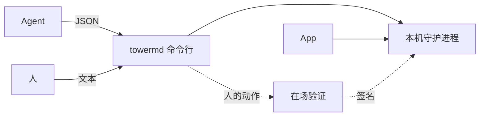
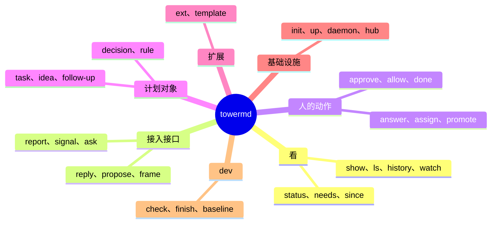
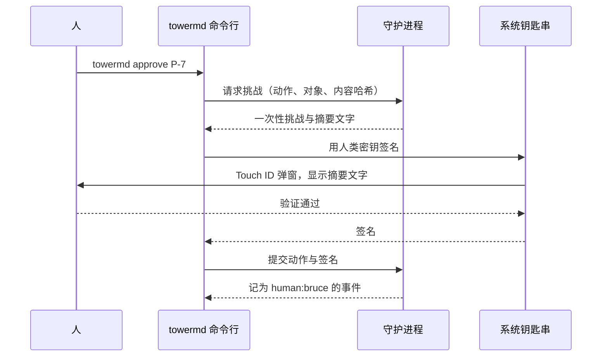

# Tower.md 以命令行为第一入口，人的动作经本机在场验证后才签名

| 项 | 内容 |
| --- | --- |
| 名称 | `towermd` 命令行 |
| 版本 | 命令行规格 v0.1 草案 |
| 姊妹文档 | [核心规格](2026-10-21-spec-towermd-core.md)、[开发套件规格](2026-10-21-spec-towermd-development-kit.md) |
| 读者 | 实现负责人；技能包作者；实现 Agent |

本文新增条款 FR-190–200，并修订核心规格的 FR-95、FR-109、FR-111（第 8 节）。

> **2026-10-23 裁定：C3 不做。**用户决定保留 `AGENTS.md` 的红线"命令行不提供批准类命令"。[^owner-1023]因此：
>
> - 第 4 节（FR-195、FR-196）与 2.3 节的人的动作、`towermd human setup/status/revoke` 暂不实现；人的动作仍只从 App 发出，署名 `human:<id>`。第 8 节对核心规格 FR-95 的修订不生效，FR-95 原文有效。
> - FR-190 的能力对等表中，人的动作一列标为"仅 App"，不算空格。
> - `towermd overview` 不是人的动作，移入 C1。
> - C4 的 `promote` 是人的动作，只在 App 提供；C4 的验收改为"除人的动作在 App 中点按外，其余全部用终端完成一整轮"。

## 0. 结论

**Tower.md 的每一项能力，都先有命令，再有 App 界面。**App 和命令行调用同一个守护进程 API；App 多出来的只是画布的渲染。[^owner-1944]

用户 2026-10-21 定下 4 件事：

| 问题 | 决定 | 本文落点 |
| --- | --- | --- |
| 人的动作（批准、授权、确认完成、立项）能否从命令行发出 | 能。命令行发起，由系统验证人在场后才签 `human:` | 第 4 节，FR-195–196 |
| 帮助和人读输出用什么语言 | 跟随系统语言，缺省英文；JSON 字段、错误码、枚举值永远是英文 | 3.8 节，FR-197 |
| 开发套件专用的命令放在哪里 | 放进 `towermd dev` | 2.7 节 |
| 是否兼容 M1 的命令 | 不兼容。M1 的命令可以重构，不保留旧名和别名 | 第 5 节，FR-200 |

下图是命令行的 4 类读者和它们经过的路径。



怎么读这张图：Agent 和人用同一个命令行，只是输出格式不同。人的动作多走一步在场验证，签名后才进守护进程。App 是守护进程的另一个客户端，与命令行平级。

## 1. 设计原则

1. **能力先落在命令行。**一项功能在命令行里能做之前，不算做完。App 中不存在命令行做不到的动作，画布的渲染和拖动布局除外。
2. **一套命令，两种读者。**Agent 读 JSON，人读文本。命令名、参数、语义完全相同，只有输出格式不同。
3. **命令名用核心名词。**命令名取核心规格第 13 节命名表的英文词，例如 `task`、`decision`、`follow-up`、`frame`。行话（baseline、gate、lease、trailer、harness）只出现在 `towermd dev` 下。
4. **终端也守注意力预算。**不带参数运行 `towermd` 时，最多显示 3 条关注项和 3 行"自上次查看以来"，与 App 首屏相同。
5. **写操作都能安全重试。**每个写操作都带请求 ID；结果未知时，用同一个 ID 重试不会重复写入。
6. **人的动作要人在场。**会扩大授权的动作，必须经系统级的在场验证；Agent 无法代人完成这一步。
7. **不统计用法。**命令行不收集、不上传任何用法数据（核心规格 NFR-13）。

## 2. 命令树

命令分 7 组。下图是总览，各组的完整命令见 2.1–2.7 节。



表中"阶段"一列见第 7 节；"现状"一列中，"已有"指 M1 已实现，"改名"指 M1 已有、本文改名或移位，"新增"指尚未实现。

### 2.1 看（人和受托者）

| 命令 | 作用 | 阶段 | 现状 |
| --- | --- | --- | --- |
| `towermd` | 不带参数：当前项目的"自上次查看以来"3 行摘要和最多 3 条关注项；在项目外运行时显示全部项目总览 | C1 | 新增 |
| `towermd status` | 当前项目、hub 连接、本运行的任务与租约、待送达的插话与回答 | C0 | 已有 |
| `towermd needs [--all]` | 关注清单（Needs You）；`--all` 包括"稍后"中的条目 | C1 | 新增 |
| `towermd since [--from <时间>]` | "自上次查看以来"的变化，或指定时间以来的变化 | C1 | 新增 |
| `towermd overview` | 全部项目总览（All Projects） | C3 | 新增 |
| `towermd show <id>` | 显示任何对象：项目、任务、决策、提案、容器、卡片、中断、证据 | C1 | 新增；取代 `project view` |
| `towermd ls <种类> [--state ...] [--since ...]` | 列出某类对象：`tasks`、`decisions`、`proposals`、`frames`、`follow-ups`、`ideas`、`holds` | C1 | 新增 |
| `towermd history <id> [--since ...]` | 对象的时间线 | C1 | 新增 |
| `towermd watch [--scope <id>]` | 持续输出事件流；JSON 模式下每行一个事件 | C1 | 新增 |
| `towermd open [id]` | 在 App 中打开项目或定位到某个对象 | C1 | 新增 |

### 2.2 接入接口动词（受托者、来源）

这些命令就是核心规格第 5 节的 6 个动词，外加等待。

| 命令 | 作用 | 阶段 | 现状 |
| --- | --- | --- | --- |
| `towermd report --state <状态> --summary <文本> [--next <文本>] [--progress 3/7]` | 汇报进度（FR-115） | C2 | 新增 |
| `towermd signal <kind> --level <级别> --title <文本> [--detail ...] [--value ...]` | 上报信号；级别取 `log`、`passive`、`active`、`time_sensitive` | C2 | 新增 |
| `towermd ask <问题> [--option ...] [--recommended N] [--context ...] [--target ...]` | 提问；`--review <对象>` 表示请求评审 | C0 | 已有；`ask --wait` 删去，统一用 `wait` |
| `towermd wait <id> [--seconds N]` | 等回答或等验证结果，单次最多 90 秒 | C0 | 已有 |
| `towermd reply <request-id> --state <状态> --summary <文本> [--next <文本>]` | 回应一次汇报请求（FR-116、FR-211）；`state` 取 FR-115 的固定词汇，`summary` 不超过 100 字；未回应的请求以 `request_report` 出现在 `delivered[]` 中，直到回应 | C2 | 已有（托付与信任账本，只回应检查点产生的请求） |
| `towermd propose <json>` | 申请改人定内容 | C0 | 已有 |
| `towermd frame show/add/update/move/link/archive` | 按容器规则增改卡片（FR-147 的 `card` 动词） | C2 | 新增；核心规格中写作 `board`，以本文为准 |

### 2.3 人的动作（需要在场验证）

下表的动作都产生 `human:<id>` 署名的事件。"验证"一列见 4.2 节的两档。

| 命令 | 英文界面名 | 作用 | 验证 | 阶段 |
| --- | --- | --- | --- | --- |
| `towermd approve <id>` / `decline <id>` | Approve / Decline | 批准或驳回提案、版本、评审 | 每次 | C3 |
| `towermd allow <id>` / `deny <id>` | Allow / Don't Allow | 授权或拒绝一次请求 | 每次 | C3 |
| `towermd done <task>` | Mark as Done | 确认任务完成（FR-124 的第二种情况） | 每次 | C3 |
| `towermd answer <hold> <文本> [--save-as-decision]` | Reply | 人回答提问；可记为决策 | 每次 | C3 |
| `towermd assign <task> --to <受托者>` | Assign | 委托任务；没有完成标准时拒绝（FR-184） | 每次 | C3 |
| `towermd promote <idea> --as project/task` | Promote | 立项：把想法变成项目或任务（FR-183） | 每次 | C3 |
| `towermd waive <id> --until <时间> --reason <文本>` | Waive | 授予豁免 | 每次 | C3 |
| `towermd level set <范围> <级别>` | Delegation Level | 设置委托级别（FR-185） | 每次 | C3 |
| `towermd rule add <文本> --until <时间> [--scope ...]` | Add Rule | 临时规则（FR-69） | 每次 | C3 |
| `towermd resume <范围>` | Resume | 解除暂停 | 每次 | C3 |
| `towermd hub rebuild` | Rebuild | 从快照重建 hub；验证通过即执行，不再分"请求"和"确认"两步 | 每次 | C3 |
| `towermd send <范围> <文本>` | Send Message | 插话 | 宽限期 | C3 |
| `towermd pause <范围>` | Pause | 暂停；范围是项目、容器、任务或 `--all` | 宽限期 | C3 |
| `towermd follow-up add/done/snooze` | Follow-Up | 管理跟进项 | 宽限期 | C4 |
| `towermd frame new --template <模板>` | New Frame | 建容器（FR-144） | 宽限期 | C4 |

验证不通过时，这些命令一律返回 `needs_human`，不降级执行。

人在 harness 会话里直接回答了 Agent 的提问时，由 Agent 用 `towermd answer <hold> <文本> --relayed` 代为记录。这是受托者的动作，不需要验证，署名 `process:towermd-cli`，带 `data.relayed_from: human`；它只能解开当前提问，不能记为决策（核心规格 FR-96）。`--relayed` 与 `--save-as-decision` 不能同时使用。

### 2.4 计划对象

| 命令 | 作用 | 谁用 | 阶段 | 现状 |
| --- | --- | --- | --- | --- |
| `towermd task add/edit/show/ls` | 任务的增改与查看；受托者建的任务受开发套件 FR-16 限制；`show` 附委托卡、该工作类别的规则、历次退回理由和未回应的汇报请求 | 人、受托者 | C0 | `add`、`show` 已有 |
| `towermd task claim [id] [--harness H --harness-version V] [--vendor V] [--model M] [--skills-version S]` / `release` | 领取或放弃任务并取得租约；启用开发套件时同时绑定工作树与分支；自报配置进入领取事件，作为信任账本的配置指纹（FR-203） | 受托者 | C0 | 已有 |
| `towermd idea add <文本>` | 记下一个未立项的想法；受托者也可以提议 | 人、受托者 | C4 | 新增 |
| `towermd decision show/ls` | 查看决策；`decision retire` 属于人的动作 | 人、受托者 | C1 | 新增 |
| `towermd rule ls` | 查看生效中的临时规则 | 人、受托者 | C1 | 新增 |

### 2.5 扩展

| 命令 | 作用 | 阶段 |
| --- | --- | --- |
| `towermd ext ls` / `show <id>` | 列出和查看已安装的扩展及其清单 | C4 |
| `towermd ext add <路径或地址>` / `remove <id>` | 安装或卸载扩展；属于次要变更，是人的动作，每次验证 | C4 |
| `towermd template ls` | 列出可用模板 | C4 |

### 2.6 基础设施与元命令

| 命令 | 作用 | 阶段 | 现状 |
| --- | --- | --- | --- |
| `towermd init [path] [--docs-dir ...]` | 生成项目 ID、配置与 `AGENTS.md` | C0 | 已有 |
| `towermd up` | 启动守护进程与 App | C0 | 已有 |
| `towermd daemon ensure/status/stop` | 管理本机守护进程 | C0 | 已有 |
| `towermd snapshot` | 立即写一次快照 | C0 | 已有 |
| `towermd rebuild-index` | 重建本机派生索引 | C1 | 新增 |
| `towermd doctor` | 本机自检：守护进程、hub、git、在场验证是否可用；只在本机输出，不上传 | C1 | 新增 |
| `towermd human setup/status/revoke` | 登记、查看、吊销本机的人类签名密钥（第 4 节） | C3 | 新增 |
| `towermd whoami` | 显示本次调用会被记成谁：运行 ID、受托者自报身份、是否能做人的动作 | C1 | 新增 |
| `towermd schema [命令]` | 输出某个命令的输入与输出 JSON Schema | C0 | 新增；取代 `baseline schema` |
| `towermd help [主题]` / `completion <shell>` / `--version` | 帮助、补全、版本 | C0 | `help` 新增 |

### 2.7 开发套件 `towermd dev`

开发套件的命令按"冷启动 → 领取 → 收尾"的顺序重新整理。M1 的 `baseline` 组把扫描和综合草稿混在一起，这里拆成 `scan` 和 `draft` 两组。

| 命令 | 作用 | 阶段 | M1 中的对应 |
| --- | --- | --- | --- |
| `towermd dev scan start` / `wait <id>` / `show <id>` / `cancel <id>` | 冷启动 S1–S5：盘点、聚类、真实运行验证命令；不批准 | C0 | `baseline scan`、`scan --wait`、`show`、`cancel` |
| `towermd dev draft template <scan>` / `submit <json>` / `ls` / `show <id>` | 冷启动 S6：导出综合模板、提交 Agent 的综合结果为未批准草稿 | C0 | `baseline template`、`submit`、`list` |
| `towermd dev check` | 路径守卫与人定内容保护（G2） | C0 | `check` |
| `towermd dev clarify <task> <文件\|->` | 复述待澄清的任务、起草完成标准、提出不超过 3 个问题（FR-201）；文件为 `{"restated", "done_when": [], "questions": []}`；委托卡只由 App 中的人定稿 | C0 | 无 |
| `towermd dev finish [--wait] [--claims <文件>]` | 冻结提交并后台验证（G3、G5）；`--claims` 为 `[{"criterion": 0, "note": "…"}]`，只记为自述，不算证据（FR-209） | C0 | `finish` |
| `towermd dev trailers <task>` | 输出合并 trailer，供 `git commit --amend` 使用 | C0 | `trailers` |
| `towermd dev seed <一句话>` | 一句话长出代码骨架 | 开发套件 M2 | 无 |
| `towermd dev run` / `queue` / `adapters` | 无头运行、合并队列、harness 适配器 | 开发套件 M3 | 无 |

各子命令的 JSON Schema 用 `towermd schema dev.<组>.<命令>` 取得，例如 `towermd schema dev.draft.submit`。

## 3. 调用约定

### 3.1 上下文定位

- 项目：按当前目录所在的 git 仓库确定；可用全局参数 `--project <路径或项目 ID>` 覆盖。
- 运行：按"本机 + 当前工作树 + 当前分支"确定（开发套件 FR-113）；可用全局参数 `--run <id>` 覆盖。不用环境变量定位运行，因为同一终端里的多个 Agent 共用环境。
- 全局参数：`--project`、`--run`、`--json`、`--text`、`--lang`、`--request-id`、`--quiet`。

### 3.2 输出：一个信封，两种格式

- **FR-191** 标准输出是终端时，命令输出人读文本；不是终端时（管道、文件、Agent 调用），输出 JSON。`--json` 和 `--text` 可以强制指定。`watch` 在 JSON 模式下每行输出一个 JSON 对象。JSON 输出总是同一个信封：

```json
{
  "v": 1,
  "ok": true,
  "data": { },
  "delivered": [
    { "kind": "prompt", "from": "human:bruce", "scope": "T-2-4", "text": "先别改公共接口", "at": "2026-10-21T19:50:00+09:00" }
  ],
  "next": [
    { "cmd": "towermd wait H-12", "why": "问题还没有回答" }
  ],
  "warnings": []
}
```

`data` 是命令自己的结果，格式由 `towermd schema <命令>` 给出。`next` 是建议的下一步命令，供 Agent 直接使用；人读模式下显示在末尾。

- **FR-194** 插话和回答的送达（核心规格 FR-109）放进信封的 `delivered` 字段，不再作为独立的输出段落。人读模式下，送达内容仍排在输出最前面。只有当命令成功写出输出后，送达才记为 `prompt.delivered`（沿用 M1"实际输出成功后才标为已读"的做法）。

### 3.3 错误码与退出码

- **FR-192** 失败时，JSON 信封为 `"ok": false`，并带 `error`：

```json
{
  "v": 1,
  "ok": false,
  "error": {
    "code": "lease_busy",
    "message": "Task T-2-4 is claimed by another delegate.",
    "hint": "Run `towermd ls tasks --state ready` to find another task.",
    "retry": { "safe": true, "request_id": "0193f0c2-..." }
  },
  "delivered": [],
  "next": [ { "cmd": "towermd ls tasks --state ready", "why": "找可领取的任务" } ]
}
```

`code` 是稳定的英文标识，Agent 按它分支；`message` 和 `hint` 按 3.8 节的语言显示。退出码按类别固定：

| 退出码 | 类别 | 例子 |
| --- | --- | --- |
| 0 | 成功 | |
| 1 | 内部错误 | 未预期的异常 |
| 2 | 用法错误 | 缺参数、参数冲突、`too_long` |
| 3 | 找不到 | `not_found`、`not_initialized` |
| 4 | 冲突 | `lease_busy`、`stale_epoch`、`conflict` |
| 5 | 还在等 | `pending`、`deferred`：用 `wait` 继续 |
| 6 | 被拦下 | `guard_blocked`、`gate_failed`、`needs_proposal` |
| 7 | 需要人 | `needs_human`：在场验证失败或不可用 |
| 8 | 连不上 | `daemon_unavailable`、`hub_offline` |

### 3.4 幂等与重试

- **FR-193** 每个写操作都接受 `--request-id`。省略时由命令行生成，并写进输出（成功时在 `data.request_id`，失败时在 `error.retry.request_id`）。结果未知（超时、断网）时，用同一个请求 ID 重试，守护进程返回第一次的结果，不重复写入。M1 的 `ask`、`propose`、`finish`、`trailers`、`pause`、`resume` 已经这样做，本条把它推广到全部写操作。

### 3.5 输入

- 简单输入用参数；结构化输入用 `--json <文件>`，`-` 表示从标准输入读取。
- 长度限制与核心规格一致：标题不超过 30 字，摘要与关注卡正文不超过 100 字。超出时返回 `too_long`，`hint` 写明上限，不自动截断。
- 输入文件上限 2 MiB（沿用 M1 的 `baseline submit`）。

### 3.6 等待

- 会等待的命令（`ask`、`wait`、`dev finish --wait`）单次最多阻塞 90 秒，低于常见 Agent 工具的命令超时。没等到时返回退出码 5 和 `next: towermd wait <id>`。
- 累计等待超过 `live_wait_max`（默认 10 分钟）时返回 `deferred`，受托者结束当前回合（核心规格 FR-59）。
- 人用 `watch` 持续看变化；`watch` 不续租、不改变任何状态。

### 3.7 离线

- 读命令在守护进程可用时都能执行；hub 断开时，读到的是本机最后的投影，`warnings` 中注明"hub 离线，数据截至某时间"。
- 普通写命令在 hub 断开时进入本机发件箱（核心规格 FR-88），`data.queued: true`。
- 领取、续租、人的动作必须在线，离线时返回退出码 8。

### 3.8 语言

- **FR-197** 帮助文本、`message`、`hint` 和人读输出跟随系统语言：按 `--lang`、环境变量 `TOWERMD_LANG`、`LC_ALL`、`LANG`、macOS 的首选语言依次确定；都没有，或该语言没有译文时，用英文。第一版提供英文和简体中文。JSON 的字段名、`error.code`、枚举值（状态、级别）、命令名和参数名永远是英文，不翻译。
- 人读输出的名词使用核心规格第 13 节的命名表：英文界面显示 Needs You、Follow-Up、Mark as Done；中文界面显示关注清单、跟进项、确认完成。

### 3.9 终端里的注意力

- **FR-198** 不带参数运行 `towermd` 时，输出遵守核心规格的注意力预算：最多 3 条关注项，按 FR-128 排序；"自上次查看以来"不超过 3 行；有更多条目时只写"另有 N 条，运行 `towermd needs --all` 查看"。每条关注项后面给出一步就能处理它的命令。
- 颜色只表示含义，同时用文字区分；遵守 `NO_COLOR`。不输出进度动画；需要等待时只打印一行说明。
- 人在终端里运行 `towermd`、`needs`、`since` 时，更新"上次查看"的时间；Agent 调用（非终端）不更新。

人读模式的样子如下（中文系统）：

```text
$ towermd
婚礼筹备 · 自上次查看以来（2 天前）
  完成 4 项：确认场地、发出 60 份请柬……
  卡在：餐饮报价，等对方回复已 3 天
  需要你：2 件

关注清单
  1. 提问 · 菜单 · 预算超出 12%，是减一道菜还是加预算？（推荐：减冷盘）
     towermd answer H-31 "减冷盘"
  2. 评审 · 座位表 · 受托者重排了 8 桌，变化 3 处
     towermd show P-7    towermd approve P-7
另有 1 条，运行 towermd needs --all 查看
```

### 3.10 帮助与发现

- **FR-199** 每个命令都能用 `towermd schema <命令>` 取得输入与输出的 JSON Schema，`towermd help <命令>` 给出说明和至少 1 个例子。帮助按 2.1–2.7 节分组显示；`towermd dev` 的命令只在 `towermd help dev` 中列出。技能包引用命令时，以 `schema` 的输出为准，不靠解析帮助文本。

## 4. 人的动作：在场验证

### 4.1 为什么要验证

**命令行能发人的动作以后，最大的风险是 Agent 自己放行自己。**Agent 和人用同一个系统账号、同一个命令行。所以"人在场"不能靠命令行自己判断，必须交给 Agent 无法代劳的系统机制：macOS 的 Touch ID 或登录密码。依据：用户 2026-10-21 的决定；它把核心规格 v0.5 5.4 节"安全加固"中的人类密钥签名提前。[^owner-1944][^core]

### 4.2 两档验证

- **FR-196** 人的动作分两档：
  - **每次验证**：会扩大授权或改变人定内容的动作（2.3 节表中标"每次"的命令）。每次执行都弹出系统验证。
  - **宽限期**：只影响当前工作、风险较低的动作（插话、暂停、跟进项、建容器）。验证一次后，同一个终端会话在宽限期内不再弹窗；宽限期默认 5 分钟，可以改短或关闭，不能改长到 30 分钟以上。

### 4.3 签名流程

- **FR-195** 人的动作按以下流程签名：



怎么读这张图：守护进程先出一次性挑战，签名在钥匙串里完成，验证弹窗由系统显示。命令行拿不到私钥，只拿到签名。

具体规则：

1. **密钥。**人类密钥是 Secure Enclave 中的 P-256 密钥，访问控制要求"用户在场"（Touch ID 或登录密码）。私钥不离开 Secure Enclave，不写入仓库。
2. **登记。**`towermd human setup` 生成密钥后，必须在 App 中确认一次：App 显示 6 位确认码，与终端显示的一致时人点确认。守护进程只接受已登记公钥的签名。登记和吊销本身也是人的动作。
3. **签名内容。**签名覆盖：动作、对象 ID、对象内容哈希、目标版本号、请求 ID、守护进程给出的一次性挑战和时间。挑战 2 分钟内有效，用过即作废，防止重放。
4. **弹窗文字。**系统弹窗显示守护进程给出的摘要，例如"Tower.md：批准提案 P-7《拆分 A-sync》，影响 3 个对象"。人看到的就是将被签名的内容。
5. **终端检查。**命令的标准输入和标准输出都必须是终端，否则直接返回 `needs_human`，不弹窗。这样 Agent 在后台调用时不会弹出让人误点的窗口。
6. **失败时。**验证失败、取消、不可用时，返回退出码 7 和 `needs_human`，`next` 给出 `towermd open <id>`，人可以改在 App 中处理。
7. **审计。**事件记录验证方式（`touch_id`、`password`、`app`）和公钥 ID。App 中的批准与命令行中的批准记录格式相同。
8. **平台。**第一版只支持 macOS。其他平台在实现前，人的动作仍只能在 App 中完成（与 M1 相同）。

### 4.4 前提与限制

- **需要签名的构建。**只有用同一开发者证书签名的 `towermd` 和 App 才能访问钥匙串中的人类密钥（钥匙串访问组按代码签名限制）。当前的 v0.1.1 预览版没有签名，所以 C3 阶段的前提是有 Developer ID 签名的构建。签名之前，人的动作仍走 App。
- **不防人"条件反射"地点确认。**在场验证保证"有人按了 Touch ID"，不保证"人看清了"。缓解办法是弹窗显示摘要、终端检查（规则 5），以及关注清单中的"人定内容被改"信号仍照常出现。
- **不防恶意 Agent 的全部手段。**例如 Agent 修改命令行二进制。代码签名可以挡住被改过的二进制访问密钥，但这依赖签名构建；核心规格的威胁模型（防粗心、不防恶意）不变。

## 5. 对 M1 命令的重构

- **FR-200** 命令行按本文第 2 节重构，不兼容 M1 的命令：不保留旧名，不提供别名。同一次改动中，技能包、`.towermd/AGENTS.md` 模板、使用说明和测试一起改用新命令。依据：用户 2026-10-21 19:52 的决定。[^owner-1952]

| M1 命令 | 重构后 | 说明 |
| --- | --- | --- |
| `check`、`finish`、`trailers` | `dev check`、`dev finish`、`dev trailers` | 移到开发套件下 |
| `baseline scan/show/cancel` | `dev scan start/show/cancel`，`dev scan wait` | 扫描单独成组 |
| `baseline template/submit/list` | `dev draft template/submit/ls` | 综合草稿单独成组 |
| `baseline schema` | `towermd schema dev.draft.submit` | 统一由 `schema` 输出 |
| `project view` | `show <项目>` | 统一由 `show` 查看任何对象 |
| `ask --wait <id>` | `wait <id>` | 等待只有一个入口 |
| `answer`（转述） | `answer --relayed`（受托者）；`answer`（人，需验证） | 两种语义用参数显式区分，不再隐式降级 |
| `pause --all`、`resume --all` | `pause <范围>`、`resume <范围>` | 可以只暂停一个任务或容器；`resume` 需验证 |
| `hub rebuild`（请求）加 App 确认 | `hub rebuild`（需验证，一步完成） | App 中的确认按钮仍保留，与命令行平级 |
| `status`、`task add/claim/show/release`、`propose`、`snapshot`、`init`、`up`、`daemon ...`、`wait` | 名字不变 | 输出改用第 3 节的信封 |
| 技能中引用的 `review request`（未实现） | `ask --review <对象>` | |

需要同步重写的技能：`towermd-finish`、`towermd-baseline`、`towermd-ask`、`towermd-claim`。M1 的命令契约测试按新命令重写。

## 6. 新增条款

FR-191–199 已在第 3 节中给出。其余两条：

- **FR-190** 命令行与 App 的能力对等。每项能力都在守护进程 API 中实现一次；命令行和 App 都只调用这个 API。新增一项人的动作时，同一个版本内同时提供命令行命令和 App 按钮。验收：一张"能力对等表"列出每个守护进程端点对应的命令和 App 入口，测试检查表中没有空格，画布渲染与布局拖动除外。
- **FR-200** 见第 5 节。

## 7. 实现顺序

| 阶段 | 内容 | 验收口径 |
| --- | --- | --- |
| C0 契约与重构 | JSON 信封与 `delivered` 字段（FR-191、FR-194）；错误码与退出码（FR-192）；全部写操作带请求 ID（FR-193）；语言（FR-197）；`schema` 与 `help`（FR-199）；按第 5 节重构命令（FR-200）；技能、`AGENTS.md` 模板与使用说明同步改写 | 每个命令都有契约测试：成功与失败的信封都符合 `schema`；M1 的功能测试改用新命令后全部通过；仓库中不再出现旧命令名（技能、模板、文档、测试） |
| C1 看 | 不带参数的概览（FR-198）；`needs`、`since`、`show`、`ls`、`history`、`watch`、`open`、`doctor`、`whoami`、`rebuild-index` | 离开 1 天后，只用终端在 1 分钟内说出到哪了；输出从不超过 3 条关注项 |
| C2 接入接口 | `report`、`signal`、`reply`、`frame`（核心第 1、2 阶段） | 一个 20 行的 shell 脚本只用这些命令就能出现在画布上 |
| C3 人在场（2026-10-23 裁定不做，见开头说明） | `human setup/status/revoke`；2.3 节全部人的动作；`overview`（移入 C1）；能力对等表（FR-190，人的动作标"仅 App"） | 前提是签名构建。Agent 在后台调用 `approve` 时 100% 返回 `needs_human` 且不弹窗；人在终端里批准后，事件与 App 中批准的事件格式相同 |
| C4 计划与扩展 | `idea`、`promote`、`follow-up`、`frame new`、`ext`、`template` | 不打开 App，只用终端完成"记想法 → 立项 → 委托 → 确认完成"一整轮 |

开发套件的 `dev seed`、`dev run`、`dev queue`、`dev adapters` 按开发套件规格第 18 节的 M2、M3 排期。

## 8. 对其他文档的修订

本文修订以下条款。核心规格和开发套件规格中的对应位置，已按本节加注修订说明。

| 条款 | 原文要点 | 修订后 |
| --- | --- | --- |
| 核心规格 FR-95 | 命令行不提供批准类命令，批准只能从 App 发出 | 批准类动作可以从 App 发出，也可以从命令行经在场验证后发出（FR-195）；不能验证时，命令行仍不提供批准 |
| 核心规格 FR-111 | `human:` 署名的事件都必须从 App 发出 | `human:` 署名的事件来自 App，或来自经在场验证签名的命令行；未经验证的命令行事件仍署名 `process:towermd-cli` |
| 核心规格 FR-109 | 送达内容排在输出最前面 | JSON 模式下放进信封的 `delivered` 字段（FR-194） |
| 核心规格 FR-147 | 卡片命令写作 `towermd board ...` | 以 `towermd frame ...` 为准，与命名表一致 |
| 核心规格 11.1 节、开发套件规格 16.1 节 | 命令表 | 以本文第 2 节为准；开发套件的旧命令名作废（FR-200） |

以下两处是仓库的产品准绳，本次没有改，需要你确认后再改：

- 仓库根目录 `AGENTS.md` 的不变量"人机署名不混……只能从 App 发出；命令行不提供批准类命令"。
- `docs/product-principles.md` 中相应的表述。

## 9. 风险与待决问题

| 风险 | 影响 | 当前处理 |
| --- | --- | --- |
| 弹窗太多，人开始不看就点 | 在场验证名存实亡 | 宽限期覆盖低风险动作；摘要文字写清对象和影响；关注清单把同类请求合并后再请人批 |
| 没有签名构建 | C3 无法实现 | C0–C2 不依赖签名；C3 之前人的动作仍走 App |
| Agent 与人共用一个终端会话 | 宽限期内 Agent 可能借用验证 | 宽限期绑定终端设备和登录会话，且只覆盖低风险动作；Agent 工具通常不以终端方式运行命令，此时规则 5 直接拒绝 |
| 非终端默认输出 JSON | 人把输出接到 `less` 时看到 JSON | 用 `--text`；也可以在配置中改默认值 |
| 英文命令名对中文用户不直观 | 学习成本 | 命令名与 App 的英文界面一致；中文帮助给出对照 |

待决问题：

1. **立项的英文名**暂定 Promote，命令为 `towermd promote`。核心规格第 13 节的命名表还没有收这个词。
2. **宽限期的默认值**暂定 5 分钟。
3. **`towermd` 不带参数、在项目外运行时**，本文定为显示全部项目总览；另一种做法是只提示 `towermd init`。
4. **Linux 与 Windows 上的在场验证**用什么机制（例如 Windows Hello、polkit），第一版不做。

[^owner-1944]: 2026-10-21 19:44 用户要求："能否先设计规划一下 cli，本项目 cli 优先。"随后在 3 个选项中选定：命令行可发起人的动作、由系统验证确认；跟随系统语言、缺省英文；开发套件命令放进 `towermd dev`。
[^owner-1952]: 2026-10-21 19:52 用户补充："无须考虑兼容，兼容旧命令那一块都可以重构。"
[^owner-1023]: 用户 2026-10-23 在实现规划中的裁定：保留红线，不做 C3。
[^core]: [Tower.md 核心规格](2026-10-21-spec-towermd-core.md)，10.3 节"人机署名与批准"与 FR-95、FR-111；安全加固的原文见 v0.5 5.4 节。
