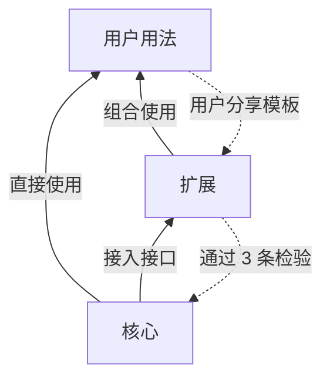

# Tower.md 核心只为人脑的共同局限建抽象，开发等场景经扩展接入

| 项 | 内容 |
| --- | --- |
| 名称 | Tower.md（命令行 `towermd`）。与 Note.md 成对：Note.md 管知识，Tower.md 管行动 |
| 版本 | 核心规格 v0.6 草案。由规格 v0.5 拆出，并入 2026-10-21 的注意力需求[^v05][^attention] |
| 姊妹文档 | [开发套件规格](2026-10-21-spec-towermd-development-kit.md)：git 分支与工作树、代码模块、验证命令、harness 适配器、无头双环与合并队列[^devkit] |
| 归属依据 | [产品边界文档](../../../sotvault/project/towermd/2026-10-21-product-towermd-boundary-core-extensions-emergent.md)及其第 10 节的 4 项已定决策[^boundary][^owner-1910] |
| 读者 | 产品、架构与实现负责人；扩展作者；实现 Agent |

**编号约定。**FR 编号是稳定引用：v0.5 的 FR-01–113 与注意力需求的 FR-114–180 保持原号，只换所在文档；本次新增条目从 FR-181 起。每一条的去处见附录 B。条款中的节号指本文的节号。

## 修订记录

| 日期 | 修订 |
| --- | --- |
| 2026-10-21 | 新增[命令行规格](2026-10-21-spec-towermd-cli.md)；按它修订 FR-95、FR-109、FR-111，卡片命令改为 `towermd frame`。 |
| 2026-10-21 | v0.6：按用户决定把规格 v0.5 拆成核心规格和开发套件规格，并入当天的注意力需求，去掉与新方向冲突的内容（见 0.2）。只改文档，M1 已实现的代码不变。[^owner-1910][^owner-1925] |

## 0. 摘要

### 0.1 核心只做一件事

**用户怎么用 Tower.md，我们预测不了；人脑在哪里会出错，我们预测得了。**所以核心只做一件事：替人脑补上它在多任务、快速放行和长期跟进中的共同短板。任何以某个场景为前提的东西，都不进核心。[^boundary]

产品分 3 层：

| 层 | 是什么 | 谁决定 | 本文是否规定 |
| --- | --- | --- | --- |
| 核心 | 从人脑共同局限推出的少数名词、动作和系统能力，加上扩展机制和基础设施 | Tower.md，变化很慢 | 是 |
| 扩展 | 模板、检查、连接器、技能包、实践包、套件；第一方的开发套件也在这一层 | 核心定接口，第一方和社区实现 | 只规定接口；开发套件另有规格 |
| 用户用法 | 用户把核心和扩展组合出来的工作方式 | 用户 | 否。核心不统计用法，只接收用户主动分享的模板 |

下图从下往上读：核心不知道上面两层的存在，扩展只经接入接口使用核心。



实线是依赖方向；虚线是功能升级的通道。功能只能沿虚线逐层下沉，不能跳过检验直接进核心。

### 0.2 与 v0.5 相比去掉的偏差

v0.5 以软件开发为前提写成。下表列出本版去掉或改写的内容。

| 偏差 | v0.5 或注意力需求中的写法 | 本版 |
| --- | --- | --- |
| 核心以代码工程为前提 | 模块有路径和验证命令；基线是 Git 标签；检查点是提交；G0–G6 都在核心 | 这些移到开发套件。核心只保留场景无关的名词；门禁只保留 G0、G6 和"请求人评审"（FR-124、6.3 节） |
| 六层对用户可见 | L0–L5 出现在界面和用户旅程中 | 对用户只呈现"人定的"和"受托者推进的"两类；`layer` 字段留在内部和开发套件中（FR-188） |
| 核心里有项目类型 | 项目在配置中选 `software`、`research`、`creative`；起步模板按画像推荐；插件清单写 `applies_to` | 删除项目画像。起步套装是扩展，在用户放进第一批内容后推荐，不要求选择（附录 A.1） |
| 首次打开要选场景 | 冷启动先问用户文档目录，一句话生长从空画布开始 | 第一次打开只有空画布和一句话输入框，不问项目类型和使用场景；场景引导（onboarding）以后单独设计（FR-181） |
| pin 只是收藏 | "固定关注，加入个人 pin 列表，最多 5 个" | 换成带到点条件的跟进项（Follow-Up，FR-134） |
| 名词带场景和行话 | 工作线、事项、参与者、参与接口；信号级别 info、watch、act、stop；界面出现 baseline、gate、hold、harness | 按第 13 节的命名表第一版：项目、任务、受托者、来源、接入接口；信号级别 `log`、`passive`、`active`、`time_sensitive`；行话只留在开发者接口和开发套件中 |
| 用法统计 | 产品边界文档初稿把"用法统计与模板分享"排在核心第 3 阶段 | 不做用法统计（NFR-13）。升级通道只靠用户主动分享模板 |

### 0.3 名字、与 Note.md 的关系、非目标

名字取自空管塔台（control tower）。塔台不开飞机，只掌握全局、给出放行、在冲突前叫停。这正是 Tower.md 与受托者的关系。后缀 `.md` 表示状态是仓库里的纯文本，任何 Agent 都能读，不锁定在某个服务里。

Note.md 管知识，Tower.md 管行动：Note.md 回答"凭什么相信"，Tower.md 回答"谁在什么时间前负责什么"。两者不保存对方的状态，只互相引用；知识进入行动要经人批准的提案，行动回写知识只写已关闭的任务和决策摘要（设计原则第 6–8 条，附录 A.3）。[^principles]

v0.1 不做：多人协作与权限体系；Tower.md 运营的云服务（多机 hub 由用户自部署）；自研模型或 Agent 循环；工时、排班等传统项目管理功能。

## 1. 放置检验：3 条

一项功能要进入核心，必须同时通过 3 条检验。只通过前 2 条的放进扩展层；3 条都通不过、但用户确实在这样用的，留在用户用法层，核心只提供材料。[^boundary]

1. **局限检验**：这项功能能否追溯到第 2 节中的某一条人脑局限？不能追溯的，不是核心。
2. **场景无关检验**：把它放进 3 个毫不相关的用途（例如写一个软件、做一项长期研究、准备一场婚礼），它的形态是否不变？只要换个场景就得改名字、改规则或改流程，就不是核心。
3. **一致性检验**：如果交给扩展各自实现，是否会破坏人的信任或认知一致性？例如每个扩展自己决定何时打扰人，人就无法预期打扰。会破坏的，必须由核心统一实现。

**反例。**"看板"能追溯到工作记忆局限（检验 1 通过），但婚礼筹备的人未必想要看板（检验 2 不通过），所以看板是模板。"把卡片按某个字段分栏"能通过 3 条检验，所以是核心的布局能力。

## 2. 人脑的 10 条共同局限

下表是核心的唯一来源。每一项核心抽象都必须能指回其中至少一条。

| # | 局限 | 表现 | 对产品的要求 |
| --- | --- | --- | --- |
| H1 | 工作记忆很小 | 同时只能把握约 4 个组块 | 每次只给少数几件事；内容逐层展开 |
| H2 | 切换和打断代价高 | 被打断后要花时间才能回到原来的思路 | 控制打扰的时机和频率；能成批处理 |
| H3 | 前瞻记忆差 | "到时候要做的事"到点时想不起来 | 由系统在条件满足时提醒 |
| H4 | 重返时找不到"我在哪" | 离开几天后，要重读很多东西才能接上 | 重返时直接告诉人变化和下一步 |
| H5 | 空间记忆强，识别优于回忆 | 记得东西"在哪儿"，认得出比想得起容易 | 位置稳定；用看得见的形状代替要回忆的名字 |
| H6 | 看不出什么变了 | 两个画面之间的变化常被忽略 | 显式标出变化，可以沿时间回看 |
| H7 | 未完成的事占着心 | 没有关闭、也没有计划的事会反复冒出来 | 每件事都有明确的状态和下一步；可以安心搁置 |
| H8 | 对自动化要么全信要么全不信 | 要么不检查就放行，要么什么都亲自看 | 让人知道哪些可信、凭什么可信；信任可以逐步调整 |
| H9 | 判断次数有限 | 一天中要做的判断越多，质量越差 | 少问；同一个问题不问第二遍；给推荐选项 |
| H10 | 遗忘 | 长期搁置的事，上下文会丢失 | 按节奏让旧事重新浮现，并附上当时的上下文 |

背景研究的出处见产品边界文档第 2 节。[^boundary]

## 3. 核心概念

### 3.1 7 个名词

核心只认识 7 种东西。名称必须对任何场景都成立；开发、研究、创作中的叫法由扩展换上。

| 名词 | 英文界面名 | 接口名 | 定义 | 对应局限 |
| --- | --- | --- | --- | --- |
| 项目 | Project | `project` | 一件需要跟进的事，可以是一个产品、一项研究、一个念头 | H7、H10 |
| 任务 | Task | `task` | 项目中可以单独完成的一步 | H7 |
| 完成标准 | Done When | `done_when` | 任务怎样算完成；由人定稿 | H8 |
| 受托者 | Delegate | `delegate` | 可以接受委托、执行任务的一方：人、AI Agent、自动化程序 | H8 |
| 信号 | 界面上显示为 Update 或 Alert | `signal` | 受托者或来源上报的"值得注意的事"，带级别 | H1、H2 |
| 决策 | Decision | `decision` | 人做过的判断，可以被引用 | H9 |
| 视图 | View | `view` | 人看项目的方式：画布、容器、时间 | H5、H6 |

另有两个辅助概念，它们不是新的名词：

- **来源（Source）**：只上报状态、不接受委托的检查和连接器。来源属于扩展层。
- **版本（Version）**：人批准过的一组人定内容。开发套件把它实现为基线（baseline）和 Git 标签。

每一项内容都标明是谁定的：

- **FR-188** 每一项内容都带"谁定的"属性 `set_by`，取值 `human` 或 `delegate`。`human` 表示人定的内容，只有人能改（FR-02）；`delegate` 表示受托者推进的内容，人只读（FR-47）。界面只呈现这两类。内部的 `layer` 字段（FR-01）继续存在，换算关系是：L0–L3 为 `human`，L4–L5 为 `delegate`。开发套件可以在两类之内再细分（见开发套件规格第 3 节）。依据：H8；产品边界文档建议 2。[^boundary]

### 3.2 人的 6 个动作

人在 Tower.md 里只做 6 件事。核心要让每件事都能在一步之内完成。

| 动作 | 英文按钮 | 含义 | 对应局限 |
| --- | --- | --- | --- |
| 看 | View | 打开、缩放、下钻、沿时间回看 | H1、H4、H6 |
| 放行 | Approve、Allow、Mark as Done | 批准、授权、确认完成 | H8 |
| 回答 | Reply | 回应受托者的提问 | H9 |
| 委托 | Assign | 把一个任务交出去，写清完成标准 | H7、H8 |
| 插话 | Send Message | 在进行中改方向，或给一条临时规则 | H2 |
| 提问 | Ask About This | 对任何对象问"怎么回事" | H4、H8 |

### 3.3 系统的 6 项能力

| 能力 | 英文 | 做什么 | 对应局限 | 本文条款 |
| --- | --- | --- | --- | --- |
| 注意力调度 | Attention | 信号分级；立即、下次查看、摘要三种打扰时机；首屏最多 3 条；合并、去重；专注时段 | H1、H2、H9 | 第 7 节 |
| 重返与跟进 | Catch Up and Follow Up | "自上次查看以来"摘要；跟进项；休眠与按节奏浮现；汇报请求与失联提示 | H3、H4、H7、H10 | 7.2、7.4 节 |
| 稳定的空间视图 | Canvas | 无限画布；位置只由人定；固定的视觉词汇；容器；嵌套与跨层连线；旁注 | H5 | 第 8 节 |
| 时间维度 | History | 变化高亮；时间滑块回放；任意时间范围过滤 | H6、H10 | 8.7 节 |
| 信任校准 | Trust | 完成只认证据或人的确认；承诺弱化检测；兜圈子检测；委托级别；人与 AI 的署名分开 | H8 | 第 6 节、10.4 节 |
| 判断留存 | Decisions | 回答可以记为决策；同类问题引用已有决策；决策带复查日期 | H9 | 6.4 节 |

### 3.4 核心要说"不"的事

- **不让用户在开始时选择项目类型或场景。**第一次打开就是一张空画布和一句话输入框（FR-181）。
- **不内置任何方法论。**看板、敏捷、GTD、OKR、TDD、UML 都是模板或实践包。
- **不判断工作做得好不好。**核心只判断"有没有证据"和"人有没有确认"。好坏由扩展中的检查定义。
- **不规定节奏和数字。**复查间隔、休眠天数、阈值都有默认值，都可以改，并且不写进核心概念。
- **不做编排引擎。**谁领什么事、几个 Agent 并行、怎样分工，是扩展和用户的事。核心只提供租约和署名，保证不冲突、可追溯。
- **不让扩展自己决定何时打扰人。**扩展只能声明信号级别。
- **不统计用法。**见 NFR-13。

### 3.5 已实现对象与核心名词的对应

M1 的实现沿用 v0.5 的对象类型，代码不变。下表供实现者对照；界面和对外文档使用左列的名称。

| 核心名词或概念 | M1 中的对象或机制 | 说明 |
| --- | --- | --- |
| 项目 | 一个初始化了 Tower.md 的仓库，以 `project_id` 标识（FR-98） | 多项目总览见 FR-133 |
| 任务 | `Task` | 任务的路径、模块等字段属于开发套件 |
| 完成标准 | `Acceptance` 的 `criteria` | 验证命令属于开发套件 |
| 受托者 | 运行（`Run`）的执行方；actor `<harness>/<version>`、`human:<id>`、`process:<id>` | harness 适配器属于开发套件 |
| 信号 | `alert.*`、`hold.*`、`gate.*` 事件 | 级别按 5.3 节换算 |
| 决策 | `Decision` | 不变 |
| 视图 | `tower.canvas` 与 Z0–Z3 | 不变 |
| 版本 | `Baseline` 与标签 `towermd/B<n>` | 标签是开发套件的实现 |
| 容器 | 带 `towermd.container` 键的 `group` 节点（FR-154） | M2 起实现 |
| 模块 | `Module` | 开发套件的对象：一个绑定代码路径和验证命令的容器 |

### 3.6 权限与变更等级

- **FR-01** 每个对象带 `layer` 字段，权限检查以 `layer` 为准，而不是以文件位置为准。`layer` 是内部字段，按 FR-188 换算成对用户可见的 `set_by`。
- **FR-02** 人定的内容只能经人在 App 中的批准修改，由持有主干租约的守护进程提交（FR-95）。受托者对人定内容的修改，在合并前被拒绝，或在合并后被检出（FR-103）。
- **FR-03** 变更等级分 3 种：主要变更（改人定内容，须人批准并生成新版本）、次要变更（改流程配置，须登记）、豁免（带有效期的临时偏离，不改变版本）。

## 4. 用户旅程

用户旅程不预设场景。下文的例子有意取自互不相关的用途。

### 4.1 第一次打开

- **FR-181** 第一次打开 Tower.md 时，App 只显示一张空画布和一句话输入框。App 不询问项目类型、使用场景或工作方法，也不要求选择模板。项目是什么，由用户放进来的东西决定。场景引导（onboarding）以后单独设计，不进入本版的任何阶段。依据：用户 2026-10-21 的决定。[^owner-1910]

### 4.2 两种起头方式

- **FR-182** 核心提供两种起头方式，两者都不要求选择场景：
  - **从一句话开始**：用户在输入框写一句话，例如"准备 11 月的婚礼"或"做一个把会议录音转成待办的命令行工具"。系统建一个项目，写下这句话作为项目的目标，并可以提最多 3 个澄清问题；问题只针对这句话本身，用户可以全部跳过。接下来由受托者起草任务和完成标准，人批准后成为第一个版本。
  - **从已有材料开始**：用户把一个文件夹、一组文档或一个已有仓库放进来。系统把已有材料作为引用节点放上画布，由受托者起草结构，人审阅后批准为第一个版本。

  开发套件为这两种方式提供面向代码的实现：从一句话长出可运行的代码骨架，以及冷启动扫描源码、生成模块草图（见开发套件规格第 8、9 节）。其他扩展也可以提供自己的实现。

### 4.3 日常：看、放行、插话

1. 用户打开画布，首屏显示"自上次查看以来"的 3 行摘要和不超过 3 条关注项（FR-128、FR-131）。
2. 用户点开关注项，下钻到项目、任务、原文。
3. 用户批准或驳回提案，回答提问，或确认完成；这 3 种动作都能在关注卡上一步完成（FR-138）。
4. 用户选中一个对象，在临时面板中插话，例如"这周先别联系场地"或"A-sync 先别改依赖版本"（FR-68）。
5. 用户关闭画布，受托者继续工作。

### 4.4 改结构：草稿版本

1. 用户进入草稿模式，在画布上增删、拆分、合并人定的对象，或改完成标准。
2. 系统对比当前版本与草稿，列出受影响的任务、决策和受托者。
3. 用户批准后，新版本生效，画布平滑过渡（FR-46）；与旧版本冲突的任务标为"需复核"（FR-38）。

### 4.5 一次提问

1. 受托者遇到一个完成标准没写清的问题，经接入接口发出 `ask`。
2. 系统先查已有决策：同一问题已有决策覆盖时直接引用作答（FR-62）。
3. 没有可引用的决策时，对应节点出现提问图标，关注清单出现一张卡。
4. 人在卡片上选推荐选项，并勾选"Save as Decision"。
5. 受托者收到回答后继续；同一问题之后不再问第二遍。

### 4.6 立项：想法变成承诺

- **FR-183** 想法和承诺分开。从对话、连接器或输入框进来的想法，先作为线索或未立项的卡片挂在画布上，不进入关注清单，也不派给受托者。人点"立项"后，想法才成为项目或任务。立项卡宜写清完成标准和期望的交付时间；没写完成标准的任务不能委托（FR-184）。同时立项的数量与关注清单共用注意力预算：人在一次查看中立项超过 3 个时，App 提示"另有 N 个已立项的事还没有人跟进"。依据：H7；红军"明天把结果交给我"的设想与李峻"想法太多压得喘不过气"的经验。[^hj]

### 4.7 委托与委托级别

- **FR-184** 委托（Assign）是人的动作。委托前，任务必须有完成标准（G0）。委托卡可以再写两项，都是可选：边界（哪些地方不许碰）、检查点（在哪一步停下来给人看）。缺完成标准时，委托按钮不可用，并提示补写。依据：H7、H8；红军分析稿 6.3.2 节。[^hj]
- **FR-185** 人可以为一个项目、一个受托者或二者的组合设置委托级别。级别决定受托者在不打扰人的情况下能做什么，例如只汇报、可以按已有决策回答同类问题、可以批准次要变更。级别只能由人改变。系统可以根据证据建议升级或降级（例如"最近 20 次代答都没有被推翻"），但从不自动升级。具体有几级、每级允许什么，由扩展或用户定义；"秘书段位"是一种用法，不是核心功能。依据：H8。[^boundary]

## 5. 接入接口（Tower API）

**受托者和来源都经接入接口与 Tower.md 交互。**接口的设计目标是：一个 20 行的 shell 脚本就能接入。本节由注意力需求第 3 节改写而成，名称按第 13 节更新。[^attention]

### 5.1 消息信封

- **FR-114** 所有消息使用同一信封。

```json
{
  "v": 1,
  "project": "<project_id>",
  "from": { "id": "pkg:eng-clean@1.2/crap", "kind": "source" },
  "target": "T-2-4",
  "verb": "signal",
  "data": { },
  "refs": ["src/sync/queue.ts#L40", "notes/2026-10-21-claim.md"],
  "at": "2026-10-21T16:10:00+09:00"
}
```

`from.kind` 取 `delegate`（人、AI Agent、自动化程序）或 `source`（检查、连接器）。受托者或来源自报的身份记为 `self_reported`，不作为可信署名（与 FR-106 一致）。`target` 是任意对象 ID：项目、任务、容器、卡片、线索。

### 5.2 6 个动词

- **FR-115** 受托者或来源只需支持以下动词中的一个或几个。`report` 和 `signal` 是最小集：只会 `report` 的受托者也能被看见。

| 动词 | 方向 | 含义 | 关键字段 |
| --- | --- | --- | --- |
| `report` | 接入方 → Tower.md | 汇报进度 | `state`、`summary`（不超过 100 字）、`next`（下一步一句话）、可选 `progress {done, total, unit}` |
| `signal` | 接入方 → Tower.md | 上报值得关注的事 | `kind`（带命名空间）、`level`、`title`（不超过 30 字）、`detail`（不超过 100 字）、可选 `value`、`threshold`、`deterministic` |
| `ask` | 受托者 → Tower.md | 请求人回答或评审 | 问题、选项、推荐项、上下文；评审另带评审对象 |
| `propose` | 受托者 → Tower.md | 申请改人定内容 | 见 9.2 节 |
| `reply` | 接入方 → Tower.md | 回应一次汇报请求 | `request_id` 加 `report` 的字段 |
| `card` | 受托者 → Tower.md | 按容器规则增改卡片 | 见 FR-147 |

`state` 只取固定词汇：`not_started`、`in_progress`、`waiting`、`blocked`、`claimed_done`。没有 `done`：完成只由核心按 FR-124 判定。

- **FR-116** Tower.md 向受托者或来源发出 3 种消息：`request_report`（汇报请求，带截止时间）、`answer`（回答）、`prompt`（人工插话）。送达方式按受托者或来源类型：Agent 在下一次调用命令行时收到（沿用插话机制），连接器在下一次轮询时收到，检查程序不接收消息。
- **FR-117** 接入接口有 3 种等价的入口：命令行（`towermd report`、`towermd signal` 等）、本机 HTTP（`POST /tower`）、以及在用户文档目录中追加一行 JSON 的文件入口（供无法联网或调用命令行的工具使用）。三种入口写入同一条事件流。
- **FR-59** `ask` 是可以等待的调用。经命令行发出时，`towermd ask` 每次最多阻塞 `ask_wait`（默认 90 秒，低于常见 Agent 工具的命令超时），未得到回答时返回 `pending` 和中断 ID，受托者用 `towermd ask --wait <id>` 继续等。累计等待超过 `live_wait_max`（默认 10 分钟）时返回 `deferred`；受托者收到 `deferred` 后结束当前回合，之后在下一次调用接入接口时取到回答（FR-109）。
- **FR-61** 中断只停住提问的那个任务，其他任务照常推进。中断期间，提问任务的租约按正常的有效期续租或到期，不因中断无限延长。

### 5.3 信号级别决定打扰方式

- **FR-118** 信号的 `level` 只有 4 档。受托者或来源只声明级别，打扰方式由核心决定。级别的接口名与 Apple 通知的中断级别对齐；Tower.md 自己决定每一级的打扰方式，不直接发系统通知。[^apple-levels]

| 级别 | 对应的 Apple 中断级别 | 含义 | 核心的默认处理 |
| --- | --- | --- | --- |
| `log` | 无（不产生通知） | 记录即可 | 只进时间线，不显示角标 |
| `passive` | passive | 值得留意 | 节点角标，计入"自上次查看以来"摘要 |
| `active` | active | 需要人判断 | 进入关注清单候选，按注意力预算排队（FR-128） |
| `time_sensitive` | time-sensitive | 必须停下 | 立即出现；专注时段内也打扰 |

Apple 的 critical 级别用于健康和安全，Tower.md 不使用。

- **FR-119** 同一受托者或来源、同一 `kind`、同一 `target` 的信号合并为一条，只保留最新值和出现次数。同一 `target` 上 3 个及以上不同来源的 `passive` 信号，核心可合并成一张卡。

### 5.4 扩展的 6 种类型与清单

- **FR-120** 扩展用一个清单文件 `towermd-plugin.yaml` 声明自己。核心只读清单，不执行扩展代码；检查类扩展的命令由验证器运行。清单不声明适用的场景或项目类型。

| 类型 | 英文名 | 做什么 | 例子 |
| --- | --- | --- | --- |
| 模板 | Template | 一种方法论图，在画布上实例化为容器（第 8 节） | 看板、四象限、时间线、UML 组件图、论证图、情节线 |
| 检查 | Check | 一段确定性程序，产生信号或证据 | 单元测试、"每条主张有来源"、字数统计 |
| 连接器 | Connector（界面写 Connection） | 从外部工具读取状态，转成 `report` 和 `signal` | Note.md、Git 托管平台、日历、写作软件、Hemory 语音 |
| 技能包 | Skills | 让 Agent 按某种方式干活并调用接入接口 | Tower.md 自带的领取、提问、收尾技能；superpowers |
| 实践包 | Pack | 一组模板、检查、技能和规则的组合 | 整洁代码实践包、研究主张包、长篇写作包 |
| 套件 | Kit | 面向一类场景的完整第一方方案，内部可以包含以上各种扩展 | 开发套件；起步套装（附录 A.1） |

```yaml
# towermd-plugin.yaml 示例（检查类）
id: eng-clean
version: 1.2.0
type: check
emits:
  - kind: eng.crap
    label: CRAP
    icon: gauge          # 只能取核心视觉词汇中的图标
    unit: 分
    deterministic: true
config:
  crap_max: { type: number, default: 12 }
commands:
  crap: "cargo run -p probe -- functions"
```

- **FR-122** 项目在 `gates.yaml` 中把某个 `deterministic: true` 的信号种类声明为门禁：达到 `active` 或 `time_sensitive` 时阻止标记完成（开发套件中还阻止 `finish`）。非确定性信号（如 Agent 的评审意见）不能声明为硬门禁，只能声明为软门禁。
- **FR-123** 扩展不能产生 `human:` 署名的事件，不能修改人定对象，不能修改 `gates.yaml` 和扩展配置。扩展改变自己的配置（如阈值）只能经提案。检查程序出错或输出不合法时，记为"检查出错"，不能记为通过。

开发套件的模块验证命令就是一种内置检查（FR-121，见开发套件规格）。

## 6. 信任底线

本节的 4 条对任何扩展、任何场景都成立。它们不属于某种工程规范，而属于"人能不能放心地少看"。[^attention]

### 6.1 完成、弱化与兜圈子

- **FR-124 完成的判定。**对象只有在以下两种情况之一才记为完成：所有声明为门禁的确定性检查通过；或者人在 App 中确认完成。受托者或来源上报 `claimed_done` 时，画布显示"已声称、未确认"。研究和创作项目通常走第二种。
- **FR-33** 任务进度只按"已完成"计算，完成的判定见 FR-124。受托者上报 `claimed_done`、或检查尚未通过时，画布显示"已声称、未确认"（Claimed Done）。
- **FR-125 承诺弱化检测。**以下改动不论来自哪个受托者或来源，核心都生成 `active` 级信号 `core.weakening`，列出每一处改动：删除或停用一个检查；放宽任何阈值；从 `gates.yaml` 删除门禁；任务的完成标准条目减少或措辞变弱（由受托者或来源提案中的差异判定）；截止时间推迟；范围缩小。人可以接受并写一句理由，理由记为决策。检查扩展还可以自行上报 `weakening` 子类（如"测试被删""断言减少"），核心按同样方式处理。
- **FR-126 兜圈子检测。**核心从事件中计算 `core.stuck` 信号，不依赖领域知识。触发条件任选其一（阈值在 `config.yaml`）：同一对象连续 3 次 `report` 的 `next` 基本相同；同一门禁连续失败 3 次；同一对象 24 小时内 `ask` 超过 3 次；持续时间超过同类对象中位数的 3 倍。`core.stuck` 达到 `active` 级时，App 建议 3 种处理：拆小、先清理或澄清、换受托者。

### 6.2 节点提问

- **FR-127 节点提问。**人可以对画布上任何节点提问。核心把问题作为 `request_report` 发给该节点上声明 `answers: true` 的受托者或来源；没有这样的受托者或来源时，按第 16 节待决问题 1 处理。回答不超过 100 字，带 `refs`，可以记为决策。

### 6.3 门禁：核心只保留 3 个

核心只规定与场景无关的门禁。其余门禁由检查扩展声明（FR-122），或由开发套件提供（开发套件规格第 11 节）。

| 门禁 | 阶段 | 检查方式 | 未通过时 |
| --- | --- | --- | --- |
| G0 就绪 | 委托前 | 任务有完成标准；任务显式引用的决策都已存在于权威版本中 | 不能委托，生成"缺信息"提问 |
| 请求人评审 | 受托者或门禁要求时 | 人在 App 中通过、要求修改或驳回 | 不会超时自动通过 |
| G6 版本 | 改人定内容时 | 提案有影响分析，且人已批准 | 提案不生效 |

- **FR-56** 每个门禁和检查的结果都写成证据（`kind: gate` 或 `kind: check`），绑定到它所检查的对象版本。证据写入后不得修改；更正时写新证据。

### 6.4 判断留存

- **FR-62** 提问主机的守护进程应在开中断前对问题做去重：以"所在对象加归一化问题文本"作指纹（归一化：Unicode NFKC、去首尾空白、合并连续空白、英文转小写、去掉结尾标点；指纹完全相同才算同一问题），在本机状态投影与 `main` 上的决策中查找。已有决策覆盖同一问题时，直接引用该决策回答，署名 `process:towermd-dedupe`；这是核心唯一的自动回答；开发套件的总控代答见开发套件规格 12.4 节。hub 不做这项判断（FR-86）。
- **FR-64** 回答一旦涉及人定内容，系统应自动转为草稿提案，不得直接写入人定内容。
- **FR-79** ADR 和提案引用 Note.md 知识时，应在 `sources` 中记录来源文档的 OKF `id` 与块引用；文件路径只作定位提示，路径失效不影响引用成立。[^principles]
- **FR-186** 决策可以带复查日期 `review_on`。到期时，决策作为一张"该复查了"的卡进入关注清单候选，附当时的问题、选项和理由；人可以保留、改写或作废。作废的决策不再被 FR-62 引用。依据：H10。[^boundary]

## 7. 注意力调度

本节是核心的重心。目标有两个：降低每次查看的认知负载；保护人把注意力扩展到更多项目上的能力。[^attention]

### 7.1 注意力预算与关注清单

- **FR-128** 关注清单是跨所有信号来源的唯一出口，首屏最多 3 条（沿用 FR-40）。`active` 级候选超过 3 条时，核心按以下顺序取舍：`time_sensitive` 级与安全相关的；等待最久的人工中断；影响对象最多的；到点的跟进项。其余放入"稍后"，并在首屏写明"另有 N 条已延后"。核心不会默默丢弃任何 `active` 级信号。
- **FR-129** 每条关注卡正文不超过 100 字，格式固定：何时、在哪个对象、发生了什么、为什么、建议怎么做、需要人做什么。解释按 N+1 写：熟悉的概念不解释，陌生点给一句定义，一次不超过 2 个。[^hj]
- **FR-130** 打扰时机分 3 档：立即（`time_sensitive` 级、授权）；下次查看（`active` 级）；摘要（`passive` 级，只在"自上次查看以来"中汇总）。人可以设"专注时段"，专注时段内只有 `time_sensitive` 级立即打扰。
- **FR-40** 关注清单（Needs You）的排序以 FR-128 为准。同一类中按影响的对象数降序排列；其余条目放入"稍后"（Later）。
- **FR-41** 关注卡的格式以 FR-129 为准。
- **FR-42** 首屏默认时间窗是"自上次查看以来"（Since Your Last Visit），以人上次关闭画布的时间为起点。

### 7.2 重返

- **FR-131** 打开项目时，首屏先显示"自上次查看以来"的 3 行摘要：完成了什么、卡在哪里、需要你做什么。离开时间越长，摘要越粗，但始终不超过 3 行，细节可下钻。
- **FR-132** 位置是记忆的锚。节点位置只由人改变或经人批准的版本改变；任何扩展、信号和布局算法都不得自动移动节点。人可以使用对齐功能。容器内卡片的例外见 FR-149。依据：用户在红军分析稿上的批注。[^hj]

### 7.3 多项目

- **FR-133** 增加**多项目总览**：本机所有 Tower.md 项目各为一个节点，显示健康色、需要人做的事数量和最近活动时间。跨项目的关注清单仍然最多 3 条。依据：用户要求 Tower.md 聚焦"人脑在多任务"的抽象领域。[^owner-1604]
- **FR-134** 跟进项是带"到点条件"的未来提醒，最多 5 条（沿用红军分析稿的建议）。到点条件可以是：某个对象完成、某个日期、某个对象开始有活动、某个信号出现。到点后进入关注清单候选。跟进项取代 v0.5 15.5 节的 pin（"固定关注"）。[^hj]

### 7.4 长期跟进：休眠、浮现、失联

- **FR-135** 对象（项目、容器、线索、任务）超过 `dormant_after`（默认 14 天）没有任何事件时，进入"休眠"。休眠对象在画布上变淡，不占关注清单。
- **FR-136** 休眠对象在以下情况重新浮现：跟进项到点；它的 `review_every`（复查节奏，可由实践包或人设定）到期；连接器上报了与它相关的新活动（例如 Note.md 中有新笔记引用了这条线索）。浮现时附一张"上次到哪了"的卡：上次结论、推翻过什么、未决问题。[^thread]
- **FR-137** 汇报请求超过截止时间没有回应时，核心生成 `core.silent` 信号（`passive` 级；连续 2 次升为 `active` 级）。这对长期研究和外部协作者尤其重要：沉默本身就是信息。

### 7.5 快速放行

- **FR-138** 批准、回答、确认完成这 3 种人工动作，都应能在关注卡上一步完成，不需要打开详情。需要看细节时，卡片上的"为什么"链接直接打开扩展提供的变化摘要（FR-139）。
- **FR-139** 扩展可以为任务或提案提供**变化摘要**：不超过 7 行、由结构化字段组成。软件项目的摘要可以是"新增 3 个函数、新增 1 条依赖、删除 1 个测试"；研究项目可以是"新增 2 条主张、其中 1 条无来源"；创作项目可以是"第 3 章增加 1200 字、改了结尾"。核心只负责在固定位置显示，不解释内容。原文和 diff 留在最后一层。依据：Bob 审阅时先看结构，不读代码；红军和李峻都不读长文。[^bob-blur][^hj]

### 7.6 视觉词汇

- **FR-140** 核心维护一套固定的视觉词汇：约 16 个图标、4 档级别的颜色与形状、3 种连线（声明的关系、实测的关系、共同变化）、包含关系（框中框）、旁注（贴在卡片旁、带引线的说明，见 FR-160）。扩展只能从词汇中选择，不能注入自定义界面。理由：所有项目用同一套视觉语言，人换项目时不需要重新学。词汇的扩充由核心版本发布，不由扩展决定。
- **FR-73** 需要人回应的中断，在画布上按以下规则显示：任务节点显示该任务的中断图标；容器和项目节点显示优先级最高的图标，并附各类中断的总数；点击图标打开中断卡片；等待超过超时阈值的图标缓慢脉动；`time_sensitive` 级可以另发系统通知。每个图标都同时有形状、颜色和文字标签，不只靠颜色或表情符号区分。

核心的中断类型和图标优先级如下。开发套件可以增加授权、预算、harness 错误 3 种（开发套件规格第 12 节），图标同样从视觉词汇中选。

| 优先级 | 类型 | 形状 | 颜色 | 触发 | 默认级别 |
| --- | --- | --- | --- | --- | --- |
| 1 | 人定内容被改 | 八边形 | 红 | 受托者改了人定内容，或改动未经批准（FR-103） | `time_sensitive` |
| 2 | 检查未通过 | 方形 | 红 | 声明为门禁的确定性检查未通过（FR-122） | `active` |
| 3 | 兜圈子 | 三角形 | 红 | `core.stuck`（FR-126） | `active` |
| 4 | 评审 | 圆形 | 蓝 | 受托者或门禁请求人评审 | `active` |
| 5 | 提问 | 圆形 | 黄 | 受托者发出 `ask`；G0 缺信息 | `active` |
| 6 | 已暂停 | 圆形 | 灰 | 人主动暂停，只作提示 | `log` |

## 8. 画布、容器与时间

### 8.1 画布与位置

- **FR-43** 人定对象的画布坐标存于 `<docs_dir>/tower.canvas`（8.10 节），属于人定内容。只有版本变化或人拖动（生成草稿）时坐标才改变；App 读取权威版本（FR-83）。
- **FR-44** 推进状态只通过以下方式表达：节点填充色（健康色）、角标（Badge：中断图标与数量、进行中的受托者数）、细微动画（有受托者在工作时）。推进状态的变化不得移动任何节点。
- **FR-45** 拟议变更以虚线叠加在当前版本上；批准后变实线。
- **FR-46** 新版本生效时，布局变化用 300–800 毫秒的过渡动画，并可切换显示旧版本的幽灵层。
- **FR-47** 受托者推进的内容在画布上只读。人不能直接修改任务状态、进度或健康色。
- **FR-48** 人在画布上对人定内容的任何编辑（新建、删除、拆分、合并，画关系，改完成标准，拖动位置）都写入草稿版本。草稿只有在人点击批准后才生效。拖动位置这类纯布局修改可以直接批准，不要求影响分析。
- **FR-49** 守护进程通过 WebSocket 向 App 推送事件；多机时转发 hub 的广播。画布按对象 ID 增量更新，不整页重绘。
- **FR-50** 同一对象 1 秒内的多个推进事件合并为一次视觉更新，避免闪烁。

主界面只有一个全窗口画布（2026-10-20 用户裁决）。标题、状态条、关注列表、工具栏、输入栏和详情侧栏都不常驻；详情、工具和人工确认由选中节点或右键按需打开，关闭后只剩画布。

| 缩放级别 | 显示 | 进入方式 |
| --- | --- | --- |
| Z0 全局 | 项目或容器地图、关系连线、健康色、角标、节点内关注摘要 | 默认首屏 |
| Z1 对象 | 对象内的任务与依赖、进行中的受托者、相关决策 | 选中对象后进入 |
| Z2 任务 | 时间线：事件、证据、问题与回答、汇报 | 点击任务 |
| Z3 原文 | 决策原文、变化原文、检查日志、受托者原始输出 | 点击任何事件或证据 |

### 8.2 容器的概念

用户 16:11 要求：方法论的图（UML、看板等）在无限画布上快速变成容器，Agent 按用户指定的规则往里加卡片、更新文本和状态。[^owner-1611] **模板由一套布局配置（两根轴加一种结构）和一份词汇配置组成。**人用一步把模板放上画布，再给容器写规则；受托者只能按模板的格式和容器的规则写卡片。容器的位置由人定，容器里卡片的位置由模板从数据推导。

| 术语 | 英文界面名 | 定义 |
| --- | --- | --- |
| 模板 | Template | 一种方法论图的定义：布局配置、分区、卡片字段、状态集合与转换、默认归属、导出格式 |
| 容器 | Frame | 模板在画布上的一个实例，是 `tower.canvas` 中带 `towermd.container` 键的 `group` 节点 |
| 卡片 | Card | 容器里的一项：标题、正文、状态、字段、来源和最后修改者 |
| 容器规则 | Rules | 人为这个容器写的要求：受托者何时、按什么来源、在哪里加卡片和改什么 |

### 8.3 布局模型：两根轴加一种结构

用户 16:18 指出：时间不应是一种孤立的图，而应是一根可以和其他维度组合的轴。[^owner-1618]

- **FR-141** 模板的布局由 3 项配置组成，核心只实现这 3 项，模板不带自己的布局代码：
  - **横轴**和**纵轴**：各取一种类型，分类（按状态或某个字段分栏、分行）、时间（按日期或发生顺序排列）、顺序（按加入顺序）、无。
  - **结构**：两项可以单独用，也可以组合。**嵌套**：卡片或容器可以放进另一张卡片或另一个容器，层数不限；树是嵌套的一种显示方式。**关系线**：卡片之间画线，可以跨越嵌套层级和容器边界，使用稳定的增量布局。两项都不用时，结构为"无"。依据：红军认为 PlantUML 比文本看板高一个阶段，正是因为它能同时表达"内嵌的节点"和它们之间的关系。[^hj-puml]

下表说明常用方法论图怎样由这 3 项组成。这些图都是模板，不是核心功能。

| 方法论图 | 横轴 | 纵轴 | 结构 |
| --- | --- | --- | --- |
| 看板 | 分类：状态 | 顺序 | 无 |
| 四象限、风险矩阵、文献矩阵 | 分类 | 分类 | 无 |
| 用户故事地图 | 分类：活动 | 分类：版本 | 无 |
| 思维导图、问题树、OKR | 无 | 无 | 树 |
| UML 组件图与类图、C4、论证图 | 无 | 无 | 嵌套加关系线 |
| 进度图（红军的做法） | 无 | 无 | 嵌套加关系线；卡片带状态；决策用旁注 |
| UML 状态图 | 无 | 无 | 关系线（状态是卡片，转换是线） |
| 时间线、里程碑、决策史 | 时间 | 分类（可选的泳道） | 无 |
| 甘特图 | 时间 | 分类：任务 | 关系线（依赖） |
| UML 时序图 | 分类：参与者 | 时间：消息顺序 | 关系线（消息） |
| 泳道流程图 | 分类：角色 | 顺序 | 关系线 |
| 情节线、三幕结构 | 时间：章节顺序 | 分类：幕或人物 | 可选关系线 |

- **FR-142** 模板以扩展清单声明，`type: template`。

```yaml
# towermd-plugin.yaml（模板类）
id: kanban
version: 1.0.0
type: template
layout: { x: { category: state }, y: { order: added }, structure: none }
states: [To Do, In Progress, Waiting for Review, Done]
transitions: { Waiting for Review: [Done, In Progress] }   # 未列出的状态之间可自由转换
done_states: [Done]
card_fields: { owner: text, due: date, source: ref }
limits: { title_max: 30, body_max: 100, per_lane_max: 7 }
default_set_by: delegate
export: [mermaid, markdown]
```

模板中的状态名由模板定义，界面按用户的语言显示。起步模板见附录 A.1。

### 8.4 一步变成容器

- **FR-144** 人可以用 3 种方式一步创建容器：从模板面板把模板拖到画布空白处；选中画布上已有的节点，选"转为容器"，再选模板和字段映射（例如"把这 6 张卡片按'状态'字段放进看板"）；粘贴或拖入 Mermaid、PlantUML 或 Markdown 列表文本，系统按布局模型解析成容器和卡片。创建是人的动作，以 `human:<id>` 署名。
- **FR-145** 创建后容器带默认尺寸，人可以拖动和缩放。容器的位置和大小只由人改变（沿用 FR-132）。

### 8.5 容器规则

- **FR-146** 每个容器带一份规则，属于容器本身，随容器一起版本化。修改规则是人的动作，Agent 只能经提案申请修改。规则由两部分组成：
  - 一段不超过 300 字的自然语言要求，例如"每读完一篇论文，在'已读'加一张卡片：标题写论文名，正文写一句结论，来源字段填笔记链接"。
  - 结构化约束：按元素分开授权，即谁可以加卡片、谁可以加连线、谁可以改文本、谁可以改状态（例如红军的做法：卡片只由人加，连线交给 AI）；可用的卡片字段；允许的状态转换；每栏或每格的上限；是否必须填来源；更新节奏（`review_every`）。
- **FR-147** Agent 用命令行操作容器。每个操作先按模板格式和容器规则校验，不合规时拒绝并给出原因。

| 命令 | 作用 |
| --- | --- |
| `towermd frame show <容器>` | 紧凑打印规则和当前卡片，供受托者读取 |
| `towermd frame add <容器> <json>` | 新增卡片 |
| `towermd frame update <卡片> <json>` | 改标题、正文或字段 |
| `towermd frame move <卡片> <状态>` | 改状态；横轴按状态分类时，卡片随之换栏 |
| `towermd frame link <卡片> <卡片>` | 在结构为关系线的容器中加线 |
| `towermd frame archive <卡片>` | 归档卡片，不删除历史 |

这些命令就是接入接口的第 6 个动词 `card`，经 FR-117 的 3 种入口都可用，信封格式相同（FR-114）。

- **FR-148** 容器有 3 种模式：
  - **绑定**：卡片是核心对象的投影，例如"本项目的任务看板"。Agent 不能新增自由卡片，卡片状态跟随核心状态。
  - **自由**：卡片由受托者或来源按规则维护。
  - **混合**：两种卡片并存，绑定卡片和自由卡片在外观上区分。

### 8.6 布局、人的优先权与认知负载

- **FR-149** 容器里卡片的位置由模板从数据推导：新卡片追加到栏或分支的末尾；已有卡片的相对顺序不变；关系线结构使用稳定的增量布局，新卡片不推动旧卡片；时间轴上的卡片按时间插入，不改变其他卡片的先后。人拖动过的卡片记为"人工固定"，自动布局不再移动它。FR-132 的"任何布局算法都不得自动移动节点"，改为"不得移动容器和人工固定的卡片；容器里其他卡片按模板规则从数据推导位置"。
- **FR-150** 人改过的字段，Agent 不能直接覆盖，只能提出修改建议；卡片上显示建议标记，人一键接受或忽略。
- **FR-151** 卡片标题不超过 30 字、正文不超过 100 字，超出部分折叠。栏或格里的卡片超过上限时，显示"+N"，并向写入的 Agent 返回提示，要求按规则合并或归档。自上次查看以来变化过的卡片加细边标记。同一容器 1 秒内的多次更新合并为一次视觉变化（沿用 FR-50）。
- **FR-152** 卡片的状态只能取模板的状态集合。绑定到核心任务的卡片进入完成类状态时，必须满足 FR-124；自由卡片进入完成类状态时，由容器规则规定是否需要人确认。

### 8.7 归属、存储、导出与时间

- **FR-153** 模板声明容器的默认归属 `default_set_by`，人创建容器时可以改。人定的容器（例如一张架构图）中，受托者的任何写入都转为提案，在容器里以虚线卡片叠加，人批准后才生效。受托者推进的容器（例如一个看板）中，受托者直接写入，事件进入时间线。
- **FR-154** 存储按归属分开，与 FR-100–102 一致：
  - 容器本身（模板、规则、位置、大小）存为 `tower.canvas` 中的 `group` 节点，附加键为 `towermd: { container: "C-reading", template: "kanban@1.0.0" }`。
  - 人定的容器中已批准的卡片，存为该 `group` 内的 `text` 或 `file` 节点。
  - 受托者推进的卡片存在 hub 中，随快照归档到 `state/`，不写入 `tower.canvas`。
- **FR-155** 每个容器可以导出为文本：分类轴的容器导出为 Markdown 表格或列表，树导出为 Mermaid mindmap，关系线导出为 Mermaid flowchart 或 PlantUML，时间线导出为 Mermaid timeline，甘特图导出为 Mermaid gantt，时序图导出为 Mermaid sequenceDiagram 或 PlantUML。导出文本供 Agent 阅读、供 git 比较差异，也是 FR-144 导入的逆操作。
- **FR-156** 容器可以作为接入接口的 `target`。`request_report` 可以要求 Agent"按规则更新这个容器"。容器的 `review_every` 适用于休眠与浮现（FR-135、FR-136）。容器里卡片上的信号向上聚合到容器的角标。
- **FR-157** 每个容器带一个时间滑块。人拖动滑块，容器显示到那个时刻的样子；不在当时的卡片隐去，后来改过的字段显示当时的值。人定的容器还可以按版本切换，旧版本以幽灵层显示（沿用 FR-46）。回放只读，不改变任何数据。
- **FR-158** 容器默认高亮"自上次查看以来"的变化：新卡片、换了状态的卡片、改了文本的卡片。人可以把时间范围改成"本周""某个里程碑以来"等，容器只显示这段时间里有变化的卡片，其余变淡。
- **FR-159** 模板可以声明由时间派生的视图，核心从事件计算，不需要 Agent 额外上报。例如：看板的累积流图（每天各状态的卡片数）；论证图的演变（主张何时被提出、何时被推翻）；时间线上"计划日期"与"实际日期"的偏差。派生视图在容器的角落按需打开，不占默认画面。

### 8.8 旁注与生命周期

红军用 PlantUML 维护进度图时，每个箱子旁拉一个箭头写"当时做了为什么"；让便宜模型持续更新这张图，直到模块结束；他自己的方向调整也记成图上的节点。[^hj-puml]

- **FR-160** 旁注（Callout）是贴在卡片或容器旁、带引线的一段短说明，不超过 100 字。旁注有 3 种：为什么（链接到一条决策）、人的调整（链接到一次插话或回答）、问题（链接到一次提问）。旁注跟随它所指的卡片移动，不参与布局。人可以按种类隐藏旁注。
- **FR-161** 人回答提问、发出插话或记下决策时，如果它针对容器里的某张卡片，系统在该卡片旁自动生成对应的旁注。容器规则可以关闭这一行为。
- **FR-162** 容器规则可以声明生命周期：`update_until`（持续更新，直到某个对象完成或某个日期）。到期后容器冻结为只读记录，仍可用时间滑块回看，不再接受写入，也不再进入复查节奏。

### 8.9 文本源容器

**文本源容器（Source-Backed Frame）指权威内容是仓库里一份文本文件的容器，画布只是这份文件的视图。**它让图的源头可以是文本：Agent 能直接写，git 能比较差异，人在别的工具里也能打开。核心提供这个通用机制；PlantUML 是用它实现的第一方模板（附录 A.2），Mermaid、Markdown 表格、CSV 以后也可以走同一条路。[^owner-1748]

- **FR-163** 模板可以声明 `source: file` 并提供一个解析器。人创建这类容器时，选择一份已有文件或新建一份；容器记住文件路径。解析器把文件解析成核心模型：卡片、嵌套、连线、旁注、状态。
- **FR-164** 写入有两条路，结果相同：Agent 或人可以直接编辑文件（任何编辑器、任何 harness）；也可以经画布或 `towermd frame` 命令修改，此时系统对文件做最小的文本修补，只改相关的行。解析器不认识的行（注释、样式、高级语法）原样保留，往返后逐字节不变。
- **FR-165** 元素的身份由文本中的稳定标识决定（PlantUML 中是别名，如 `as A1`）。没有标识的元素按名称识别，改名会被当成"删除加新增"。模板的规则应要求 Agent 为每个元素写标识，`towermd frame` 写入时自动补上。
- **FR-166** 文件属于人定内容时，受托者对它的修改转为提案；否则直接生效。判定方式与其他对象相同（FR-01、FR-188）。
- **FR-167** 文件和画布同时被修改时，以文件为准重新解析；画布上尚未写入的修改以虚线显示，由人决定重做还是放弃。
- **FR-168** 容器内元素的位置不取自外部渲染器，由核心的稳定增量布局决定（FR-149）。人拖动过的元素，其位置按元素标识保存在 `tower.canvas` 中，不写进文本文件。理由：PlantUML 每次渲染都会重新计算布局，改一行字整张图可能都会变样，这与"位置是记忆的锚"冲突。
- **FR-169** 时间滑块（FR-157）对文本源容器同时使用两份历史：文件的 git 提交历史和事件流。变化摘要（FR-139）由解析结果相减得到，例如"新增 2 个节点、1 条连线、1 条旁注；A1 状态由进行中变为完成"。

**容错原则：输入宽容，承诺严格。**[^owner-1805] 任何文件都能打开，绝不因为看不懂而拒绝；绝不悄悄改坏或"整理"用户的文件，也不悄悄丢掉看不懂的内容；看不懂的部分照样保留，并在画布上说清楚哪里没看懂；问题提示也守注意力预算。下表是适用于所有文本源容器的情况；只属于某个模板的情况（如 PlantUML 的宏和远程引用）见附录 A.2。

| 乱用的情况 | 例子 | 处理方式 |
| --- | --- | --- |
| 语法错误，或文件里有合并冲突标记 | 括号不配对；`<<<<<<<` | 画布保留"最后一次成功解析"的样子，标"文件当前无法解析"和出错行号；画布编辑暂时锁定，免得错上加错；原图视图显示 PlantUML 自己的报错 |
| 只看懂一部分 | 混用了不支持的写法 | 容器角标显示理解比例（如"理解 82%"）；看不懂的元素在画布上不出现，对应区域只读 |
| 没写别名 | `component "同步模块"` | 按名称识别；同名元素按所在的嵌套路径区分；画布写入时自动补别名 |
| 别名重复或冲突 | 两个元素都用 `as A1` | 不猜，两个都标"标识冲突"，与之相关的画布编辑锁定 |
| 改名 | 把 `A1` 改成 `Sync` | 一对一、连线相同的改名自动认作同一元素，记入历史；拿不准时把旧卡片标"已消失"，新卡片标"新出现"，不弹窗打扰 |
| 一个文件里有多张图 | 多个 `@startuml ... @enduml` | 每张图成为容器里的一个子容器；不同图种可以混在同一个文件里 |
| 把长文写进 note | 一条 note 写了 800 字 | 旁注只显示第一行和"展开"，全文在下钻层；检查扩展建议把长文移到 Markdown 并链接 |
| 图太大 | 一张图 600 个元素、10 层嵌套 | 画布默认把超过 2 层的嵌套折叠，只显示数量；单层超过 50 张卡片时折叠成摘要；提示一次"建议拆分"。原图视图按大小上限拒绝渲染并说明 |
| 文件超大或渲染超时 | 几 MB 的文件；宏死循环 | 解析和渲染都有大小与时间上限（起点：1 MB、10 秒），超过时停止并说明，不拖慢 App |
| 多个 Agent 同时改同一份文件 | 两个会话都在更新进度图 | 文件源有写租约：经 `towermd frame` 写入时先取得租约；绕过命令直接改文件的，由 git 检出，冲突按"语法错误"一行处理 |
| 文件被移动、改名或删除 | 在别的工具里整理目录 | 按 git 的改名检测跟随文件；文件不存在时，容器保留最后的样子并只读，标"源文件缺失"，提供"重新关联" |
| 编码和换行 | GBK 编码；Windows 换行 | 写入时保持原编码和原换行符 |
| Agent 反复把文件写坏 | 每次更新都引入语法错误 | 命令写入前先校验，校验不过就拒绝；直接编辑造成的连续失败计入兜圈子检测（FR-126） |

- **FR-174** 文本源容器的解析结果必须包含 3 部分：已理解的元素、看不懂的行（附行号和原因）、理解比例。画布只渲染已理解的元素，看不懂的行永远原样保留。
- **FR-175** 文件解析失败时，容器显示最后一次成功解析的结果并锁定画布编辑，直到文件恢复可解析。修复由人或 Agent 改文件完成；系统可以给出修复建议，但必须以差异预览的形式出现，由人点 Fix 后才写入，从不自动修复。
- **FR-176** 画布编辑只改已理解的行。涉及只读区域（宏生成、被引入、标识冲突）的编辑被禁用，并说明原因。
- **FR-177** 文本源容器的问题信号默认是 `passive`，同一容器、同一类问题合并为一条。只有当容器绑定了进行中的任务或到点的跟进项，并且文件已连续 24 小时无法解析时，才升为 `active`。
- **FR-178** 解析器和渲染器都设大小与时间上限，并且都不访问网络。外部渲染器的安全配置由模板规定（PlantUML 见附录 A.2）；放宽必须针对单个容器，由人确认，并写进容器规则。
- **FR-180** 用户的"乱用"有时就是新用法（例如把 PlantUML 当待办清单用）。只要文件能解析，Tower.md 不阻止也不纠正。容器规则和检查扩展只约束 Agent 的写入，不约束人的写法。

### 8.10 画布文件 tower.canvas

`<docs_dir>/tower.canvas` 保存人定内容的画布布局，是 Z0 地图的唯一布局来源。

- **FR-100** `tower.canvas` 应使用 JSON Canvas 1.0 格式，读写规则沿用 Note.md 的无限画布设计：节点类型只有 `text`、`file`、`link`、`group`，几何为整数像素；根、节点、边三层的未知字段原样保留；非法条目作为不透明条目保留，不静默修复；viewport、选中状态等视图状态不写入文件。[^canvas-design] 路径的解析根是仓库根目录，`file` 节点的路径为相对仓库根的 POSIX 路径；越出仓库根的路径不自动读取。
- **FR-101** 画布条目与 Tower.md 对象的对应关系如下。对象指向不存在时，节点显示为悬空并给出诊断；对象存在而画布上没有节点时，App 把它放进"未摆放"托盘。

| 画布条目 | 对应 | 标识 |
| --- | --- | --- |
| `file` 节点，指向 `<docs_dir>` 中的人定对象文件 | 项目目标、任务、完成标准、决策等人定对象 | 附加键 `towermd: { obj: "<对象 ID>" }` |
| `file` 节点，指向其他文档 | 引用来源，供人和受托者跳转阅读 | 无 `towermd` 键 |
| 边（edge） | 人定的关系 | `towermd: { obj: "<关系 ID>" }`，可选 |
| `group` 节点 | 容器或人画的分区 | `towermd: { container: ... }` 或 `towermd: { region: ... }` |
| `text`、`link` 节点 | 人的注释与外部链接 | 无 |

开发套件在这张表上增加"模块"和"接口"两种对应（开发套件规格 6.5 节）。

- **FR-102** 推进状态（健康色、角标、中断图标、动画）只在 App 中叠加显示，不写入 `tower.canvas`。Z1 中按依赖自动布局的任务图由 App 运行时计算，也不写入文件。

## 9. 人工输入与变更控制

### 9.1 插话与临时规则

人工输入从选中对象后的临时面板或右键菜单唤出，关闭后返回纯画布。输入的范围取决于当前选中的对象。

| 选中对象 | 输入发给 | 效果 |
| --- | --- | --- |
| 无（全局） | 所有进行中的受托者 | 作为插话送达 |
| 项目或容器 | 其中进行中的受托者 | 只影响这个范围 |
| 进行中的任务 | 该任务的受托者 | 插话，按 FR-109 送达 |
| 中断卡片 | 该中断 | 作为自由回答 |

开发套件的无头双环另有"发给总控"的范围（开发套件规格 12.5 节）。

- **FR-68** 插话显示送达状态：已送达、排队中、已处理。送达方式由受托者的接入方式决定。
- **FR-109** 发给受托者的插话和已到达的回答，在该受托者下一次调用接入接口时，排在返回内容的最前面送达，并记 `prompt.delivered`。技能包宜要求 Agent 在每个检查点调用一次 `towermd status`，保证插话最迟在一个检查点内送达。JSON 模式下，送达内容放进输出信封的 `delivered` 字段（[命令行规格](2026-10-21-spec-towermd-cli.md) FR-194）。
- **FR-69** 人可以创建临时规则，例如"今晚所有 Agent 不要改依赖版本"。临时规则带范围和到期时间，存在 hub 中并随快照归档，注入范围内所有任务卡；到期后自动失效并记事件。
- **FR-70** 输入面板支持少量快捷命令。

| 命令 | 作用 |
| --- | --- |
| `/pause`、`/resume` | 暂停或恢复选中范围 |
| `/report` | 要求选中的受托者汇报（发出 `request_report`，FR-116） |
| `/assume <假设>` | 回答提问时声明假设，假设记入决策的理由 |
| `/rule <内容> --until <时间>` | 创建临时规则（FR-69） |

- **FR-71** 每条人工输入都应记录 `human.prompt` 事件，包含范围、原文和产生的动作，并显示在时间轴和 Z2 运行时间线中。
- **FR-72** 人工输入不能绕过 FR-02（人定内容只能经批准修改）和硬门禁。要跳过硬门禁，只能授予带到期时间的豁免。
- **FR-74** 人工输入发出后，立即出现在对应对象的时间线中，并在送达状态变化时更新。

### 9.2 变更控制与提案

| 等级 | 适用内容 | 审批 | 记录 |
| --- | --- | --- | --- |
| 主要变更 | 人定内容 | 人在画布上批准 | 提案、决策、新版本 |
| 次要变更 | 流程配置（门禁声明、扩展配置、容器规则） | 人登记 | 决策，状态"已登记" |
| 无需审批 | 受托者推进的内容 | 无 | 事件 |
| 豁免 | 任何完成标准或门禁 | 人批准，带到期时间 | 决策，到期后自动提醒 |

- **FR-35** 提案包含：变更内容（草稿版本与当前版本的差异）、理由、受影响的对象清单（项目目标、任务、完成标准、决策、受托者）、备选方案、建议。提案默认以结构图的前后对比呈现，文本只作溯源。依据：NASA 决策分析要求记录准则、备选方案和最终理由；红军与李峻都不读长文。[^hj]
- **FR-36** 涉及两个对象之间关系的提案，在画布上同时高亮关系两端的对象。
- **FR-37** 人批准提案后，持有主干租约的守护进程在一个提交中完成：更新人定对象、写入决策、生成新版本的清单。开发套件同时打 Git 标签 `towermd/B<n+1>`。
- **FR-38** 新版本生效后，与旧版本冲突的任务标为"需复核"；受托者下一次调用接入接口时收到提示。

### 9.3 聚合与健康色

- **FR-39** 画布上层只显示聚合值。项目和容器的聚合字段为：已完成任务数、进行中任务数、受阻任务数、各类未处理中断数、最近一次检查结果。扩展可以增加聚合字段（例如开发套件的费用）。

| 颜色 | 条件（满足任一） |
| --- | --- |
| 红 | 存在未处理的"人定内容被改""检查未通过"或"兜圈子"中断；存在阻塞它的待批提案 |
| 黄 | 存在未处理的提问或评审；存在受阻任务；有进行中的任务但超过阈值时间没有已确认的进展；`passive` 级信号来自 3 个及以上不同来源 |
| 绿 | 以上都不满足 |
| 灰 | 没有任务 |

阈值写在 `config.yaml`，人可以修改。

## 10. 基础设施（用户不可见）

hub、多机和快照是核心的基础设施：状态必须只有一个来源，否则人无法信任画布（检验 3）。用户看不到这些名词。

### 10.1 两个面与唯一来源

| 面 | 内容 | 权威来源 |
| --- | --- | --- |
| 人定内容 | 项目目标、完成标准、决策、版本、画布布局 `tower.canvas`、容器规则 | `main` 上的用户文档目录（默认 `docs/tower/`） |
| 推进状态 | 任务状态、租约、中断与回答、证据、提案、信号、事件 | 唯一的 hub：单机时是本机守护进程，多机时是用户自部署的 Cloudflare Worker |

开发套件增加第 3 个面"代码"，权威来源是任务分支与工作树（开发套件规格第 7 节）。

- **FR-83** 人定对象、`tower.canvas` 与 `.towermd/` 配置的权威版本是 `main` 上的那一份。有远端时，App 和命令行按最近一次 fetch 后的 `origin/main` 读取；没有远端时按本地 `main` 读取。不读工作树中的副本，工作树中的副本只供 Agent 阅读。快照按 FR-91 在 `main` 与私有引用 `refs/towermd/snapshot` 中取 `(epoch, seq)` 最大的一份；私有引用不改变人定内容的权威来源。[^owner-1017-remediation]
- **FR-84** 推进状态（任务、领取、租约、中断、回答、证据、提案、临时规则、事件）不写入任何工作树文件，只经命令行追加到 hub。每个项目同一时间只有一个 hub，在 `.towermd/config.yaml` 中配置：`hub: local`，或 `hub: { url: wss://<用户的 Worker 域名> }`。
- **FR-85** 本地 hub 的数据放在 `$(git rev-parse --git-common-dir)/towermd/` 下。同一个 clone 的所有工作树共享这个目录，因此一台机器上多个 harness 开多个工作树时，天然只有一份状态。该目录不进入版本控制。同一台主机上同一项目若有两个 clone 都配置 `hub: local`，就会出现两个 hub；本地 hub 启动时按 `.towermd/config.yaml` 中的项目 ID 在用户运行时目录加锁，发现另一个 clone 已持有时拒绝启动，并提示改用工作树或 Cloudflare hub。
- **FR-86** Cloudflare hub 由一个 Worker 和每个项目一个 SQLite Durable Object 组成。它的全部职责是：按项目 ID 路由到该项目的 Durable Object、给事件分配全局序号、按 `eid` 去重、发放和回收租约（含主干租约）、执行暂停全部（拒绝领取）、向已连接的守护进程广播、保存上次快照之后的事件。它只读事件信封（`seq`、`eid`、`epoch`、`actor`、`type`、`task`），不解析 `data`；状态投影在各主机的 `towermd-core` 中计算。v0.1 不做认证与加密，见 5.4 的"安全加固"。实现沿用 Note.md 的 mdrelay：wrangler、vitest-in-workerd。理由：需要可靠并发检查的权威状态应放 Durable Object，最终一致的 KV 不适合。[^mdrelay][^share-design]
- **FR-87** 客户端 `eid` 幂等适用于 `append`；`lease.*` 由 hub 自产，续租请求不携 `eid`、不进入发件箱，已省略续租不承诺恢复其历史 `eid`／`seq`。每个追加事件由客户端生成 `eid`（UUIDv7，按时间有序；沿用 Note.md 已有的 uuid 库），hub 分配连续、无空洞的 `seq`；被拒收的追加不占用 `seq`。同一 `eid` 重复提交时，hub 返回原 `seq`，不重复记录。hub 截断已快照的事件时只删内容，在 hub 检查点保留非心跳事件的 `eid → seq` 索引，以便发件箱在截断之后补发时仍能去重；续租心跳不进发件箱，恢复时丢弃发件箱中的续租事件。快照 `state.json` 不保存该索引，恢复时非心跳事件的 `eid → seq` 从归档 `events/*.jsonl` 推导。从 git 观察推导出的事件（如 FR-103 的检测结果、FR-107 的合并），`eid` 取“提交 SHA + 事件类型”的确定性哈希，由调用方计算；hub 只按 `eid` 去重，不解析 `data`。[^owner-1017-remediation]
- **FR-88** 守护进程与 hub 断开时，普通事件进入本机发件箱，恢复后按原 `eid` 补发。领取任务、续租、取得主干租约必须在线。租约续不上时，命令行告诉 Agent 停止领取新任务。在已失效 `epoch` 下产生的事件，hub 照常定序记录，但标 `stale: true`，不参与状态投影，因此不计入进度；审计信息不丢。

### 10.2 快照

hub 是推进状态的唯一来源；快照让状态仍跟随仓库做版本管理，并在 hub 丢失时可以重建。

- **FR-110** 主干租约默认由 App 所在主机的守护进程申请；App 没有运行时，由第一个需要写快照或人定内容的提交的守护进程申请。TTL 默认 2 分钟，持有者每 30 秒续一次。新持有者上任时，先在 `main` 与私有引用 `refs/towermd/snapshot` 中读取 `(epoch, seq)` 最大的快照 trailer，对其中的 `seq` 补发 `snapshot.ack`，再开始写入。[^owner-1017-remediation]
- **FR-89** 快照只由持有主干租约的守护进程写入，全局同一时间只有一个写入者。一次快照是按 FR-91 持久化到 `main` 或私有引用的一个提交，只改两个位置：`<docs_dir>/state/state.json`（当前状态投影：任务、中断、提案、租约摘要、证据索引、临时规则，覆盖写）与 `<docs_dir>/state/events/<YYYY-MM>.jsonl`（自上次快照以来的事件，追加写；续租这类心跳事件不归档）。`state.json` 不保存 receipts 或逐条心跳，只保存省略心跳的 `seq` 区间与恢复跳号等最小恢复元数据。提交带 trailer `Towermd-Snapshot: <seq>` 与 `Towermd-Epoch: <epoch>`。快照只覆盖 hub 已确认的连续前缀：写入者以 `HubProtocol::contiguous_seq()` 返回的“已连续定序到的最大 `seq`”为快照点，而不是以自己收到的最后一个事件为准。[^owner-1017-remediation]
- **FR-90** 写快照的时机：版本批准、任务关闭、人处理了中断或提案、执行 `towermd snapshot`；此外，有变化时按 `snapshot_interval` 定期写，默认 30 分钟。
- **FR-91** 写快照（以及 FR-37 的人定内容的提交）不得触碰任何用户工作树或 index；除本条明确允许的无远端且 `main` 未检出时更新本地 `main` 外，不得移动任何本地分支。有远端时，在 fetch 下来的 `origin/main` 上用 git 底层命令（`read-tree`、`write-tree`、`commit-tree`，使用临时 index）生成提交，再 `push <sha>:refs/heads/main`；非快进被拒时重新 fetch、检查 fencing、在新的基底上重建提交并推送，最多尝试 3 次，仍失败则报错。生成新快照前在 `main` 与私有引用中检查已有快照，若有 `(epoch, seq)` 不小于自己的快照，则放弃写入并记录原因；旧持有者的推送要么非快进被拒，要么在重做前因发现更新快照而放弃。提交作者经命令行参数传入 `process:towermd-snapshot` 身份，不使用用户的 git 身份，不运行仓库的 hooks。没有远端时，`main` 未检出则用带旧值校验的 `update-ref`（比较并交换，CAS）更新本地 `main`；`main` 在任一工作树已检出时，快照用同样的 CAS 写入私有引用 `refs/towermd/snapshot`，它不是分支，不移动分支、工作树或 index。待 `main` 不再检出，或配置了远端后，将最新私有快照按常规路径写回 `main`；搬送同一私有快照不因它与自身边界相等而拒绝，仍须核对当前主干租约及目标 `main` 的 fencing 边界。私有引用仅保存快照，不授权未经批准的人定内容的变更。`towermd init` 对远端直推 `main` 只作尽力检查：先尝试 fetch，再以 `origin/main` 的 SHA 作 dry-run 协商；只有明确的策略拒绝（如受保护分支、明确权限不足）才报错，网络失败、认证失败、没有本地 `main` 只警告“快照写入时会再次检查”。dry-run 不作为实际推送权限的保证。[^owner-1017-remediation]
- **FR-92** hub 在收到 `snapshot.ack` 之后，才可以将 `seq` 不大于该快照的事件折叠为检查点并丢弃事件内容；检查点保留业务投影与非心跳事件的 `eid → seq` 索引（FR-87）；业务投影由守护进程中的 `towermd-core` 计算，调用方将其作为不透明检查点提供，hub 只持久化该数据及定序元数据，不解释业务 `data`。ack 必须对应 FR-91 已持久化到 `main` 或 `refs/towermd/snapshot` 的快照提交。客户端以小于截断点的 `seq` 订阅时，hub 返回“请从快照加载”，客户端按 FR-83 读取最大 `(epoch, seq)` 的快照，再从快照点之后订阅。[^owner-1017-remediation]
- **FR-93** hub 数据丢失时，`towermd hub rebuild` 只发起重建请求；App 经 16.2 节确认端点批准后，守护进程从 `main` 与 `refs/towermd/snapshot` 中 `(epoch, seq)` 最大的快照加各主机发件箱恢复，并扫描快照之后 `main` 上带 Towermd trailer 的提交，按“提交 SHA + 事件类型”补回 `merge.done`、`baseline.created`、`snapshot.written` 等事件。未知的 `Towermd-*` trailer 记为附原文的 `alert.raised`，不阻止恢复。发件箱按从归档推导的非心跳 `eid` 索引去重，丢弃续租事件，旧 `epoch` 的写入标为过期。重建后的 `seq` 与 `epoch` 都跳过一个大间隔（2^32）继续发放，原有租约全部作废，Agent 须重新领取。新的边界必须按 FR-91 先持久化到 `main` 或私有快照引用，成功后才开放写服务；即使本地安装失败，下一次恢复也从已持久化的新边界继续，不能再次发放同一区间。恢复证明只接受统一reader核过的原归档或confirmed完整原Event；pending正文、孤立passed文件、raw投影或bare版本标签都不能认证完成/批准。正常producer先pending耐久→hub接受→核原完整回执→confirmed耐久才返回本次成功，Hub已接受事实仍正常同步。恢复重放不产生第二confirmed，不把新stale外层回执替换原非stale证明；canonical证明随归档持久，使二次无旧outbox仍可核。数据/证明格式与唯一consumer见[共享恢复证明契约](../archive/2026-10-20-pre-skeleton/plans/2026-10-17-shared-recovery-proof-contract.md)。只存在于丢失的 hub 中、既未进入快照也不在任何发件箱里的事件会丢失，丢失范围以一个快照间隔为上限。Cloudflare 的 Durable Object 存储本身是持久的，这条只用于灾难恢复。`state.json` 是快照点上的检查点，权威语义是“在快照点加载 `state.json`，再应用 `seq` 更大的事件”；实现须有测试保证“重放全部归档事件”与 `state.json` 的业务投影一致，心跳省略与恢复跳号由元数据解释。本机投影索引（SQLite）是派生的，删除后从 hub 重建。hub 为空时 `status` 仍可只读报告“需恢复”，其他写命令拒绝执行。[^owner-1017-remediation]
- **FR-94** 除快照写入者外，任何提交都不得修改 `<docs_dir>/state/`。检查方式同 FR-17。

### 10.3 人机署名与批准

**威胁模型。**v0.1 防的是 Agent 粗心、跳过流程，不防 Agent 恶意，也不防网络上的第三方。v0.1 的保障是结构性的：命令行和技能里没有批准类命令，人的动作只有 App 一个入口。2026-10-21 起，命令行也可以发出人的动作，但必须经系统的在场验证签名（[命令行规格](2026-10-21-spec-towermd-cli.md)第 4 节）；这把安全加固中的"人类密钥签名"提前。认证、签名与加密留到安全加固，未排期（v0.5 5.4 节，内容不变）。[^v05]

- **FR-95** 命令行不提供批准类命令：批准提案与版本、授予豁免、通过评审、确认人定内容草稿。这些动作只能从 App 发出。批准事件记录"对象 ID + 内容哈希 + 目标版本号"；人定内容草稿以 git 引用 `refs/towermd/drafts/<id>` 推送，主干租约持有者提交前核对内容哈希与批准事件一致，保证提交的正是人批准的那一份。（2026-10-21 修订：命令行经在场验证签名后，也可以发出批准类动作；不能验证时仍不提供。见[命令行规格](2026-10-21-spec-towermd-cli.md) FR-195。）
- **FR-111** 凡是署名 `human:<id>` 的事件都必须从 App 发出，包括回答提问、人工提示词、临时规则、暂停与恢复。命令行发出的事件一律署名 `process:towermd-cli`，不能产生 `human:` 事件。会扩大影响面的命令行操作（`towermd hub rebuild`、`towermd resume --all`）只发起请求，须在 App 中确认后才执行。（2026-10-21 修订：`human:` 事件也可以来自经在场验证签名的命令行，见[命令行规格](2026-10-21-spec-towermd-cli.md) FR-195、FR-196。）
- **FR-96** 人在 harness 会话里直接回答 Agent 的提问时，Agent 可以经命令行代为记录，事件署名仍为 `process:towermd-cli`，并带 `data.relayed_from: human`；harness 名称与版本仅放在 `self_reported`，不能替代可信署名。[^owner-1018-actor]这类转述的回答可以解开当前提问，但不能记为决策或规则，也不能触及人定内容；要记为决策，须在 App 中确认。
- **FR-97** 多机协作以项目 ID 为准。`towermd init` 生成的项目 ID（FR-98）与 hub 地址都写在 `.towermd/config.yaml` 中、随仓库分发；任何主机 clone 仓库后，命令行读 `main` 上的配置，用同一个项目 ID 连接同一个 hub，不需要额外的配对步骤。[^owner-1016pm] 任何密钥都不写入仓库。

### 10.4 租约与人定内容的保护

- **FR-187** 同一对象同一时间只有一个写入者。受托者写入任务、容器或文本源文件前，向 hub 取得该对象的租约；租约带有效期和递增的 `epoch`（FR-99）。开发套件把它用于代码模块（FR-14、FR-112）。
- **FR-99** hub 发放租约时附带递增的 `epoch`。依赖租约的写入（领取后的证据、合并 trailer、快照、人定内容的提交）都带上 `epoch`；hub 把 `epoch` 已失效的写入标为过期、不参与投影（FR-88）；快照与人定内容的提交的写入者按 FR-91 在 git 远端上检查并放弃过期写入。理由：持锁方可能因为暂停或断网而不知道租约已过期，只靠客户端自查不够，必须由资源方按递增令牌挡住旧写入。[^ddia]
- **FR-103** v0.1 中 Agent 跑在用户自己的会话里，技能可能被跳过，所以守护进程每次 fetch 后还应检查 `main` 上的新提交：改动受保护路径、而 hub 中没有对应事件（`baseline.created`、`snapshot.written`、已批准的提案）记录其提交 SHA 的，生成禁止中断，并在卡片上提供"生成撤销提交"和"转为提案"。如果是人自己在编辑器里改了人定内容并直接推送，卡片另提供"认领此提交"，在 App 中确认后记为已批准的人定内容的变更。这些检测事件的 `eid` 按 FR-87 由提交 SHA 确定，多台主机重复检测只记一次。v0.1 对受保护路径是"检查加事后检测"，M3 的集成器才能在合并前拦截。

  首次检测边界（2026-10-17 用户明确确认：整笔启用提交作为导入起点）：在完整权威 main 历史中，首次引入当前 project_id 配置的整笔提交及其祖先作为导入上下文，不能据此批准 B0 或激活人定内容；该锚点之后全部可达提交都检查，包含 B0 之前及 daemon 首次启动之前的提交。删除后重加同项目配置不重置锚点；daemon 首见 HEAD、B0、快照时间与派生游标均不能替代锚点。浅历史、多义引入点、项目来源不明或非快进回退使完整检查不可证明时，返回 inspection_incomplete 并阻止合并认证，不提供跳过检查的运行开关。

### 10.5 进程与数据

- **FR-04** 每台主机、每个系统用户运行一个 `towermd` 守护进程，服务这台主机上的所有项目（按项目 ID 区分）、所有终端和所有 Agent。命令行在首次调用时自动启动它；多个终端同时调用、同时尝试启动时，用用户运行时目录中的锁文件保证只启动一个，其余调用等待它就绪后再连接。守护进程须能同时处理多个命令行请求。App 是 Tauri 桌面应用，作为本机守护进程的客户端；关闭 App 不影响 Agent。
- **FR-05** 守护进程重启后，应能凭 hub、git 仓库与 Arca 恢复全部状态。派生索引（如 SQLite）只做缓存，可以删除后重建。
- **FR-07** 用户文档目录下的对象文件应使用 Markdown 加 YAML frontmatter，按 OKF v0.2 书写，便于人和 Agent 都能读。[^okf] `tower.canvas` 与 `state/` 下的文件是 JSON，不是 OKF 文档，对象加载器跳过它们。
- **FR-82** 对象的 `type` 取值应只在 `towermd-core` 中登记一处，所有写入路径都经过这份登记。读取时宽容：缺可选字段、未知 `type`、未知附加键都不得使对象被拒绝；读不懂的键在往返后原样保留。[^okf]
- **FR-98** `towermd init` 生成项目 ID（UUIDv7），写入 `.towermd/config.yaml` 的 `project_id` 与 `docs_dir`。项目 ID 一经生成就不再改变：再次执行 `init` 时保留原值，它是本地 hub 加锁（FR-85）、Cloudflare hub 路由（FR-86）与多机协作（FR-97）的依据。`docs_dir` 默认 `docs/tower/`；从 App 首次打开时直接用默认值，不提问（FR-181），用户可以在命令行中另行指定。目录中已有的 md 文件保持原样，可以作为引用节点出现在画布上。`init` 在 hub 与守护进程存在之前运行，是唯一不经守护进程的写入：它只在当前工作树中生成文件，不提交，由人检查后自己提交。开发套件对目录有额外的检查（开发套件规格 6.1 节）。
- **FR-81** `towermd init` 生成 `.towermd/AGENTS.md`，写明哪些内容是人定的、受托者越界的改动如何转为提案、哪些状态必须经 `towermd` 命令行写入。若仓库根目录已有 `AGENTS.md`，只提示用户自行加一行引用，不修改该文件。`.towermd/AGENTS.md` 不是对象文件，对象加载器跳过它。开发套件在其中增加路径与合并规则。
- **FR-09** 每个事件是一个 JSON 对象，在 hub 中按 `seq` 排序，归档时一行一个。字段如下：

核心的事件类型如下。开发套件的事件（检查点、合并、技能加载、计划调整等）见开发套件规格 6.3 节。

| 类型 | 归属 | 含义 |
| --- | --- | --- |
| `run.started` / `run.finished` | 推进 | 受托者开始与结束一次尝试 |
| `run.question` | 推进 | 受托者提问 |
| `evidence.recorded` | 推进 | 检查或门禁结果写入 |
| `task.state` | 推进 | 任务状态变化 |
| `task.claimed` / `task.released` | 推进 | 受托者领取或放弃任务 |
| `decision.recorded` | 人定 | 新决策或取代 |
| `proposal.created` / `proposal.resolved` | 人定 | 提案生成与人工处理结果 |
| `baseline.created` | 人定 | 新版本生效（事件名沿用 M1） |
| `human.action` | 人定 | 人的干预，如暂停、批准 |
| `human.prompt` / `prompt.delivered` | 人定 / 推进 | 人工插话与送达确认 |
| `alert.raised` / `alert.cleared` | 推进 | 信号升起与清除 |
| `hold.opened` / `hold.resolved` / `hold.escalated` | 推进 | 中断打开、处理、超时升级 |
| `gate.passed` / `gate.failed` | 推进 | 门禁结果 |
| `rule.temp.added` / `rule.temp.expired` | 人定 | 临时规则生效与到期 |
| `lease.granted` / `lease.renewed` / `lease.expired` / `lease.released` | 推进 | 租约变化，含 `epoch` |
| `snapshot.written` | 推进 | 快照提交，含提交 SHA 与覆盖到的 `seq` |

技术选型见仓库根目录的 `AGENTS.md`：Rust 核心、Tauri 2 加 Svelte 5 的 App、可选的 Cloudflare Worker hub、直接调用 `git`。

## 11. 接口

### 11.1 命令行（核心部分）

| 命令 | 作用 | 谁用 |
| --- | --- | --- |
| `towermd init [path]` | 生成项目 ID、`.towermd/` 配置与 `AGENTS.md` | 人、技能 |
| `towermd up` | 启动守护进程与 App | 人 |
| `towermd status` | 当前项目、hub 连接、待送达的插话与回答 | 人、受托者 |
| `towermd report` / `signal` / `ask` / `propose` / `reply` | 接入接口的动词（第 5 节） | 受托者、来源 |
| `towermd frame show` / `add` / `update` / `move` / `link` / `archive` | 接入接口的 `card` 动词（FR-147） | 受托者 |
| `towermd snapshot` | 立即写一次快照（需持有主干租约） | 人 |
| `towermd hub rebuild` | 发起从快照重建 hub 的请求，须在 App 中确认 | 人 |
| `towermd rebuild-index` | 重建本机派生索引 | 人 |
| `towermd pause --all` / `resume --all` | 暂停或恢复全部受托者（恢复须在 App 中确认） | 人 |

完整的命令树、输出格式、错误码和人的动作以[命令行规格](2026-10-21-spec-towermd-cli.md)为准；本表只列核心命令的概要。未经在场验证时，命令行不提供批准类命令（FR-95），发出的事件署名 `process:towermd-cli`（FR-111）。开发套件的命令（`task claim`、`check`、`finish`、`trailers`、`baseline scan`、`seed` 等）见开发套件规格 16.1 节。

### 11.2 守护进程 API 与 hub 协议

守护进程 API（只绑定 127.0.0.1）与 hub 协议沿用 v0.5 16.2、16.3 节，内容不变；开发套件的端点（冷启动扫描、草稿读取）在开发套件规格中列出。[^v05] 新增接入接口的 HTTP 入口 `POST /tower`（FR-117），替代注意力需求中的 `POST /participate`。

## 12. 非功能需求

| ID | 要求 |
| --- | --- |
| NFR-01 本地优先 | 单机使用不需要任何云服务或账号，本机守护进程担任 hub；多机 hub 由用户自部署 |
| NFR-02 可恢复 | 删除本机派生索引后，`towermd up` 能凭 hub 与 git 恢复到一致状态；hub 丢失后能从最新快照重建，丢失范围不超过一个快照间隔（FR-93） |
| NFR-03 响应 | 事件写入到画布显示的延迟不超过 2 秒（多机时含经 hub 转发）；Z0 在 50 个容器、500 个任务时首屏渲染不超过 1 秒 |
| NFR-04 安全 | 守护进程只绑定 127.0.0.1，对外只有到 hub 的出站连接；任何密钥都不写入仓库。v0.1 的 hub 不做认证与加密 |
| NFR-05 费用如实 | 扩展上报费用时如实显示；未报告时记为 `null`、显示为"未知"，不填 0 |
| NFR-06 可观测 | 守护进程自身日志与事件流分开，事件流只记录业务事件 |
| NFR-07 可替换 | 任何能执行命令行或发 HTTP 请求的受托者和来源都能接入；新增一种接入方不修改核心代码 |
| NFR-08 中断时延 | 中断从发生到出现在画布不超过 5 秒；回答到达受托者不超过 5 秒（实时等待时） |
| NFR-10 不卖 token | Tower.md 不转售、不加价 token；模型调用走用户自己的订阅或 API 密钥 |
| NFR-11 可移除 | 卸载 Tower.md、停掉 hub 后，仓库仍是标准 git 仓库，用户文档目录中的 md、`tower.canvas` 与快照能被普通编辑器和 Agent 读懂；Tower.md 不修改用户全局的 git 配置和 harness 配置 |
| NFR-12 多机一致 | 同一对象在任何时刻最多一个有效写租约；失效 `epoch` 的写入 100% 不进入状态投影；快照只覆盖连续 `seq` 前缀；同一 `eid` 重发不产生重复事件 |
| NFR-13 不统计用法 | Tower.md 不收集、不上传用法统计或遥测数据，也不在本机分析用户的使用习惯来推荐扩展。功能从用法升级为扩展，只靠用户主动导出并分享模板。依据：用户 2026-10-21 的决定[^owner-1910] |
| NFR-14 名称一致 | 一个概念只有一个英文词和一个中文词，界面、文档、扩展清单和接口全部一致（第 13 节）。界面不出现 baseline、gate、lease、hold、harness、epoch、slow layer 等行话 |

NFR-09（技能包可复现）移入开发套件规格。

## 13. 国际化命名：第一版

**状态：暂定第一版（用户 2026-10-21 决定）。**下一版前可以调整；日文等其他语言的名称按"跟随英文"补齐。[^owner-1910] 命名原则：用普通词，不用行业黑话；优先借用 Apple 自带 App 已经教会用户的词；不照搬 Apple 的品牌功能名（Focus、Live Activities、Time Machine、Handoff、Check In）；按钮和菜单项用标题式大写；中文名跟随英文名。完整理由见产品边界文档 3.6 节。[^boundary]

### 13.1 核心名词

| 中文 | 英文界面名 | 接口名 | 依据 |
| --- | --- | --- | --- |
| 项目 | Project | `project` | 通用英语；iMovie、Final Cut Pro 的 Projects。一个项目可以是一个产品、一项研究、一个念头，也可以是一场婚礼 |
| 任务 | Task | `task` | 通用英语，跨领域都能理解 |
| 完成标准 | Done When | `done_when` | 用一句完整的话做字段名，比 acceptance criteria、definition of done 更不像术语 |
| 受托者 | Delegate | `delegate` | macOS 日历的 Delegates（代你行事的人）；与动作 Assign 成对。人、AI Agent、自动化程序都用这个词。接口里是 JSON 字段名；做 Swift SDK 时类型宜命名为 `TowerDelegate`，避免和 Cocoa 的 delegate 模式混淆 |
| 来源 | Source | `source` | 只上报状态、不接受委托的检查和连接器；属于扩展层，不是核心名词 |
| 接入接口 | Tower API | — | 普通说法；受托者和来源都通过它上报和接收消息，此前叫"参与接口" |
| 信号 | 按级别显示为 Update 或 Alert | `signal` | 用户看不到"信号"这个词，只看到它在界面上的样子 |
| 决策 | Decision | `decision` | 通用英语 |
| 视图 | View | `view` | 通用英语；具体视图见下表 |

### 13.2 视图与画布

| 中文 | 英文界面名 | 接口名 | 依据 |
| --- | --- | --- | --- |
| 画布 | Canvas | `canvas` | Xcode 预览的 canvas；与 JSON Canvas 一致 |
| 容器 | Frame | `frame` | 设计工具的通用叫法；不用 group，因为 group 在 Finder 中指"分组显示" |
| 卡片 | Card | `card` | 通讯录、钱包中的 card |
| 连线 | Connector | `connector` | Freeform 的 connector |
| 模板 | Template | `template` | Pages、Keynote、Numbers 的模板选择器 |
| 横轴、纵轴 | Columns By、Rows By | `columns_by`、`rows_by` | 仿 Finder 的 Group By、Sort By |
| 结构 | Layout：Nested、Connected，可组合 | `structure` | 普通词 |
| 文本源容器 | Source-Backed Frame | `source` | 普通英语；容器内容来自一份文本文件 |
| 原图视图 | Original | `original_view` | 普通英语；显示外部渲染器画出的原样图 |
| 旁注 | Callout | `callout` | 普通英语；贴在卡片旁、带引线的短说明 |
| 时间滑块 | History | `history` | 仿 Pages 的 Browse All Versions；不用 Time Machine |
| 版本（人批准过的结构） | Version | `version`（开发套件中为 `baseline`） | Pages、Numbers 的 Versions |
| 角标 | Badge | `badge` | Apple 人机界面指南的 badge |
| 全部项目总览 | All Projects | `overview` | 仿提醒事项的 All |

### 13.3 注意力与跟进

| 中文 | 英文界面名 | 接口名 | 依据 |
| --- | --- | --- | --- |
| 关注清单（首屏 3 条） | Needs You | `needs_you` | 普通英语，直接说明为什么出现在这里 |
| 自上次查看以来 | Since Your Last Visit | `since_last_visit` | 普通英语 |
| 摘要 | Summary | `summary` | 系统通知的 Scheduled Summary |
| 跟进项 | Follow-Up | `follow_up` | 邮件的 Follow Up、提醒事项的 Remind Me |
| 休眠 | Quiet | `quiet` | 系统通知的 Deliver Quietly；表示"没有动静，也不打扰你" |
| 重新浮现 | Resurfaced | `resurfaced` | 普通英语 |
| 复查节奏 | Check Every | `check_every` | 普通英语；不用 Check In（Apple 信息 App 的功能名） |
| 汇报请求 | Request Update | `request_update` | 普通英语 |
| 失联 | No Response | `no_response` | 普通英语 |
| 专注时段 | Focus Time，并跟随系统专注模式 | `focus_time` | 不用 Focus 作功能名，但读取系统的专注模式状态 |
| 兜圈子 | Stuck | `stuck` | 普通英语 |
| 承诺弱化 | Bar Lowered | `bar_lowered` | 普通英语；比 weakening 更具体 |
| 已声称、未确认 | Claimed Done | `claimed_done` | 普通英语 |
| 已验证 | Verified | `verified` | Apple 账户、联系人密钥验证中的 Verified |

### 13.4 人的动作（按钮）

| 中文 | 英文按钮 | 依据 |
| --- | --- | --- |
| 批准 / 驳回 | Approve / Decline | "询问购买"的 Approve 与 Decline |
| 授权 / 拒绝 | Allow / Don't Allow | 系统权限弹窗 |
| 确认完成 | Mark as Done | 普通英语 |
| 回答 | Reply | 信息、邮件的 Reply |
| 委托 | Assign | 提醒事项共享列表中的 Assign |
| 插话 | Send Message | 普通英语；不用 interject、nudge |
| 提问 | Ask About This | 普通英语 |
| 记为决策 | Save as Decision | 普通英语 |
| 稍后处理 | Later | 普通英语 |

### 13.5 信号级别

开发者熟悉 Apple 通知的 4 个中断级别，所以信号级别的接口名与之对齐。[^apple-levels] Tower.md 自己决定每一级的打扰方式，不直接发系统通知。

| 原名 | 接口名 | 对应的 Apple 中断级别 | Tower.md 中的处理 |
| --- | --- | --- | --- |
| info | `log` | 无对应（不产生通知） | 只进时间线 |
| watch | `passive` | passive | 角标，计入摘要 |
| act | `active` | active | 进入 Needs You，下次查看时出现 |
| stop | `time_sensitive` | time-sensitive | 立即出现；专注时段内也打扰 |

Apple 的 critical 级别用于健康和安全，Tower.md 不使用。

### 13.6 扩展

| 中文 | 英文名 | 依据 |
| --- | --- | --- |
| 扩展（统称） | Extension | macOS、Safari 的 extensions |
| 模板 | Template | 同上表 |
| 检查 | Check | 普通英语 |
| 连接器 | Connector（界面中写 Connection 以免与连线混淆） | 普通英语 |
| 技能包 | Skills | 与 Claude 等 Agent 的 skills 一致 |
| 实践包 | Pack | 普通英语 |
| 套件 | Kit，如 Development Kit | 普通英语 |
| 起步套装 | Starter Kit | 普通英语 |

## 14. 路线图

M0、M1 已按 v0.5 完成，并以 v0.1.1 预览版发布。M1 中的大部分内容属于开发套件；本次拆分不回头改代码。[^v05] 下表只排核心；开发套件的里程碑见开发套件规格第 18 节。

| 阶段 | 核心交付 | 验收口径 |
| --- | --- | --- |
| 已完成（M0、M1） | hub 与快照、本地 hub、租约与 `epoch`、署名规则、`tower.canvas` 读写、关注清单的第一版、App 中的批准与回答 | 见 v0.5 第 18 节与 `docs/verification/` |
| 第 1 阶段 | 第 13 节命名第一版进入界面与接口（FR-188、NFR-14）；首次打开只有空画布（FR-181）；接入接口的 `report`、`signal`、`reply`（FR-114–118）；信号合并（FR-119）；确定性门禁声明（FR-122）；完成判定与承诺弱化检测（FR-124、FR-125）；关注卡格式（FR-129）；"自上次查看以来"（FR-131） | 用同一个 App 跟进 1 个开发项目和 1 件非开发的事，两者的界面、名词和打扰方式完全一致；一个 20 行的 shell 脚本能上报进度和信号并出现在画布上；删除一个检查或放宽一个阈值，100% 生成弱化信号；受托者自述完成不计入完成 |
| 第 2 阶段 | 扩展清单（FR-120、FR-123）；HTTP 与文件入口（FR-117）；汇报请求与失联（FR-116、FR-137）；兜圈子检测与节点提问（FR-126、FR-127）；注意力预算与打扰时机（FR-128、FR-130）；跟进项（FR-134）；休眠与浮现（FR-135、FR-136）；立项与委托（FR-183、FR-184）；布局模型、容器与容器规则（FR-141–154、FR-156）；文本源容器（FR-163–169、FR-174–178）；容器时间滑块与变化高亮（FR-157、FR-158）；旁注与生命周期（FR-160–162） | 离开 1 周后，1 分钟内说出每个项目到哪了；首屏从未超过 3 条，且没有 `active` 级信号被静默丢弃；人在 10 秒内把一个模板放上画布，受托者按规则加卡片，不合规的写入 100% 被拒绝；没有任何扩展能绕过注意力调度打扰人 |
| 第 3 阶段 | 全部项目总览（FR-133）；委托级别（FR-185）；决策复查日期（FR-186）；变化摘要（FR-139）；视觉词汇的扩充流程（FR-140）；时间派生视图（FR-159）；文本导入导出（FR-144 的文本导入、FR-155）；模板的导出与分享 | 同时跟进的项目数增加，而每次查看要做的判断次数不增加 |
| 基础设施 | Cloudflare hub 与离线发件箱（FR-86、FR-88，v0.5 的 M2） | 两台主机上的受托者争取同一对象，只有一个拿到租约；断网主机恢复后补发事件不重复 |

第一方扩展随核心阶段提供：PlantUML 模板第 1 阶段与 Note.md 连接器随第 2 阶段（附录 A.2、A.3）；起步套装随第 2 阶段（附录 A.1）。

## 15. 度量

度量用于试用评估，由用户在试用中记录或在本机查看，不上传、不汇总（NFR-13）。

| 指标 | 定义 | 用途 |
| --- | --- | --- |
| 态势获得时间 | 打开画布到能说出现状的时间 | 检验重返 |
| 每次查看的判断次数 | 一次查看中人做出的批准、回答、确认的次数 | 检验注意力预算 |
| 可掌控的项目数 | 用户同时跟进、且每天 1 分钟内能说出现状的项目数 | 核心的北极星指标 |
| 意外次数 | 事后才发现、画布未提前标出的问题数 | 检验信号覆盖 |
| 关注项采纳率 | 关注清单中人实际处理的比例 | 采纳率低说明信号噪声大 |
| 决策等待时间 | 提案从生成到处理的时间 | 发现人是否成为瓶颈 |
| 中断等待时间 | 中断打开到处理的时间，按类型统计 | 发现人工瓶颈 |

## 16. 风险与待决问题

| 风险 | 影响 | 当前处理 |
| --- | --- | --- |
| 受托者汇报不真实 | 画布给出错误的安心感 | 完成只认证据或人的确认（FR-124）；汇报缺失由失联检测标出（FR-137） |
| 提问风暴 | 多个受托者同时提问，人被淹没 | 已有决策先作答（FR-62）；同类合并（FR-119）；关注清单最多 3 条 |
| hub 不可用 | 多机时无法领取、续租 | 普通事件进发件箱（FR-88）；不临时切换到另一个 hub，避免出现两个定序源 |
| 云端数据隐私 | 任务标题、提问以明文经过用户的 Cloudflare 账号 | 用户自部署在自己的账号；端到端加密放进安全加固 |
| 项目 ID 外泄 | v0.1 的 hub 不认证 | 公开仓库默认用本地 hub；云端 hub 地址不公开 |
| 没有用法统计 | 发现"很多人重复的用法"会更慢，样本偏向愿意分享的用户 | 有意的取舍（NFR-13）；升级通道只靠分享 |
| 7 个名词不够或过多 | 扩展作者被迫绕开核心 | 用至少 3 类互不相关的真实用途检验；"项目"和"任务"在长期研究里的边界待观察 |

待决问题：

1. **节点提问没有可回答的受托者时怎么办？**选项 A：排队，直到有受托者调用接入接口。选项 B：由开发套件开一个只读的无头运行来回答。用户曾在红军分析稿上批注"调用无头模式的 harness"，倾向 B；B 属于开发套件。
2. **跨项目的关注清单是否和单项目共用 3 条上限？**本文按共用写。
3. **非确定性信号能否做硬门禁？**本文规定不能（FR-122）；没有确定性检查的项目，人的确认就是硬门禁。
4. **承诺弱化检测是否包含截止时间推迟？**截止时间在个人项目里经常调整，全部标出可能是噪声。
5. **扩展从哪里分发？**本地目录、git 地址，还是将来的社区目录。
6. **视觉词汇第一版的约 16 个图标是哪些？**需要先列出 3 类不相关用途中的高频信号再定。
7. **同一容器能否切换时间粒度？**本文暂定每个容器只用一种时间粒度。
8. **自由容器的卡片是否计入关注清单？**本文按"只有卡片上的 `active` 级信号计入"写。
9. **场景引导（onboarding）怎样设计？**已定以后单独设计，不进本版（FR-181）。

已定：卡片可以跨容器连线，跨容器的线默认只在选中或悬停一端时显示（FR-141）；不做用法统计（NFR-13）；名称暂定第一版（第 13 节）。

## 附录 A：第一方扩展（不属于核心）

以下内容由 Tower.md 团队提供，但属于扩展层，经第 5 节的接口接入。开发套件另有规格。

### A.1 起步模板与起步套装

- **FR-143** Tower.md 自带一组起步模板：看板、四象限、时间线、思维导图、PlantUML。其余模板由社区以扩展形式贡献，安装方式与其他扩展相同。
- **FR-189** 起步套装是一组推荐的模板、检查和名词显示名称（例如在写作中把 Task 显示为"章节"，在研究中显示为"阅读"或"实验"）。用户不必选择套装；系统在用户放进第一批内容后推荐，用户可以忽略，也可以混用多个套装。套装不改变任何核心规则。第一方起步套装有 3 份：软件开发（由开发套件提供）、长期研究、写作与创作。依据：产品边界文档 4.3 节。[^boundary]

### A.2 PlantUML 模板

用户 17:48 要求把 PlantUML 图作为一种模板规划进来。[^owner-1748] 红军已经在用 PlantUML 维护进度图：节点由他输入，AI 连线并持续更新，每个箱子旁写"当时做了为什么"。[^hj-puml] PlantUML 模板用 8.9 节的文本源容器实现。

- **FR-170** PlantUML 模板的映射规则如下。

| PlantUML 写法 | 核心模型 | 说明 |
| --- | --- | --- |
| `package`、`node`、`folder`、`frame`、`rectangle`、`component` 带 `{ }` | 嵌套 | 层数不限 |
| `component`、`class`、`actor`、`usecase`、`rectangle`、`object` 等元素 | 卡片 | 别名作为卡片标识 |
| `-->`、`..>`、`--`，以及箭头上的标签 | 连线 | 实线与虚线分别对应"声明的关系"和"其他关系"；可跨层 |
| `note left/right/top/bottom of X`、`note on link` | 旁注 | 用构造型区分 3 种旁注：`<<why>>` 为什么、`<<adjust>>` 人的调整、`<<question>>` 问题；没有构造型时为"为什么" |
| 构造型（如 `<<done>>`）或颜色（如 `#lightgreen`） | 状态 | 对应关系写在容器规则里，例如 `<<done>>` 为完成、`<<wip>>` 为进行中 |
| `skinparam`、`!include`、`sprite`、主题等 | 不进入模型 | 原样保留，只在"原图"视图中生效 |

- **FR-171** 容器提供两种显示，人可以切换：
  - **画布视图**（默认）：按核心模型和视觉词汇显示，位置稳定，可以编辑。
  - **原图视图**（Original）：调用本机的 PlantUML 渲染器，显示 PlantUML 自己画出的图，只读。用于核对和显示解析器不支持的写法。默认只用本机渲染器；使用在线渲染服务必须由人明确开启，因为图的内容会离开本机。
- **FR-172** PlantUML 的图种按阶段支持，映射到 6.2 的布局模型：

| 阶段 | 图种 | 布局模型 |
| --- | --- | --- |
| 第 1 阶段 | 组件图、部署图、类图、用例图，以及红军式的进度图（`@startuml` 中的方框与箭头） | 嵌套加关系线 |
| 第 2 阶段 | 时序图（`@startuml` 中的 `participant` 与消息） | 横轴为参与方，纵轴为消息顺序，加关系线 |
| 第 2 阶段 | 思维导图（`@startmindmap`）、工作分解结构（`@startwbs`） | 嵌套（树） |
| 第 2 阶段 | 甘特图（`@startgantt`） | 横轴为时间，纵轴为任务，加关系线 |
| 第 3 阶段 | 活动图、状态图 | 关系线；不支持时只提供原图视图 |

- **FR-173** 模板自带一份 Agent 规则，随容器发给负责更新它的 Agent：每个元素写别名；状态只用容器规则中声明的构造型；理由写成 `note <<why>>`；不改动 `skinparam` 等样式行；每次只改与本次进展相关的行。

```yaml
# towermd-plugin.yaml（PlantUML 模板，节选）
id: plantuml
version: 1.0.0
type: template
source: file
file_types: [.puml, .plantuml]
parser: builtin:plantuml-v1
layout: { structure: [nested, connected] }
status_map: { "<<done>>": Done, "<<wip>>": In Progress, "<<todo>>": To Do }
callout_map: { "<<why>>": why, "<<adjust>>": adjust, "<<question>>": question }
original_view: { renderer: local, online: opt_in }
```

PlantUML 特有的乱用情况如下；适用于所有文本源容器的情况见 8.9 节。

| 乱用的情况 | 例子 | 处理方式 |
| --- | --- | --- |
| 隐式元素 | 箭头指向一个没声明过的名字 | 照 PlantUML 的规则当作元素，卡片标"隐式" |
| 不认识的图种 | `@startjson`、`@startsalt` | 只提供原图视图 |
| 预处理器和宏 | `!define`、`!procedure`、`!function` | 第 1 阶段不展开，宏生成的内容只在原图视图中出现；宏调用的那一行保持只读 |
| 标准库宏 | C4-PlantUML 的 `Container(api, "API", ...)` | 第 1 阶段按启发式识别：第 1 个参数当别名，第 2 个当标题，生成卡片并标"来自宏"，卡片只读；第 2 阶段再按常用标准库的定义展开 |
| 本地 `!include` | 引用仓库里另一份 `.puml` | 只跟随仓库内的路径；被引入的元素只读，标"来自 x.puml"，点开可以跳到那份文件的容器 |
| 远程引用 | `!includeurl`、`!include https://...` | Tower.md 的解析器从不访问网络；原图视图调用本机渲染器时，设 `PLANTUML_SECURITY_PROFILE=SANDBOX`，禁止读本地文件和网址；人可以对单个容器改为 ALLOWLIST，并只放行明确列出的路径[^puml-sec] |
| 颜色随手用 | 同时有 `#green`、`#lightgreen`、`#98FB98` | 只有 `status_map` 里写明的写法才算状态，其余颜色只当装饰；第一次遇到未映射的颜色时提示一次"是否把 #green 当作完成？"，人点"Save as Rule"后写入容器规则 |
| 布局提示 | `left to right direction`、`-[hidden]->`、`-up->` | 画布视图不使用，文件里原样保留，原图视图照常生效；每个容器只提示一次"画布视图不使用这些布局提示" |

- **FR-179** 第一方提供一个 PlantUML 检查扩展（Lint），检查语法是否有效、是否每个元素都有别名、状态写法是否都在 `status_map` 里、note 是否过长、文件是否过大。它只产生 `passive` 级信号和修复建议，不是门禁；项目可以按 FR-122 自行把其中几项声明为门禁。

**例子：红军的进度图。**人在一个容器旁新建 PlantUML 容器，文件放在 `docs/progress/sync.puml`，规则写"持续更新到 T-2-4 完成；状态用 `<<done>>`、`<<wip>>`、`<<todo>>`；每个重要决策写一条 `note <<why>>`"，并设 `update_until: T-2-4`。负责的便宜模型在每次进展后修改这份文件。人在画布上看到嵌套的子任务、依赖线和"为什么"旁注。人把一张卡片拖到 Done，文件中对应元素的构造型被改为 `<<done>>`，其他行不变。T-2-4 完成后容器冻结，之后只能用时间滑块回看。

验收口径：
- 用一份含 3 层嵌套、15 个元素、5 条旁注、`skinparam` 样式的真实进度图建容器，解析后在画布上看得到全部嵌套、连线、旁注和状态。
- 在画布上改一个状态，文件的 git diff 只有 1 行变化；未改动时文件往返后逐字节不变。
- Agent 直接编辑文件后，画布在 2 秒内更新，已有元素的位置不变。
- 用 20 份真实的、写法杂乱的 `.puml` 文件逐一打开：没有一份被拒绝或被改动；每份都显示理解比例；远程引用一次都没有被访问。

待决：PlantUML 解析器在核心中用 Rust 实现所支持的子集（倾向），还是调用 PlantUML 自身导出的中间格式（需要本机有 Java）。引入新依赖前需人确认。

### A.3 Note.md 连接器

Note.md 管知识，Tower.md 管行动；两者只互相引用，不保存对方的状态（设计原则第 6–8 条）。[^principles] Note.md 连接器负责两件事：把 Note.md 中的线索和新笔记上报为 `report` 与 `signal`（用于 FR-136 的浮现）；把已关闭的任务和决策摘要回写到 Note.md。

- **FR-80** 回写 Note.md 的已关闭 issue 和决策摘要应是 OKF 文档：纯 `.md`，写入 vault 约定的捕获目录；`generated.by` 为 `process:towermd`；`sources` 指回提交 SHA 与 issue ID。回写不创建 `.note.md`，不自动建立链接；进入 Note.md 知识网仍由人确认。[^principles]

### A.4 实践包示例

整洁代码实践包（CRAP、变异测试、依赖方向、测试保护等检查）是一个社区实践包的样子，内容见注意力需求附录 B。[^attention] 它不属于核心，也不属于开发套件的默认内容。

## 附录 B：FR 去向总表

"核心"指本文，"开发套件"指开发套件规格，"扩展"指本文附录 A。

| FR | 主题 | 去处 |
| --- | --- | --- |
| FR-01–03 | 层字段、人定内容的保护、变更等级 | 核心 3.6 节；FR-01 改为内部字段，按 FR-188 换算 |
| FR-04、FR-05 | 守护进程与恢复 | 核心 10.5 节 |
| FR-06 | 无头运行的工作树 | 开发套件 5.5 节 |
| FR-07、FR-09、FR-81、FR-82、FR-98 | 对象文件、事件、`AGENTS.md`、类型登记、`init` | 核心 10.5 节；FR-98 不再要求首次打开时提问，目录检查移入开发套件 6.1 节 |
| FR-08 | 运行原始输出交给 Arca | 开发套件 6.1 节 |
| FR-10–17、FR-112、FR-113 | 分支、合并、trailer、模块租约、路径守卫、按工作树判定运行 | 开发套件第 7 节、5.5 节 |
| FR-18–21 | 冷启动扫描源码 | 开发套件第 8 节 |
| FR-22 | 每步生长后可通过验证 | 开发套件第 9 节 |
| FR-23–31 | 总控、适配器、运行契约、角色与模型、并发 | 开发套件第 10 节 |
| FR-32、FR-34 | 合并前验证、异构交叉评审 | 开发套件第 11 节 |
| FR-33 | 进度只认已完成 | 核心 6.1 节，按 FR-124 判定 |
| FR-35–38 | 提案、关系高亮、批准后生成新版本、需复核 | 核心 9.2 节；Git 标签由开发套件打 |
| FR-39 | 聚合 | 核心 9.3 节；费用聚合由开发套件增加 |
| FR-40–42 | 关注清单、关注卡、自上次查看以来 | 核心 7.1 节，以 FR-128、FR-129 为准 |
| FR-43–50 | 画布坐标、推进状态叠加、草稿、实时更新 | 核心 8.1 节 |
| FR-51–54 | 工作流技能包锁定与组装 | 开发套件 10.6 节 |
| FR-55、FR-57、FR-58 | `gates.yaml` 中的 G1–G5、自动修复、高风险模块 | 开发套件第 11 节 |
| FR-56 | 门禁与检查结果写成证据 | 核心 6.3 节 |
| FR-59、FR-61 | 提问的等待、中断不阻塞无关工作 | 核心 5.2 节 |
| FR-60、FR-63 | MCP 与授权路由 | 开发套件 12.2 节 |
| FR-62、FR-64、FR-79 | 问题去重、回答涉及人定内容、决策来源 | 核心 6.4 节 |
| FR-65–67 | 总控代答、推翻、动作计划预览 | 开发套件 12.4、12.5 节 |
| FR-68–72、FR-74、FR-109 | 插话、临时规则、快捷命令、人工输入留痕 | 核心 9.1 节 |
| FR-73 | 中断图标 | 核心 7.6 节；开发套件增加授权、预算、harness 错误 |
| FR-75–78 | Arca | 开发套件 6.4 节 |
| FR-80 | 回写 Note.md | 核心附录 A.3（第一方 Note.md 连接器） |
| FR-83–88 | 两个面、hub | 核心 10.1 节 |
| FR-89–94、FR-110 | 快照与主干租约 | 核心 10.2 节 |
| FR-95–97、FR-111 | 人机署名与批准、多机项目 ID | 核心 10.3 节 |
| FR-99、FR-103 | `epoch` 与事后检测人定内容被改 | 核心 10.4 节 |
| FR-100–102 | `tower.canvas` | 核心 8.10 节；模块与接口的对应由开发套件补充 |
| FR-104–108 | Tower.md 技能包、领取、收尾 | 开发套件 10.0 节 |
| FR-114–120、FR-122、FR-123 | 接入接口、信号级别、扩展清单 | 核心第 5 节 |
| FR-121 | 模块验证命令作为内置检查 | 开发套件第 11 节 |
| FR-124–127 | 完成判定、承诺弱化、兜圈子、节点提问 | 核心 6.1、6.2 节 |
| FR-128–140 | 注意力调度 | 核心第 7 节 |
| FR-141、FR-142、FR-144–169、FR-174–178、FR-180 | 布局模型、容器、时间、旁注、文本源容器 | 核心第 8 节；FR-153、FR-154、FR-166 由"层"改为"归属"，FR-178 的 PlantUML 细节移到附录 A.2 |
| FR-143 | 起步模板 | 核心附录 A.1；不再按项目画像推荐 |
| FR-170–173、FR-179 | PlantUML 模板与检查 | 核心附录 A.2（第一方模板） |
| FR-181–189 | 本次新增：首次打开、两种起头方式、立项、委托、委托级别、决策复查日期、通用租约、`set_by`、起步套装 | 核心 3.1、4.1、4.2、4.6、4.7、6.4、10.4 节与附录 A.1 |

没有条款被删除。以下内容不再保留：注意力需求第 7 节的"项目画像"及插件清单中的 `applies_to`（由 FR-189 的起步套装代替）；v0.5 15.5 节的 pin（由 FR-134 的跟进项代替）。NFR-09 移入开发套件规格。

[^v05]: [Tower.md 规格 v0.5 全文](../archive/2026-10-21-pre-core-split/2026-10-16-spec-towermd-layered-agent-canvas-mvp-v0.5.md)（提交 `a7feeaa`）。FR-01–113 的原文。
[^attention]: [Tower.md 注意力需求](../../../sotvault/project/towermd/2026-10-21-spec-towermd-attention-core-participation-contract.md)，2026-10-21。FR-114–180 的原文；本文并入后，该文档标为已取代。
[^devkit]: [Tower.md 开发套件规格](2026-10-21-spec-towermd-development-kit.md)。
[^boundary]: [产品边界文档](../../../sotvault/project/towermd/2026-10-21-product-towermd-boundary-core-extensions-emergent.md)，第 1–6 节、第 10 节与附录归属总表。
[^owner-1910]: 2026-10-21 19:10 用户对产品边界文档第 10 节的决定：接受"核心规格 + 开发套件规格"的拆分；名称暂定第一版；首次打开不问场景，onboarding 以后再做；不做用法统计。
[^owner-1925]: 2026-10-21 19:25 用户要求按新方向重新检查规格并去掉偏差；随后确认：两份新规格加旧路径索引；本轮只改规格；注意力需求并入核心规格、原文标为已取代。
[^principles]: [Tower.md 设计原则](../product-principles.md)。
[^hj]: [红军需求分析](../../../sotvault/project/towermd/2026-10-21-hemory-hongjun-latent-needs-attention-tower.md)，3.2、3.5、3.6、6.3 节及用户批注。
[^apple-levels]: [Apple Developer：UNNotificationInterruptionLevel](https://developer.apple.com/documentation/usernotifications/unnotificationinterruptionlevel)。
[^owner-1604]: 2026-10-21 16:04 用户在对话中的方向说明。
[^thread]: [idea 线索设计](../../../sotvault/project/towermd/2026-10-17-wechat-idea-thread-lineage-canvas.md)，第 2 节与第 4 节。
[^bob-blur]: [Uncle Bob 认知变化综述](../../../sotvault/research/2026-10-21-uncle-bob-ai-software-engineering-shift-2026.md)，2.3 节与 3.8 节：审阅时先看结构，不读代码。
[^owner-1611]: 2026-10-21 16:11 用户在对话中的补充：工程实践图形模板与容器。
[^owner-1618]: 2026-10-21 16:18 用户在对话中的提醒："你不是有时间维度吗？"
[^hj-puml]: [红军访谈逐字稿](../../../sotvault/ssot/meetings/20261015_124348/transcript.md)，17:48:59–17:50:23（人定节点、AI 连关系；PlantUML 能表达内嵌节点的相互关系）与 18:07:17–18:09:48（进度图、箱子旁的理由箭头、便宜模型持续更新到模块结束、记录方向调整）。
[^owner-1748]: 2026-10-21 17:48 用户在对话中的要求："把 PlantUML 图当作一种模板规划进去。"
[^owner-1805]: 2026-10-21 18:05 用户在对话中的要求："请考虑用户乱用 puml 的情况。"
[^canvas-design]: [Note.md 无限画布设计](../../../note.md/docs/superpowers/specs/2026-09-04-infinite-canvas-design.md)，3.1 节 JSON Canvas 1.0、7.1–7.2 节宽容读取与安全写回、9.1 节路径与解析根。
[^owner-1017-remediation]: 2026-10-17 用户对 [M0 整改总表](../archive/2026-10-20-pre-skeleton/plans/2026-10-17-m0-remediation.md) 的 D0–D6 明确答复“全部按推荐方案执行”：D0 现状按 M0-1/2/3/4 四批显式路径提交，不含 S5；D1 私有快照引用与 CAS；D2 App 客户端确认端点，M0 端到端验证、真人点击 M1；D3 共用 FR-107 分离工作树验证器，继承环境、允许网络并回收整个进程组；D4 init 本地优先、尽力检查；D5 追认任务路径上限、先工作树再领取、权威 main 的 Decision 判定，并改为有界快照恢复元数据；D6 保留覆盖率并加每层模块数与验证命令/无测试候选任务检查。
[^mdrelay]: [Note.md mdrelay README](../../../note.md/mdrelay/README.md)：SQLite Durable Object、配对码换设备令牌、vitest-in-workerd。
[^share-design]: [Note.md 项目文档分享方案对话](../../../sotvault/agent-sessions/openai/oldbruce@gmail.com/codex/mdeditor/2026-10-10-现在有一个确切的需求-我要把一个项目中的文档分享给其他人时文档中包含了引用其他文档也需要一起分享给其他人-再进一.md)，第 122–126 行与第 215 行：每个空间一个 Durable Object，权威状态不用 KV。
[^owner-1018-actor]: 2026-10-18 用户提供的 [AGENTS.md](../../AGENTS.md) 明确“命令行发出的事件署名 `process:towermd-cli`”；按 P3 已冻结的最小对齐保留转述出处和 harness 自报，不扩大 CLI 人工权限。
[^owner-1016pm]: 2026-10-16 下午用户在对话中的说明：Tower.md 是一套类似 superpowers 的技能加独立 App，初始化到用户 git 项目，产生 `tower.canvas` 与作为引用源的 md 文档，跟随仓库版本管理；`.towermd/` 只放隐藏配置，md 文档放用户指定的目录；多 harness 在不同分支、工作树乃至多台服务器上工作，需要一个全局协调点（Cloudflare Worker）；活跃实时状态以唯一服务为主，快照存回仓库；v0.1 选"技能优先，调度后置"。 随后用户确认按评审建议修订设计原则信念二、`AGENTS.md` 不变量，并确认四类新依赖（"都按你的改"）。 之后用户补充：多个终端里可能各开多个 Agent 在不同分支干活，命令行要支持；共同配置在仓库初始化时生成唯一 ID，以此做多机协作；安全将来再考虑。
[^ddia]: [Designing Data-Intensive Applications](../../../sotvault/ssot/books/2026-08/Designing Data-Intensive Applications/book.typeset.md)，第 12958–12972 行，fencing token。
[^okf]: [OKF v0.2 格式约束](../../../note.md/docs/okf-v0.2-format-constraints.md)，第 4、5、7 节。
[^puml-sec]: [PlantUML：Deploy PlantUML safely](https://plantuml.com/security)，2026-10-21 读取。安全配置由环境变量 `PLANTUML_SECURITY_PROFILE` 设定，档位有 UNSECURE、LEGACY（默认，可访问任意本地文件和网址）、INTERNET、ALLOWLIST、SANDBOX（禁止访问本地文件和网址）。
